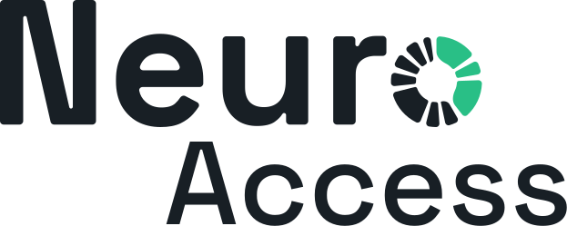
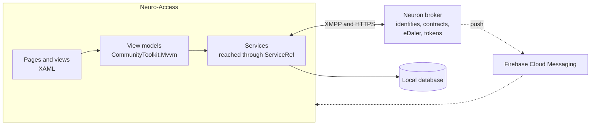

<p align="center">
<picture>
<source media="(prefers-color-scheme: dark)" srcset="NeuroAccessMaui/Resources/Images/neuro_access_logo_dark.svg">

</picture>
</p>

<p align="center">
<strong>Digital identity, smart contracts, tokens and payments in one app.</strong><br>
The .NET MAUI client for the Neuro network, by <a href="https://trustanchorgroup.com/">Trust Anchor Group</a>.
</p>

<p align="center">
<a href="https://play.google.com/store/apps/details?id=com.tag.NeuroAccess"></a>
<a href="https://apps.apple.com/se/app/trust-anchor-access/id1580610247"></a>
</p>

<p align="center">


<a href="LICENSE"></a>
</p>

<p align="center">
<a href="#features">Features</a> ·
<a href="#getting-started">Getting started</a> ·
<a href="#repository-layout">Repository layout</a> ·
<a href="#architecture">Architecture</a> ·
<a href="#documentation">Documentation</a> ·
<a href="#contributing">Contributing</a>
</p>

---

## About

Neuro-Access gives people a verified digital identity and lets them put it to use: signing smart contracts, paying with eDaler, holding Neuro-Feature tokens, signing in to services and managing connected devices. The app talks to a Neuron broker, mostly over XMPP. Each broker can publish its own KYC forms and branding, so one app can serve many operators without a new release.

Neuro-Access runs on Android and iOS, and on Windows when built on a Windows machine. It builds on the original [TAG ID App](https://github.com/Trust-Anchor-Group/IdApp).

## Features

- **Digital identity.** Apply for a legal identity through the KYC process your broker publishes, scan the MRZ and read the NFC chip of passports and ID cards, and transfer your identity to a new device.
- **Smart contracts.** Create contracts from templates, invite the parties, review and sign, and keep track of every contract you are part of.
- **Wallet.** Send, receive and request eDaler payments, buy and sell eDaler through service providers, and hold Neuro-Feature tokens with their events and reports.
- **Quick login.** Scan a QR code to sign in to a service or sign a request with your identity.
- **Petitions.** Approve or decline requests to see your identity, sign a contract or review someone else's identity.
- **Contacts and chat.** Keep a contact list and chat with other users.
- **Things.** Claim IoT devices, read their sensors, control them and decide who else may do the same.
- **Notifications.** Push notifications through Firebase, collected in an in-app notification list.
- **Security.** A PIN or password protects the app, with optional fingerprint or face unlock.
- **Branding and languages.** Brokers can ship their own colors and images, and the app is translated into 12 languages.

## Getting started

### Prerequisites

| You need | Notes |
|---|---|
| [.NET SDK 10.0.303](https://dotnet.microsoft.com/download/dotnet/10.0) | Pinned in `global.json` with roll-forward disabled, so install this exact version. |
| .NET MAUI workloads | Installed by `dotnet workload restore` below. |
| Android SDK, plus an emulator or device | For Android. Visual Studio sets these up with its .NET MAUI workload. |
| A Mac with Xcode | For iOS, either directly or from Windows through a paired Mac. |
| An IDE | Visual Studio 2026 with the .NET MAUI workload, or VS Code with the .NET MAUI extension. |

### Supported platforms

| Platform | Target framework | Minimum OS |
|---|---|---|
| Android | `net10.0-android` | Android 7.0 (API 24) |
| iOS | `net10.0-ios` | iOS 15 |
| Windows | `net10.0-windows10.0.19041.0` | Windows 10 version 1809. Only targeted when building on Windows. |

### Build and run

Clone the repository and restore the workloads:

```sh
git clone https://github.com/Trust-Anchor-Group/NeuroAccessMaui.git
cd NeuroAccessMaui
dotnet workload restore
```

Then build and launch the app on the platform you want:

```sh
# Android emulator or device
dotnet build NeuroAccessMaui/NeuroAccessMaui.csproj -t:Run -f net10.0-android

# iOS simulator (on a Mac)
dotnet build NeuroAccessMaui/NeuroAccessMaui.csproj -t:Run -f net10.0-ios

# Windows
dotnet build NeuroAccessMaui/NeuroAccessMaui.csproj -t:Run -f net10.0-windows10.0.19041.0
```

Always pass `-f`. Without it the build covers every target framework, including iOS, which needs a Mac.

In Visual Studio, open `NeuroAccessMaui.sln`, set `NeuroAccessMaui` as the startup project, pick a target in the run menu and press F5.

> [!NOTE]
> Push notifications use Firebase, and its config files are not in the repository. To get push working, put your own `google-services.json` (Android) or `GoogleService-Info.plist` (iOS) in the `NeuroAccessMaui/` folder. The project only includes them when they exist. Both are git-ignored, so never commit them.

> [!TIP]
> On Windows, Debug builds keep a separate database for each value of the `NEUROACCESS_DATA_PROFILE` environment variable, and the **Windows Machine 2** launch profile sets it. That lets you run two accounts side by side, for example to chat or sign a contract between them.

### Run the tests

The unit tests are plain .NET projects and do not need the MAUI workloads.

```sh
dotnet test NeuroAccess.Nfc.Test/NeuroAccess.Nfc.Test.csproj
dotnet test IdApp.Cv.Test/IdApp.Cv.Test.csproj
```

## Repository layout

| Path | What it holds |
|---|---|
| [`NeuroAccessMaui/`](NeuroAccessMaui) | The app: pages, view models, services, resources and platform code |
| [`NeuroAccessMaui.Camera/`](NeuroAccessMaui.Camera) | Cross-platform camera view and frame source |
| [`NeuroAccessMaui.OCR/`](NeuroAccessMaui.OCR) | On-device text recognition with ONNX Runtime, used to scan travel documents |
| [`NeuroAccess.Nfc/`](NeuroAccess.Nfc) | NFC tag interfaces and reading of passport and ID card chips |
| [`IdApp.Cv/`](IdApp.Cv) | Image processing library |
| [`NeuroAccessMaui.Generator/`](NeuroAccessMaui.Generator) | Source generator behind `[ObservableTaskCommand]` |
| [`NeuroAccess.Nfc.Test/`](NeuroAccess.Nfc.Test), [`IdApp.Cv.Test/`](IdApp.Cv.Test) | MSTest unit tests |
| [`docs/`](docs) | Developer documentation |
| [`Translation/`](Translation) | Script that generates the translated resource files |
| [`plans/`](plans) | Requirements, design and task notes from earlier feature work |

Inside the app, each page keeps its XAML, view model and navigation arguments together under `UI/Pages/<Area>/<Feature>/`, and services live under `Services/`.

## Architecture



- **MVVM.** Pages derive from `BaseContentPage` and view models from `BaseViewModel`, with `[ObservableProperty]` and `[RelayCommand]` from CommunityToolkit.Mvvm. Code-behind holds only visual work.
- **Services.** Services are registered in `MauiProgram.cs` and reached through `ServiceRef`, for example `ServiceRef.XmppService`, `ServiceRef.NavigationService` or `ServiceRef.KycService`.
- **Navigation.** `NavigationService` and `CustomShell` replace MAUI's own navigation. Together they own the page stack, popups, toasts and hardware back handling.
- **Networking.** The app talks to the broker mostly over XMPP, using the `Waher.Networking.XMPP` libraries and their extensions for legal identities, smart contracts, eDaler and Neuro-Features.
- **Broker-driven content.** KYC processes and branding are published by the broker and loaded at runtime, then cached on the device.

### Built with

- [.NET MAUI](https://dotnet.microsoft.com/apps/maui) 10, [CommunityToolkit.Maui](https://github.com/CommunityToolkit/Maui) and [CommunityToolkit.Mvvm](https://github.com/CommunityToolkit/dotnet)
- The `Waher.*` libraries from [IoT Gateway](https://github.com/PeterWaher/IoTGateway) for XMPP, smart contracts, persistence and scripting, plus the `EDaler` and `NeuroFeatures` packages
- [SkiaSharp](https://github.com/mono/SkiaSharp) for graphics, [Mapsui](https://github.com/Mapsui/Mapsui) for maps and [ZXing.Net](https://github.com/micjahn/ZXing.Net) for QR codes
- [ONNX Runtime](https://onnxruntime.ai/) for on-device OCR
- [Plugin.Firebase](https://github.com/TobiasBuchholz/Plugin.Firebase) for push notifications and [Plugin.Fingerprint](https://github.com/smstuebe/xamarin-fingerprint) for biometrics

## Documentation

| Guide | What it covers |
|---|---|
| [Getting started](docs/getting-started.md) | Setting up your machine, building and running on each platform, and troubleshooting |
| [Architecture](docs/architecture.md) | The solution's projects, app startup, dependency injection, MVVM base classes and persistence |
| [Services](docs/services.md) | The app services behind `ServiceRef`, their lifecycle and how to add one |
| [Navigation](docs/navigation.md) | The navigation service, the `CustomShell` presenter, popups, toasts and back handling |
| [Animations](docs/animations.md) | The animation coordinator and how to add animations |
| [Notifications](docs/notifications.md) | The notification service, push notifications and routing taps to pages |
| [Onboarding](docs/onboarding.md) | The first-run flow, its scenarios and steps |
| [KYC](docs/kyc.md) | Dynamic KYC processes, document scanning, and how brokers publish templates |
| [Branding](docs/branding.md) | Broker-delivered colors and images |
| [Contributing](docs/contributing.md) | Branches, pull requests, the changelog and translations |
| [Changelog](CHANGELOG.md) | Notable changes per release |

The [docs index](docs/README.md) groups the same guides by audience.

## Localization

All user-facing text lives in [`AppResources.resx`](NeuroAccessMaui/Resources/Languages/AppResources.resx) (English), with translations into Danish, Finnish, French, German, Norwegian, Portuguese, Romanian, Russian, Serbian, Spanish and Swedish.

To add text, add the key to `AppResources.resx` and the matching property to `AppResources.Designer.cs`. The other languages are generated by [`Translation/TranslateResources.bat`](Translation/TranslateResources.bat). Run it from the `Translation` folder on Windows. It uses the translation utility from a built [IoT Gateway](https://github.com/PeterWaher/IoTGateway) checkout placed next to this repository.

## Contributing

Contributions go through pull requests against `dev`. [docs/contributing.md](docs/contributing.md) describes the Git Flow branching model, and [AGENTS.md](AGENTS.md) holds the code style, which applies to every change, whether a person or an AI agent writes it. Several rules differ from common .NET defaults, such as PascalCase locals and parameters, no `var`, and `this.` on every member, so read it before your first change.

Before you open a pull request, run the style checks on the files you changed, and the unit tests:

```sh
dotnet format style NeuroAccessMaui.sln --verify-no-changes --include path/to/File.cs
dotnet format whitespace . --folder --verify-no-changes --include path/to/File.cs
```

Then fill in the [pull request template](.github/pull_request_template.md), including its Changelog section. When the pull request is merged into `dev`, a workflow copies those entries into [CHANGELOG.md](CHANGELOG.md).

AI coding agents read [AGENTS.md](AGENTS.md). `CLAUDE.md` and `.github/copilot-instructions.md` both point to it.

## Reporting issues

Report bugs and ideas in [GitHub Issues](https://github.com/Trust-Anchor-Group/NeuroAccessMaui/issues). Please do not report security problems in a public issue. Contact Trust Anchor Group through [trustanchorgroup.com](https://trustanchorgroup.com/) instead.

## License

Neuro-Access is released under the [Neuro-Foundation License](LICENSE). It is free to use for personal, evaluation, academic and security analysis purposes. Commercial use requires a commercial license from the Neuro-Foundation, and derived work must credit the Neuro-Foundation.
