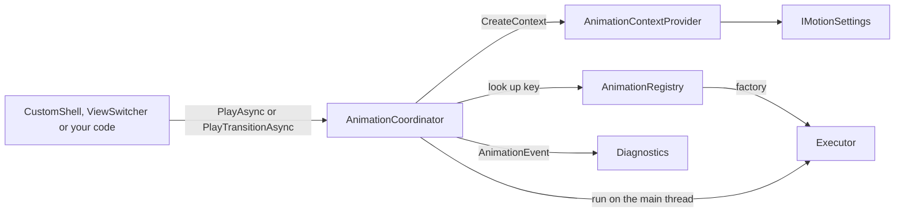

# Animations

This guide describes the animation system in `NeuroAccessMaui/Animations`, which plays the page, popup, toast and tab transitions. Read it before you add or change an animation, or when a view you write needs to respect the reduce-motion setting.

- [Architecture](#architecture)
- [How an animation is resolved](#how-an-animation-is-resolved)
- [Built-in keys](#built-in-keys)
- [Playing an animation](#playing-an-animation)
- [Registering a custom animation](#registering-a-custom-animation)
- [Writing a custom executor](#writing-a-custom-executor)
- [Motion settings and accessibility](#motion-settings-and-accessibility)
- [Diagnostics](#diagnostics)
- [Testing](#testing)
- [Checklist for a new animation](#checklist-for-a-new-animation)

## Architecture

Callers ask for an animation by key. The registry turns the key into an executor, and the coordinator runs it with a context that carries the screen size and the motion settings.

| Type | Role |
| --- | --- |
| [`AnimationKey`](../NeuroAccessMaui/Animations/AnimationKey.cs) | A strongly typed animation ID, such as `Shell.PageCrossFade`. A string converts to it implicitly. |
| [`AnimationKeys`](../NeuroAccessMaui/Animations/AnimationKeys.cs) | The built-in keys, grouped in the nested classes `Shell`, `NavigationBars` and `ViewSwitcher`. |
| [`ViewAnimationDescriptor`, `TransitionAnimationDescriptor`](../NeuroAccessMaui/Animations/AnimationDescriptor.cs) | A key, a nominal duration and easing, optional metadata, and a factory that creates an executor for a given context. |
| [`IAnimationRegistry`, `AnimationRegistry`](../NeuroAccessMaui/Animations/AnimationRegistry.cs) | A thread-safe catalog of descriptors, optionally scoped by platform and theme. |
| [`AnimationCatalog`](../NeuroAccessMaui/Animations/AnimationCatalog.cs) | Registers the built-in descriptors in `RegisterDefaults`. |
| [`IAnimationCoordinator`, `AnimationCoordinator`](../NeuroAccessMaui/Animations/IAnimationCoordinator.cs) | The entry point. `PlayAsync` and `PlayTransitionAsync` play an animation, and `AnimationEvent` reports what happened. |
| [`IAnimationContext`, `AnimationContextOptions`, `AnimationContextProvider`](../NeuroAccessMaui/Animations/AnimationContext.cs) | The snapshot an executor sees: platform, theme, safe area, keyboard inset, viewport size, reduce motion and duration scale. |
| [`AnimationOptions`](../NeuroAccessMaui/Animations/AnimationOptions.cs) | Settings for one play: `DurationOverride`, `ForceMotion` and a `Completed` callback. |
| [`IViewAnimation`, `ITransitionAnimation`](../NeuroAccessMaui/Animations/IViewAnimation.cs) | The executor contracts. A view animation has one target. A transition has an entering and an exiting view. |
| [`TimedViewAnimation`](../NeuroAccessMaui/Animations/TimedViewAnimation.cs) | Base class for executors with a duration. Applies the duration override and the duration scale. |
| [`FadeAnimation`](../NeuroAccessMaui/Animations/FadeAnimation.cs), [`ScaleAnimation`](../NeuroAccessMaui/Animations/ScaleAnimation.cs), [`TranslateAnimation`](../NeuroAccessMaui/Animations/TranslateAnimation.cs) | The primitive executors. Each takes an optional start value and an end value. |
| [`CompositeViewAnimation`](../NeuroAccessMaui/Animations/CompositeViewAnimation.cs) | Runs several view animations on one target, in parallel or in sequence. |
| [`TransitionAnimation`](../NeuroAccessMaui/Animations/TransitionAnimation.cs) | Runs an enter animation and an exit animation (and an optional one on a shared view) in parallel. |
| [`AnimationRunner`](../NeuroAccessMaui/Animations/AnimationRunner.cs) | Runs an animation and cancels the target's MAUI animations when the token is cancelled. |
| [`IMotionSettings`, `MotionSettings`](../NeuroAccessMaui/Animations/IMotionSettings.cs) | The app-wide reduce-motion flag and duration multiplier. |
| [`MotionPreferences`](../NeuroAccessMaui/Animations/MotionPreferences.cs) | A static helper for views that animate on their own. |
| [`AnimationEvent`](../NeuroAccessMaui/Animations/AnimationEvent.cs) | Diagnostic event data. |

`RegisterTypes` in [`PageAppExtension`](../NeuroAccessMaui/UI/PageAppExtension.cs) registers `IMotionSettings`, `IAnimationRegistry` (created with `AnimationCatalog.RegisterDefaults`), `IAnimationContextProvider` and `IAnimationCoordinator`, all as singletons.

Two parts of the app play animations through the coordinator: [`CustomShell`](../NeuroAccessMaui/Services/UI/CustomShell.cs), for pages, popups and toasts, and [`ViewSwitcher`](../NeuroAccessMaui/UI/Controls/Tabs/ViewSwitcher.cs), for the tabs on the main page. Other controls, such as `TabNavigationHost`, `BottomSheetView` and `Badge`, animate themselves with the MAUI animation methods and check `MotionPreferences` (see [Motion settings and accessibility](#motion-settings-and-accessibility)).



## How an animation is resolved

1. A caller calls `PlayAsync(Key, Target, Options, ContextOptions, Token)` for one view, or `PlayTransitionAsync(Key, Entering, Exiting, Options, ContextOptions, Token)` for two. A transition needs at least one of the two views.
2. The coordinator asks `IAnimationContextProvider` for a context. The platform is `ContextOptions.Platform`, or `DeviceInfo.Platform.ToString()` (`Android`, `iOS`, `WinUI` or `MacCatalyst`). The theme, safe-area insets, keyboard inset and viewport size come only from `ContextOptions`, and are `null` or zero when you leave them out. `ReduceMotion` and `DurationScale` are read from `IMotionSettings` at that moment.
3. The registry looks the key up among descriptors of the right kind. View animations and transitions are kept apart, so `PlayAsync` does not find a key that was registered as a transition. It tries these names in order and takes the first match:
   1. `Key.Platform.Theme`
   2. `Key.Platform`
   3. `Key.Theme`
   4. `Key`
4. If nothing matches, the coordinator raises a `Skipped` event, calls `Options.Completed`, and returns without touching the view.
5. Otherwise the descriptor's factory creates an executor for the context. The coordinator raises `Started`, runs the executor on the main thread, and passes the token on so that cancelling it stops the MAUI animation.
6. When the executor returns, the coordinator raises `Completed` and calls `Options.Completed`. If it throws, the coordinator raises `Cancelled` (for an `OperationCanceledException`) or `Failed`, and rethrows.

Reduced motion is handled by the executors, not by the coordinator: each built-in executor checks `Context.ReduceMotion` and jumps to its end state. A custom executor has to do the same.

## Built-in keys

`AnimationCatalog.RegisterDefaults` registers these profiles:

| Key | Kind | Animation | Played for |
| --- | --- | --- | --- |
| `Shell.PageCrossFade` | Transition | 300 ms, linear. Fades the new page from 0 to 1 and the old page to 0. | Every `NavigationService` navigation (`TransitionType.Fade`). |
| `Shell.PageSlideLeft`, `Shell.PageSlideRight` | Transition | 250 ms, `CubicOut`. Slides both pages by the viewport width (400 if unknown). | `TransitionType.SwipeLeft` and `SwipeRight`. `NavigationService` does not use them today. |
| `Shell.PopupShowScale` | View | 200 ms, `CubicOut`. Fade from 0 and scale from 0.9 to 1. | `PopupTransition.Scale`, the default show transition. |
| `Shell.PopupHideScale` | View | 150 ms, `CubicIn`. Fade to 0 and scale to 0.9. | `PopupTransition.Scale` on hide. |
| `Shell.PopupShowFade`, `Shell.PopupHideFade` | View | 150 ms. Fade in with `CubicOut`, fade out with `CubicIn`. | `PopupTransition.Fade`. Fade is the default hide transition. |
| `Shell.PopupShowSlideUp` | View | 200 ms, `CubicOut`. Fade in and move up from half the viewport height (200 if unknown). | `PopupTransition.SlideUp` on show. |
| `Shell.PopupHideSlideUp` | View | 150 ms, `CubicIn`. Fade out and move 50 down. | `PopupTransition.SlideUp` on hide. |
| `Shell.ToastShowFade`, `Shell.ToastHideFade` | View | 150 ms fade in or out. | `ToastTransition.Fade`. |
| `Shell.ToastShowSlideTop`, `Shell.ToastHideSlideTop` | View | 150 ms. Fade, and move from or to 40 above. | `ToastTransition.SlideFromTop` on a top toast (the default). |
| `Shell.ToastShowSlideBottom`, `Shell.ToastHideSlideBottom` | View | 150 ms. Fade, and move from or to 40 below. | `ToastTransition.SlideFromBottom`, and `SlideFromTop` on a bottom toast. |
| `ViewSwitcher.CrossFade` | Transition | 250 ms, linear. Cross-fade. | `ViewSwitcher` with its default `CrossFadeViewTransition`. It passes its `TransitionDuration` as `DurationOverride`. |

`AnimationKeys` also defines `Shell.PageSlideHorizontal`, `Shell.PopupFadeScale`, `Shell.ToastSlideTop` and `NavigationBars.SwitchCrossFade`, but nothing registers or plays them. Playing one of them is skipped.

`CustomShell` passes its own width, height and the current keyboard inset in `ContextOptions`, which is what the slide profiles read. It also animates two things without the coordinator: the popup backdrop fade and the padding change when the keyboard opens. Both are applied at once when motion is reduced.

## Playing an animation

Take `IAnimationCoordinator` as a constructor parameter when the type is created from dependency injection, as `CustomShell` does, or get it with `ServiceHelper.GetService<IAnimationCoordinator>()`, as `ViewSwitcher` does. Animation code belongs in code-behind or a control, never in a view model (see [AGENTS.md](../AGENTS.md)).

### One view

A built-in show profile sets its own start value, so `ToastShowFade` starts from opacity 0. A hide profile starts from the current value.

```csharp
/// <summary>
/// Shows the hint with a fade.
/// </summary>
/// <param name="Hint">The view to show.</param>
/// <param name="Token">Stops the fade.</param>
private async Task ShowHintAsync(View Hint, CancellationToken Token)
{
	IAnimationCoordinator Coordinator = ServiceHelper.GetService<IAnimationCoordinator>();

	Hint.IsVisible = true;
	await Coordinator.PlayAsync(AnimationKeys.Shell.ToastShowFade, Hint, null, null, Token);
}
```

### Two views

Pass the size the profile needs. The slide profiles fall back to a width of 400 without it.

```csharp
AnimationOptions Options = new()
{
	DurationOverride = TimeSpan.FromMilliseconds(200)
};
AnimationContextOptions ContextOptions = new()
{
	ViewportWidth = this.Width > 0 ? this.Width : null
};

await Coordinator.PlayTransitionAsync(AnimationKeys.Shell.PageSlideLeft, Incoming, Outgoing, Options, ContextOptions, Token);
```

### Options

| `AnimationOptions` | Effect |
| --- | --- |
| `DurationOverride` | Replaces the executor's duration. The duration scale is not applied to it. |
| `ForceMotion` | Runs the animation even when motion is reduced. Use it only when the motion carries meaning that a jump would lose. |
| `Completed` | Called after the animation completes, and also when it is skipped. Not called when the executor throws. |

| `AnimationContextOptions` | Effect |
| --- | --- |
| `Platform` | Overrides the platform used for the lookup. |
| `Theme` | Theme name for the lookup. Nothing in the app sets it, so theme-scoped descriptors only match if you pass it. |
| `ViewportWidth`, `ViewportHeight`, `KeyboardInset`, `SafeAreaInsets` | Values the factory and executor can read. They are zero when left out. |

The built-in executors set their end value when they finish, also when the animation is cancelled, so after the `await` the view is in its final state.

## Registering a custom animation

1. Add a key to `AnimationKeys`, in a nested class for your area:

   ```csharp
   /// <summary>
   /// Keys for popup content animations.
   /// </summary>
   public static class Popups
   {
   	/// <summary>
   	/// Bouncy entrance for celebratory popups.
   	/// </summary>
   	public static AnimationKey BounceIn { get; } = new AnimationKey("Popups.BounceIn");
   }
   ```

2. Register a descriptor in `AnimationCatalog`, from a private method that `RegisterDefaults` calls:

   ```csharp
   private static void RegisterPopupContentAnimations(IAnimationRegistry Registry)
   {
   	TimeSpan Duration = TimeSpan.FromMilliseconds(250);
   	Easing SpringEasing = Easing.SpringOut;

   	Registry.Register(new ViewAnimationDescriptor(
   		AnimationKeys.Popups.BounceIn,
   		Duration,
   		SpringEasing,
   		_ => new CompositeViewAnimation(
   			AnimationCompositionMode.Parallel,
   			new List<IViewAnimation>
   			{
   				new FadeAnimation(Duration, SpringEasing, 0, 1),
   				new ScaleAnimation(Duration, SpringEasing, 0.7, 1)
   			})));
   }
   ```

3. Play it with `PlayAsync(AnimationKeys.Popups.BounceIn, Target)`.

Things to know when you register:

- The executor carries the duration and easing that are actually used. The descriptor's `Duration` and `Easing` are not read when the animation plays (the duration must still be positive). Keep both the same so the catalog stays readable.
- The factory runs on every play, so it can use the context. `TranslateAnimation` takes `(Duration, Easing, FromX, FromY, ToX, ToY)`, so an entrance that rises from 40 percent of the viewport height below its place is `Context => new TranslateAnimation(Duration, SpringEasing, null, Context.ViewportHeight * 0.4, 0, 0)`.
- `Register` replaces a descriptor with the same key and scope, so you can also replace a built-in profile.
- The registry is thread-safe, and you can register later through `ServiceHelper.GetService<IAnimationRegistry>()`, but keeping every profile in `AnimationCatalog` makes them easy to find.
- The scope names are joined to the key with dots, so do not end a key with a platform name.

### Scoping by platform or theme

Pass a platform, a theme, or both:

```csharp
Registry.Register(Descriptor, "Android");
Registry.Register(Descriptor, "iOS", "Dark");
```

The platform names are those of `DevicePlatform`: `Android`, `iOS`, `WinUI` and `MacCatalyst`. A theme scope only matches when the caller passes the same `Theme` in `AnimationContextOptions`.

## Writing a custom executor

When the primitives are not enough, write an executor. Follow the built-in ones:

1. Derive from `TimedViewAnimation`, so that `ResolveDurationMilliseconds` applies `DurationOverride` and the duration scale. Implement `IViewAnimation` or `ITransitionAnimation` directly only if you need no duration.
2. When `Context.ReduceMotion` is `true` and `Options?.ForceMotion` is not `true`, set the end state and return.
3. Run the MAUI animation through `AnimationRunner.RunAsync`, so the token can cancel it. Use the `*Async` animation methods, such as `FadeToAsync`. The older methods are obsolete in .NET 10.
4. Set the end state in a `finally` block on the main thread, so a cancelled animation does not leave the view halfway.
5. Do not use `ConfigureAwait(false)` before you touch the view. The coordinator starts executors on the main thread, and property changes must stay there.

```csharp
using System;
using System.Threading;
using System.Threading.Tasks;
using Microsoft.Maui.ApplicationModel;
using Microsoft.Maui.Controls;

namespace NeuroAccessMaui.Animations
{
	/// <summary>
	/// Rotates a view to an angle.
	/// </summary>
	public sealed class RotateAnimation : TimedViewAnimation
	{
		private readonly double? fromRotation;
		private readonly double toRotation;

		/// <summary>
		/// Creates a rotation animation.
		/// </summary>
		/// <param name="Duration">Base duration, scaled by the motion settings.</param>
		/// <param name="Easing">Easing function.</param>
		/// <param name="FromRotation">Start angle in degrees, or null to start from the current angle.</param>
		/// <param name="ToRotation">End angle in degrees.</param>
		public RotateAnimation(TimeSpan Duration, Easing Easing, double? FromRotation, double ToRotation)
			: base(Duration, Easing)
		{
			this.fromRotation = FromRotation;
			this.toRotation = ToRotation;
		}

		/// <inheritdoc/>
		public override async Task RunAsync(VisualElement Target, IAnimationContext Context, AnimationOptions? Options, CancellationToken Token)
		{
			ArgumentNullException.ThrowIfNull(Target);
			ArgumentNullException.ThrowIfNull(Context);

			if (Context.ReduceMotion && Options?.ForceMotion != true)
			{
				Target.Rotation = this.toRotation;
				return;
			}

			if (this.fromRotation.HasValue)
				Target.Rotation = this.fromRotation.Value;

			uint DurationMs = this.ResolveDurationMilliseconds(Context, Options);

			try
			{
				await AnimationRunner.RunAsync(Target, _ => Target.RotateToAsync(this.toRotation, DurationMs, this.Easing), Token);
			}
			finally
			{
				await MainThread.InvokeOnMainThreadAsync(() =>
				{
					Target.Rotation = this.toRotation;
				});
			}
		}
	}
}
```

Register it with a descriptor like any other executor.

## Motion settings and accessibility

[`IMotionSettings`](../NeuroAccessMaui/Animations/IMotionSettings.cs) holds two values:

| Member | Meaning |
| --- | --- |
| `ReduceMotion` | When `true`, executors skip to their end state. |
| `DurationScale` | Multiplies every executor's base duration. 1.0 by default. Not applied to `DurationOverride`. |
| `Update(ReduceMotion, DurationScale)` | Changes both. Throws if `DurationScale` is zero or less. Raises `MotionSettingsChanged` when a value changes. |

`ReduceMotion` mirrors the operating system. `App.SyncMotionSettings` copies `IPlatformSpecific.IsReduceMotionEnabled` into it when the window is created and every time the app returns to the foreground, and keeps the current `DurationScale`:

| Platform | Setting that turns on reduced motion |
| --- | --- |
| Android | Animator duration scale set to off, which "Remove animations" also does. |
| iOS | Reduce Motion in the accessibility settings. |
| Windows | Animation effects turned off. |

There is no in-app setting, so a value you set with `Update` is replaced at the next activation. The context is built on every play, so a change applies to the next animation without any extra work.

### Views that animate on their own

Many controls call `FadeToAsync`, `Animate` or an animated `ScrollToAsync` directly. They must check [`MotionPreferences.ReduceMotion`](../NeuroAccessMaui/Animations/MotionPreferences.cs) and show the settled end state instead:

```csharp
if (MotionPreferences.ReduceMotion)
{
	this.Indicator.Opacity = 1;
	return;
}

await this.Indicator.FadeToAsync(1, 150, Easing.CubicOut);
```

For a scroll, pass the flag as the `animated` argument: `ScrollToAsync(Element, ScrollToPosition.MakeVisible, !MotionPreferences.ReduceMotion)`. A looping animation can subscribe to `MotionPreferences.Settings.MotionSettingsChanged` while it is loaded, so it stops or restarts when the setting changes. [`IndeterminateProgressLine`](../NeuroAccessMaui/UI/Controls/ListCard/IndeterminateProgressLine.cs), [`NfcScanVisual`](../NeuroAccessMaui/UI/Controls/NfcScan/NfcScanVisual.cs) and [`StatusVisual`](../NeuroAccessMaui/UI/Controls/StatusVisual/StatusVisual.cs) do this. `MotionPreferences.Settings` is `null` when no service provider exists, such as at design time, and `ReduceMotion` is then `false`.

## Diagnostics

`IAnimationCoordinator.AnimationEvent` reports each play with an [`AnimationEvent`](../NeuroAccessMaui/Animations/AnimationEvent.cs) record:

| Stage | Raised when | `Elapsed` |
| --- | --- | --- |
| `Started` | Before the executor runs. | Zero |
| `Completed` | The executor returned. | Run time |
| `Cancelled` | The executor threw an `OperationCanceledException`. `WasCancelled` is `true`. | Run time |
| `Failed` | The executor threw anything else. `Exception` holds it. | Run time |
| `Skipped` | No descriptor matched the key. | Zero |

Nothing in the app listens to the event today. To trace animations while you tune them, subscribe from a place with a clear lifetime and unsubscribe again, because the coordinator is a singleton:

```csharp
private void OnAnimationEvent(object? Sender, AnimationEvent Event)
{
	ServiceRef.LogService.LogDebug("Animation",
		new KeyValuePair<string, object?>("Key", Event.Key.Value),
		new KeyValuePair<string, object?>("Stage", Event.Stage.ToString()),
		new KeyValuePair<string, object?>("ElapsedMs", Event.Elapsed?.TotalMilliseconds));
}
```

The event is raised in the caller's context, usually the main thread, so keep the handler short.

The built-in executors do not throw when their token is cancelled. They stop and jump to the end state, so a cancelled play is reported as `Completed`, and `Options.Completed` runs. You only see `Cancelled` from an executor that throws on cancellation.

## Testing

There are no automated tests for the animation code. The test projects target plain `net10.0` without MAUI (see [AGENTS.md](../AGENTS.md)), and the executors depend on MAUI types such as `VisualElement` and `Easing`.

Check a new animation by hand on a device or emulator, with reduced motion off and then on. After you change the system setting, bring the app back to the foreground so that `App.SyncMotionSettings` picks it up. With reduced motion on, every view must still end in its final state.

## Checklist for a new animation

1. Check whether a built-in key already fits.
2. Add a key to `AnimationKeys`.
3. Use the primitive executors, or write one that honors `ReduceMotion` and `ForceMotion`, runs through `AnimationRunner` and sets its end state in `finally`.
4. Register a descriptor in `AnimationCatalog`, with the same duration and easing as the executor.
5. Play it through `IAnimationCoordinator`, with the `ContextOptions` the factory needs.
6. Make sure the key is registered under the right kind. A missing key is skipped quietly and leaves the view in its start state.
7. Test with reduced motion off and on.
8. For animations a view runs itself, check `MotionPreferences.ReduceMotion`.

## Related docs

- [Navigation](navigation.md)
- [Architecture](architecture.md)
- [Services](services.md)
- [Contributing](contributing.md)
- [AGENTS.md](../AGENTS.md), the code style and app patterns
