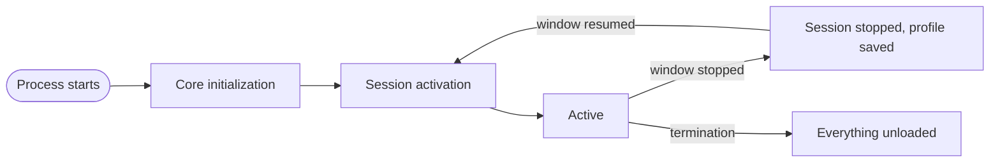

# Architecture

This guide explains how Neuro-Access is put together: the projects in the solution, the layout of the app project, how the app starts, how services and view models are created, and the rules for persistence and threading. Read it before your first change to the app, and come back to it when you add a page, a service or a persisted type.

- [Solution projects](#solution-projects)
- [App project layout](#app-project-layout)
- [Startup and lifecycle](#startup-and-lifecycle)
- [Dependency injection and service resolution](#dependency-injection-and-service-resolution)
- [Pages, views and view models](#pages-views-and-view-models)
- [Navigation and popups](#navigation-and-popups)
- [Async work with ObservableTask](#async-work-with-observabletask)
- [Local persistence](#local-persistence)
- [Threading rules](#threading-rules)

The code style and the app patterns every change must follow are in [AGENTS.md](../AGENTS.md). This guide explains the machinery behind those patterns and does not repeat the rules.

## Solution projects

Open [`NeuroAccessMaui.sln`](../NeuroAccessMaui.sln) at the repository root. It holds the app, four libraries, a source generator and two test projects.

| Project | Targets | What it is for |
| --- | --- | --- |
| [`NeuroAccessMaui`](../NeuroAccessMaui/NeuroAccessMaui.csproj) | `net10.0-android`, `net10.0-ios`, plus `net10.0-windows10.0.19041.0` when built on Windows | The .NET MAUI app: UI, services, platform code and resources. |
| [`NeuroAccessMaui.Camera`](../NeuroAccessMaui.Camera/NeuroAccessMaui.Camera.csproj) | MAUI library (`net10.0` and the platform targets) | The `CameraView` control, its platform handlers (CameraX on Android) and a frame stream. Used by the QR scanner, the MRZ scanner and the KYC profile photo page. |
| [`NeuroAccessMaui.OCR`](../NeuroAccessMaui.OCR/NeuroAccessMaui.OCR.csproj) | MAUI library | Reads the machine readable zone (MRZ) of travel documents from camera frames with ONNX Runtime. Registered by `RegisterOcrServices`. The ONNX models ship in the app under `Resources/Raw/OcrModels`. |
| [`NeuroAccess.Nfc`](../NeuroAccess.Nfc/NeuroAccess.Nfc.csproj) | `net8.0` | Platform-neutral NFC abstractions (tag interfaces, NDEF records) and the ICAO travel document client (BAC, PACE, data groups, document security checks). |
| [`IdApp.Cv`](../IdApp.Cv/IdApp.Cv.csproj) | `netstandard2.0` | Image processing on matrices: color models, convolutions, morphology, thresholds, statistics and MRZ region extraction. |
| [`NeuroAccessMaui.Generator`](../NeuroAccessMaui.Generator/NeuroAccessMaui.Generator.csproj) | `netstandard2.0` | The Roslyn source generator behind `[ObservableTaskCommand]`. The app references it as an analyzer, not as an assembly. |
| [`NeuroAccess.Nfc.Test`](../NeuroAccess.Nfc.Test/NeuroAccess.Nfc.Test.csproj) | `net10.0`, MSTest | Tests for the NFC library: ASN.1, BAC, PACE, certificates, revocation lists and document readout. |
| [`IdApp.Cv.Test`](../IdApp.Cv.Test/IdApp.Cv.Test.csproj) | `net10.0`, MSTest | Tests for the image processing library, including MRZ detection on the sample documents in `TestData/`. |

The libraries depend on each other in one direction: the app references all of them, `NeuroAccessMaui.OCR` references `IdApp.Cv` and `NeuroAccess.Nfc`, and the rest stand alone. Keep plain .NET logic in the libraries, where the test projects can reach it without MAUI.

Most of the protocol work (XMPP, legal identities, smart contracts, eDaler, Neuro-Feature tokens, persistence, scripting) comes from the Waher and Trust Anchor Group NuGet packages, for example `Waher.Networking.XMPP.Contracts`, `Waher.Persistence`, `EDaler` and `NeuroFeatures`. The app's `.csproj` keeps commented-out `ProjectReference` entries for local `IoTGateway` and `iotbroker` checkouts, which you can switch on to debug those libraries.

## App project layout

Everything below is in [`NeuroAccessMaui/`](../NeuroAccessMaui).

### Root files

| File | What it holds |
| --- | --- |
| [`MauiProgram.cs`](../NeuroAccessMaui/MauiProgram.cs) | Builds the MAUI app: handler mappings, fonts, toolkits, lifecycle hooks and service registration. Creates the `ServiceRef` provider. |
| [`App.xaml`](../NeuroAccessMaui/App.xaml), [`App.xaml.cs`](../NeuroAccessMaui/App.xaml.cs) | Global resources, the process and session lifecycle, profile auto-save, crash reporting and URL entry points such as `App.OpenUrlAsync`. |
| [`Constants.cs`](../NeuroAccessMaui/Constants.cs) | App-wide constants: intervals, timeouts, schema names, push channels, XMPP property names and more. |
| [`Messages.cs`](../NeuroAccessMaui/Messages.cs) | Message types sent through the CommunityToolkit `WeakReferenceMessenger`. |
| [`AuthenticationPurpose.cs`](../NeuroAccessMaui/AuthenticationPurpose.cs) | Why the user is asked to authenticate, passed to `IAuthenticationService`. |

### Folders

| Folder | What it holds |
| --- | --- |
| `Animations/` | The animation registry, coordinator and motion settings. See [animations.md](animations.md). |
| `Core/` | Small shared interfaces such as `IActivatable` and `ISelectable`. |
| `CustomPermissions/` | MAUI permission types the platform does not provide, such as notification permission. |
| `Exceptions/` | App-specific exception types. |
| `Extensions/` | Extension methods for framework and Waher types (strings, legal identities, contracts and so on). |
| `Helpers/` | Attached properties and small helpers, for example `PasswordMask` and `SvgCodec`. |
| `Links/` | `ILinkService` and one `ILinkOpener` per kind of link the app understands (identities, contracts, eDaler, tokens, onboarding links, browser links). |
| `MarkupExtensions/` | `SafeInsetsExtension`, for binding a literal `Thickness` to the safe-area insets. |
| `Models/` | A few plain models shared across features. |
| `Platforms/` | Android, iOS and Windows code: entry points, `PlatformSpecific`, push handling and NFC sessions. |
| `Resources/` | App icon, fonts, images, splash, XAML styles (`Styles/`), localized strings (`Languages/`), raw assets (`Raw/`, including XML schemas and OCR models) and the iOS permission texts (`Resx/` and `*.lproj/`). |
| `Script/` | Waher Script functions for country names and codes. |
| `Services/` | App services, reached through `ServiceRef`. See [services.md](services.md). |
| `UI/` | Everything visual, described below. |

### The UI folder

| Folder or file | What it holds |
| --- | --- |
| `UI/Pages/` | `BaseContentPage`, `BaseViewModel`, `ILifeCycleView` and the other MVVM base types, and one folder per area (`Applications`, `Contacts`, `Contracts`, `Identity`, `Kyc`, `Main`, `Notifications`, `Onboarding`, `Petitions`, `Signatures`, `Startup`, `Things`, `Utility`, `Wallet`). Each feature folder keeps its XAML, code-behind, view model and navigation arguments together. |
| `UI/Popups/` | Popup base classes (`BasePopupView`, `BasicPopup`, `BasePopup`, `BasePopupViewModel`, `ReturningPopupViewModel<TReturn>`) and the app's popups. |
| `UI/Controls/` | Reusable controls, grouped by kind (buttons, inputs, containers, tabs, toasts and so on). `Tabs/ViewSwitcher.cs` hosts the main page's tabs and `Containers/TaskView.cs` renders an `ObservableTask`. |
| `UI/MVVM/` | `ObservableTask`, its builder, policies and telemetry, `ObservableTaskCommand` and the `[ObservableTaskCommand]` attribute. |
| `UI/Behaviors/`, `UI/Converters/` | XAML behaviors and value converters. |
| `UI/Core/` | Data models for configurable UI elements (labels, buttons, borders, paths). |
| `UI/Rendering/` | Renderers that turn Markdown, contract parameters and multimedia into MAUI XAML. |
| [`UI/PageAppExtension.cs`](../NeuroAccessMaui/UI/PageAppExtension.cs) | `RegisterTypes` and `RegisterPages`, which register every service, page, popup and view model. |
| [`UI/AppWindow.cs`](../NeuroAccessMaui/UI/AppWindow.cs) | The app's `Window`, which forwards window lifecycle events to `App`. |
| `UI/SafeArea.cs`, `UI/KeyboardInsets.cs` | Attached properties for safe-area and keyboard insets. See [navigation.md](navigation.md). |
| `UI/AppColors.cs`, `UI/AppStyles.cs` | Code access to themed colors and shared styles. |

## Startup and lifecycle

The app separates work that runs once per process from work that runs each time the app comes to the foreground:

- Core initialization runs once per process. It prepares local state: logging, the encrypted database, the user profile, the theme and the local caches. It never needs the network.
- A session runs from activation until the app goes to the background. It loads the services that talk to the server: network monitoring, the XMPP connection and the contract, thing and wallet orchestrators.



### Startup sequence

1. The platform entry point (`MainApplication` on Android, `AppDelegate` on iOS, the WinUI `App` on Windows) calls `MauiProgram.CreateMauiApp()`.
2. `CreateMauiApp` starts building the Waher type inventory on the thread pool (`RuntimeTypeInventory.EnsureStarted()`), adjusts handler mappings, configures fonts, the Community Toolkit, localization and Firebase, and hooks the platform resume events to `App.RaiseAppActivated`. It then registers the platform services, `RegisterTypes`, `RegisterOcrServices` and `RegisterPages`, builds the app and calls `ServiceRef.Initialize(new HybridServiceProvider(...))`.
3. MAUI creates `App`. Its constructor loads the XAML resources and starts an activation in background mode. This also happens when the operating system starts the process for a push message without showing a window, so background work gets a session too.
4. Core initialization (`InitializeProcessAsync`, on the thread pool) applies the selected language, installs the unhandled exception handlers, waits for the type inventory, registers the XML schemas and the page routes (`App.RegisterRoutes`), initializes the device ID and the JWT factory, loads `LogService`, starts `StorageService`, restores the profile from the database, applies the theme, and loads the attachment cache, internet cache, notification and push notification services.
5. Session activation (`ActivateAsync`) waits for core initialization and loads `NetworkService`, `XmppService`, `ContractOrchestratorService`, `ThingRegistryOrchestratorService` and `NeuroWalletOrchestratorService`, in that order. The session is then active, the profile auto-save timer starts and `App.WaitForServicesAsync()` completes.
6. When MAUI asks for a window, `App.CreateWindow` resolves the singleton [`CustomShell`](../NeuroAccessMaui/Services/UI/CustomShell.cs) and wraps it in `AppWindow`. `CustomShell` receives a [`LoadingPage`](../NeuroAccessMaui/UI/Pages/Startup/LoadingPage.xaml.cs) through its constructor and shows it at once.
7. `AppWindow.OnCreated` joins the activation in foreground mode. Once the session is active, `App` applies the foreground state once per activation: it reapplies the theme and runs the loading page's lifecycle.
8. `LoadingPage` chooses the first page, as described below.
9. A few seconds later (`Constants.Intervals.DeferredStartupWork`), deferred work sends the crash report from the previous run, if there is one, and refreshes provider branding in the background.

If core initialization or activation fails, the error is saved as an exception dump and a `BootstrapErrorPage` with the message and stack trace replaces the window's content.

### Choosing onboarding or the main page

`LoadingPage.OnAppearingAsync` waits for `App.WaitForServicesAsync()` and then asks the profile whether onboarding is finished. `ITagProfile.IsComplete()` returns `true` when the profile has a legal identity and a local password.

- If the profile is not complete, the page sets [`OnboardingPage`](../NeuroAccessMaui/UI/Pages/Onboarding/OnboardingPage.xaml.cs) as the root with `OnboardingScenario.FullSetup`. If an onboarding link opened the app, `IIntentService.TryGetAndDequeueOnboardingUrl()` returns it and it is passed along in the navigation arguments. See [onboarding.md](onboarding.md).
- If the profile is complete, the page applies cached provider branding (a missing or expired cache is fetched in the background) and sets [`MainPage`](../NeuroAccessMaui/UI/Pages/Main/MainPage.xaml.cs) as the root.

Both use `SetRootAsync`, so back navigation never returns to the loading page. After choosing, the page schedules the deferred work, lets `INotificationServiceV2` run notification routes that were waiting for startup (onboarded profiles only), and processes intents that arrived before startup finished, such as deep links. For onboarded profiles it first gives the XMPP connection up to three seconds to come up, without delaying the first page.

### Background, resume and shutdown

`App` does not override `OnStart`, `OnResume` or `OnSleep`. [`AppWindow`](../NeuroAccessMaui/UI/AppWindow.cs) forwards the window events instead:

| Window event | What happens |
| --- | --- |
| `OnCreated` | Starts or joins the current activation and applies the foreground state. |
| `OnStopped` | Cancels pending activation and deferred work, unloads the session services in reverse order and saves the profile. Core services stay loaded. |
| `OnResumed` | Starts a new activation. Session services are loaded again with `isResuming` set to `true`. |
| `OnDestroying` | Terminates, except on Android: unloads the session and core services, saves the profile one last time, shuts down storage and closes the event log. |

An unhandled exception on the app domain is logged, saved as an exception dump, and terminates the app the same way, with a fast XMPP shutdown. An unobserved task exception is logged and dumped too, but the app keeps running, and debug builds show it in an alert. The dump is sent as a crash report during the next run's deferred work.

Pages are not told when the app goes to the background. A view model that must react to that should watch the service it depends on, for example `IXmppService.ConnectionStateChanged`.

### Waiting for startup

Code that can run before startup has finished must wait for the right stage:

| Method | Completes when | Use it in |
| --- | --- | --- |
| `App.WaitForServicesAsync()` | The current activation is active. Throws `OperationCanceledException` if the activation ends first, for example because the app went to the background. | UI code. `BaseContentPage` and `BaseViewModel` already await it in their lifecycle methods. |
| `App.WaitForCoreAsync()` | Core initialization has finished, so storage and the profile are available. It does not wait for the network. | Code that can run while the process is starting or without a session, such as push and notification handlers. |

Both throw when the stage they wait for fails or is cancelled. Use `App.IsLifecycleException(Ex)` to recognize those exceptions in a `catch` filter: they have already been reported, so log nothing more.

## Dependency injection and service resolution

### Registration

Everything the app creates through dependency injection is registered on MAUI's service collection while the app is built:

| Where | What it registers |
| --- | --- |
| `PageAppExtension.RegisterTypes` | Every app service, as a singleton keyed by its interface, for example `Builder.Services.AddSingleton<IXmppService, XmppService>()`. A few services are created by a factory that picks the platform implementation, such as `INotificationRenderer` and `INfcIsoDepSessionService`. |
| `PageAppExtension.RegisterPages` | Pages, onboarding steps, popups and their view models, as transients. `AddTransient<TView, TViewModel>()` comes from CommunityToolkit.Maui and registers both types. `CustomShell` is a singleton. |
| `OcrServiceCollectionExtensions.RegisterOcrServices` | The OCR services from `NeuroAccessMaui.OCR`. |
| `MauiProgram.CreateMauiApp` | `IPlatformSpecific` and `IKeyboardInsetsService`, inside `#if ANDROID \|\| IOS \|\| WINDOWS`. |

Because services are registered with their implementation types, the container builds them with constructor injection. [`LoadingPage`](../NeuroAccessMaui/UI/Pages/Startup/LoadingPage.xaml.cs), for example, takes `ITagProfile`, `INavigationService`, `IThemeService` and `INotificationServiceV2` in its constructor, and `NotificationServiceV2` takes its router, filter registry and renderer.

### The hybrid service provider

`ServiceRef.Provider` is a [`HybridServiceProvider`](../NeuroAccessMaui/Services/HybridServiceProvider.cs) wrapped around the built container. `GetService` tries three things in order:

1. The MAUI container. Registered services, pages and view models resolve here.
2. If the requested type is a class named in the `[DefaultImplementation]` attribute of a registered interface, the singleton registered for that interface. This stops a second instance from being created when code asks for `XmppService` instead of `IXmppService`.
3. The Waher type inventory, through `Types.Instantiate`. This is the fallback for popups, toasts and view models that are resolved by their own type without being registered. The first fallback for each type is logged, as a warning when the type is an interface or abstract class, since such a type should have been registered.

The fallback never blocks. If the type inventory is still being built, it returns `null`, so `GetRequiredService` throws.

### Waher type inventory

`Waher.Runtime.Inventory.Types` indexes the types in about forty assemblies so that Waher persistence, serialization, content encoding and scripting can find them. Building it takes a noticeable time, so [`RuntimeTypeInventory`](../NeuroAccessMaui/Services/Startup/RuntimeTypeInventory.cs) builds it on the thread pool from the first line of `CreateMauiApp`, and core initialization awaits `RuntimeTypeInventory.WaitUntilReadyAsync()` before it touches the database. The app assembly is part of the inventory, so new types in the app are found automatically. If you add a dependency whose types must be persisted or used from script, add its assembly to the list in `RuntimeTypeInventory`.

`[DefaultImplementation]` (on an interface) and `[Singleton]` (on a class) are Waher attributes. Most app services carry them, and some newer ones such as `ContractStore` and `TokenUnreadTracker` do not. The MAUI registration decides how a registered service is created and how long it lives. The attributes only matter for step 2 above and for types that are created through the inventory fallback.

### ServiceRef

[`ServiceRef`](../NeuroAccessMaui/Services/ServiceRef.cs) is a static facade with one property per common service. Each property resolves its service from `ServiceRef.Provider` on first use and caches it. Use it from view models, controls and services:

```csharp
ServiceRef.LogService.LogException(Ex);
await ServiceRef.UiService.DisplayException(Ex);
```

Services without a property, such as `INotificationServiceV2`, `ILinkService` or `IQrService`, are resolved with `ServiceRef.Provider.GetRequiredService<T>()` or injected through a constructor. [services.md](services.md) lists what is available.

`ServiceHelper.GetService<T>()` and `BaseContentView.Create<T>()` resolve from `MauiProgram.Current.Services` directly, which skips the hybrid fallback. Prefer `ServiceRef.Provider` in new code.

The old `DependencyService` and `DependencyResolver` are not used anywhere in the app.

## Pages, views and view models

The app follows MVVM with CommunityToolkit.Mvvm (`[ObservableProperty]`, `[RelayCommand]`). If MVVM is new to you, start with Microsoft's [MVVM guide for .NET MAUI](https://learn.microsoft.com/dotnet/maui/xaml/fundamentals/mvvm) and the [CommunityToolkit.Mvvm documentation](https://learn.microsoft.com/dotnet/communitytoolkit/mvvm/). The rules for where code goes are in [AGENTS.md](../AGENTS.md).

### Base classes

| Type | Derives from | Use it for |
| --- | --- | --- |
| [`BaseContentPage`](../NeuroAccessMaui/UI/Pages/BaseContentPage.cs) | `ContentView`, `ILifeCycleView` | Every page. It is a `ContentView` rather than a MAUI `Page` because `CustomShell` hosts it. It forwards its lifecycle to the view model. |
| [`BaseContentView`](../NeuroAccessMaui/UI/Pages/BaseContentView.cs) | `ContentView` | Sections of a page, such as onboarding steps and wallet tabs. It has typed access to its view model but no lifecycle of its own. |
| [`BaseViewModel`](../NeuroAccessMaui/UI/Pages/BaseViewModel.cs) | `ObservableObject`, `ILifeCycleView`, `IBackButtonHandler` | Every view model. |
| [`XmppViewModel`](../NeuroAccessMaui/UI/Pages/XmppViewModel.cs) | `BaseViewModel` | View models that show the XMPP connection state. It subscribes to `ConnectionStateChanged` in `OnInitializeAsync`. |
| [`QrXmppViewModel`](../NeuroAccessMaui/UI/Pages/QrXmppViewModel.cs) | `XmppViewModel`, `ILinkableView` | View models whose page can be shared as a link or QR code. |
| [`EmptyViewModel`](../NeuroAccessMaui/UI/Pages/EmptyViewModel.cs) | `BaseViewModel` | Views that need a view model but have no logic of their own. |
| [`BasePopupView`](../NeuroAccessMaui/UI/Popups/BasePopupView.cs) | `ContentView`, `ILifeCycleView` | Popup views. `BasicPopup` and `BasePopup` add the usual card layout. See [navigation.md](navigation.md). |
| [`BasePopupViewModel`](../NeuroAccessMaui/UI/Popups/BasePopupViewModel.cs) | `BaseViewModel` | Popup view models. Its `Popped` task completes when the popup closes, and `ReturningPopupViewModel<TReturn>` adds a `Result`. |

`BaseViewModel` also gives you:

- `IsBusy`, an observable flag for long-running work.
- `GoBackCommand`, which calls `NavigationService.GoBackAsync()`. The default `OnBackButtonPressedAsync` runs it.
- `AreYouSure(Message)`, a localized yes or no confirmation.
- Child view models (`AddChildViewModel`, `RemoveChildViewModel`), which receive every lifecycle call their parent receives.
- `DoSaveState` and `DoRestoreState` hooks, which run when the page disappears and appears, and `GetSettingsKey(PropertyName)` for building `ISettingsService` keys.

### Lifecycle hooks

[`ILifeCycleView`](../NeuroAccessMaui/UI/Pages/ILifeCycleView.cs) has four methods: `OnInitializeAsync`, `OnAppearingAsync`, `OnDisappearingAsync` and `OnDisposeAsync`. `NavigationService`, `PopupService` and `CustomShell` call them on pages and popups, and `BaseContentPage` passes each call on to its view model. The exact order is described under [Page lifecycle in navigation.md](navigation.md#page-lifecycle).

| Hook | Called | Typical use |
| --- | --- | --- |
| `OnInitializeAsync` | Once, the first time the page is shown, before `OnAppearingAsync` | Read navigation arguments, subscribe to service events, start the first load. |
| `OnAppearingAsync` | Each time the page becomes visible, including after back | Refresh data that may have changed elsewhere. |
| `OnDisappearingAsync` | Each time another page covers or replaces it | Pause timers or scanners. |
| `OnDisposeAsync` | Once, when the page leaves the navigation stack | Unsubscribe everything `OnInitializeAsync` subscribed, cancel running work. |

Always call the base method. The base methods wait for `App.WaitForServicesAsync()` and forward to child view models.

Views inside a page only get lifecycle calls when something forwards them. [`ViewSwitcher`](../NeuroAccessMaui/UI/Controls/Tabs/ViewSwitcher.cs), which hosts the main page's tabs and the onboarding steps, calls the `ILifeCycleView` methods of the view it shows and of that view's binding context. In any other host, forward the calls yourself, for example by adding the section's view model with `AddChildViewModel`.

### A page and its view model

The page's code-behind takes its view model through the constructor and sets it as the binding context:

```csharp
namespace NeuroAccessMaui.UI.Pages.Identity.IdentityStatus
{
	/// <summary>
	/// Shows whether the user has an approved legal identity.
	/// </summary>
	public partial class IdentityStatusPage
	{
		/// <summary>
		/// Creates the page.
		/// </summary>
		/// <param name="ViewModel">The page's view model, supplied by dependency injection.</param>
		public IdentityStatusPage(IdentityStatusViewModel ViewModel)
		{
			this.InitializeComponent();
			this.ContentPageModel = ViewModel;
		}
	}
}
```

The XAML derives from `BaseContentPage` and binds with compiled bindings:

```xml
<base:BaseContentPage
	x:Class="NeuroAccessMaui.UI.Pages.Identity.IdentityStatus.IdentityStatusPage"
	x:DataType="viewmodel:IdentityStatusViewModel"
	xmlns="http://schemas.microsoft.com/dotnet/2021/maui"
	xmlns:x="http://schemas.microsoft.com/winfx/2009/xaml"
	xmlns:l="clr-namespace:NeuroAccessMaui.Services.Localization"
	xmlns:base="clr-namespace:NeuroAccessMaui.UI.Pages"
	xmlns:viewmodel="clr-namespace:NeuroAccessMaui.UI.Pages.Identity.IdentityStatus">
	<Label
		IsVisible="{Binding HasApprovedIdentity}"
		Text="{l:Localize Approved}" />
</base:BaseContentPage>
```

The view model subscribes in `OnInitializeAsync`, unsubscribes in `OnDisposeAsync`, and moves to the main thread before it changes a bound property, because XMPP events arrive on background threads:

```csharp
using CommunityToolkit.Mvvm.ComponentModel;
using NeuroAccessMaui.Services;
using Waher.Networking.XMPP.Contracts.EventArguments;
using Waher.Security;

namespace NeuroAccessMaui.UI.Pages.Identity.IdentityStatus
{
	/// <summary>
	/// View model for <see cref="IdentityStatusPage"/>.
	/// </summary>
	public partial class IdentityStatusViewModel : BaseViewModel
	{
		/// <summary>
		/// Whether the user's legal identity is approved.
		/// </summary>
		[ObservableProperty]
		private bool hasApprovedIdentity;

		/// <inheritdoc/>
		public override async Task OnInitializeAsync()
		{
			await base.OnInitializeAsync();

			ServiceRef.XmppService.LegalIdentityChanged += this.XmppService_LegalIdentityChanged;
			this.HasApprovedIdentity = ServiceRef.TagProfile.LegalIdentity?.State == IdentityState.Approved;
		}

		/// <inheritdoc/>
		public override async Task OnDisposeAsync()
		{
			ServiceRef.XmppService.LegalIdentityChanged -= this.XmppService_LegalIdentityChanged;

			await base.OnDisposeAsync();
		}

		private Task XmppService_LegalIdentityChanged(object? Sender, LegalIdentityEventArgs Args)
		{
			MainThread.BeginInvokeOnMainThread(() =>
				this.HasApprovedIdentity = ServiceRef.TagProfile.LegalIdentity?.State == IdentityState.Approved);

			return Task.CompletedTask;
		}
	}
}
```

Register the pair in `RegisterPages` with `Builder.Services.AddTransient<IdentityStatusPage, IdentityStatusViewModel>()` and add a route in `App.RegisterRoutes`. [navigation.md](navigation.md#adding-a-page) walks through adding a page end to end.

## Navigation and popups

The window's root is `CustomShell`, a single `ContentPage` that hosts the current page, the popup overlay and the toast layer. The app does not use MAUI `Shell` or `NavigationPage`, so `Shell.Current` is `null` at runtime. Pages are reached by route through `ServiceRef.NavigationService`, which creates them with `Routing.GetOrCreateContent` and `ServiceRef.Provider`, so a page needs both a `RegisterPages` entry and a route. Popups go through `ServiceRef.PopupService` and toasts through `ServiceRef.ToastService`. All three queue their work on the main thread and can be called from any thread.

[navigation.md](navigation.md) covers navigation arguments, back handling, popups, toasts, safe areas and keyboard insets.

## Async work with ObservableTask

[`ObservableTask<TProgress>`](../NeuroAccessMaui/UI/MVVM/ObservableTask.cs) wraps an asynchronous operation in bindable state, so XAML can show loading, error and loaded states without extra properties in the view model. `ObservableTask` is the same type with `int` progress, and `ObservableTask<TResult, TProgress>` adds a `Result`.

| Member | What it does |
| --- | --- |
| `State`, `IsRunning`, `IsSucceeded`, `IsFailed`, `IsCanceled` and their `IsNot...` forms | The current state: `Pending`, `Running`, `Succeeded`, `Failed` or `Canceled`. |
| `IsRefreshing`, `Progress`, `ErrorMessage`, `Exception`, `InnerException` | Details of the current or last run. |
| `Load(...)` | Stores the operation and starts it. |
| `Configure(...)`, then `Run()` or `RunRefresh()` | Stores the operation and starts it later. |
| `Reload()`, `Refresh()`, `Cancel()` and `ReloadCommand`, `RefreshCommand`, `CancelCommand` | Restart the stored operation (cancelling a running one first), with or without the refresh flag, or cancel it. |

The operation receives a [`TaskContext<TProgress>`](../NeuroAccessMaui/UI/MVVM/TaskContext.cs) with `IsRefreshing`, a `CancellationToken` and an `IProgress<TProgress>`. A newer run supersedes an older one, and late results from the older run are ignored. Exceptions are logged and exposed through `ErrorMessage`, and an `OperationCanceledException` ends in the `Canceled` state without being logged. State changes are posted to the main thread. The operation itself runs on the calling thread unless `UseTaskRun` is `true`.

[`EmbeddedLayoutViewModel`](../NeuroAccessMaui/UI/Pages/Wallet/EmbeddedLayout/EmbeddedLayoutViewModel.cs) shows the basic pattern:

```csharp
/// <summary>
/// Renders the layout, and exposes its loading, error and loaded states.
/// </summary>
public ObservableTask RenderTask { get; } = new();

/// <inheritdoc/>
public override async Task OnInitializeAsync()
{
	await base.OnInitializeAsync();

	this.RenderTask.Load(this.RenderAsync);
}

/// <inheritdoc/>
public override Task OnDisposeAsync()
{
	this.RenderTask.Cancel();

	return base.OnDisposeAsync();
}

private async Task RenderAsync(TaskContext<int> Context)
{
	TokenItem? Item = this.navigationArguments?.TokenItem;
	if (Item is null)
		return;

	byte[]? Png = await Item.RenderEmbeddedLayoutPngAsync();
	ImageSource? Source = Png is null ? null : ImageSource.FromStream(() => new MemoryStream(Png));

	await MainThread.InvokeOnMainThreadAsync(() => this.RenderedLayout = Source);
}
```

The page shows it with [`TaskView`](../NeuroAccessMaui/UI/Controls/Containers/TaskView.cs), which picks content for the current state:

```xml
<controls:TaskView
	Task="{Binding RenderTask}">
	<controls:TaskView.RunningView>
		<ActivityIndicator
			IsRunning="True" />
	</controls:TaskView.RunningView>
	<controls:TaskView.ErrorView>
		<controls:TextButton
			Command="{Binding RenderTask.ReloadCommand}"
			LabelData="{l:Localize TryAgain}" />
	</controls:TaskView.ErrorView>
	<controls:TaskView.SucceededView>
		<Image
			Source="{Binding RenderedLayout}" />
	</controls:TaskView.SucceededView>
</controls:TaskView>
```

For retries, timeouts, debouncing, telemetry or a background thread, build the task with [`ObservableTaskBuilder`](../NeuroAccessMaui/UI/MVVM/Building/ObservableTaskBuilder.cs). It has `Named`, `AutoStart`, `UseTaskRun`, `WithPolicy` (with the factories in `Policies`: `Retry`, `Timeout`, `Debounce`, `Bulkhead`, `CircuitBreaker`), `WithTelemetry` and `Run`, and `Build` takes the commands whose `CanExecute` should be refreshed when the state changes. `AutoStart` is `true` by default, so `Build` starts the operation at once unless you call `AutoStart(false)`. [`ApplicationsViewModel`](../NeuroAccessMaui/UI/Pages/Applications/Applications/ApplicationsViewModel.cs) uses the builder with a retry policy.

### The ObservableTaskCommand generator

The `[ObservableTaskCommand]` attribute asks [`ObservableTaskCommandGenerator`](../NeuroAccessMaui.Generator/ObservableTaskCommandGenerator.cs) for an `ObservableTaskCommand<TProgress>` property, much like `[RelayCommand]`:

```csharp
/// <summary>
/// Reloads the balance from the server.
/// </summary>
[ObservableTaskCommand]
private async Task RefreshBalanceAsync(TaskContext<int> Context)
{
	await this.LoadBalanceAsync(Context.CancellationToken);
}
```

This generates `RefreshBalanceCommand`. Bind `Command` to it, and bind state to its `Notifier`, which is the underlying `ObservableTask`, for example `{Binding RefreshBalanceCommand.Notifier.IsRunning}`. The method must return `Task` or `Task<T>` and take either no parameters or one `TaskContext<TProgress>`, otherwise the build fails with `NTSCG002`. The command cannot run again while it is running unless you pass `ObservableTaskCommandOptions.AllowConcurrentRestart`.

The generator writes `public partial class` in the method's namespace, so the containing class must be public, top level and not generic. Execute the command from the main thread, which bindings do. The attribute is not used in the app at the moment: existing view models create `ObservableTask` instances directly, as shown above.

## Local persistence

The app keeps its data on the device in four places:

| Store | What goes there | How to use it |
| --- | --- | --- |
| Encrypted object database | The profile, contacts, contract references, notifications, chat messages, KYC references, cache indexes and the persisted event log | Waher's static `Database` class, or `ServiceRef.StorageService` |
| Settings | Key and value pairs such as UI state | `ServiceRef.SettingsService`, backed by Waher `RuntimeSettings` in the same database |
| `SecureStorage` | The keys that encrypt the database files | `CryptoService` only |
| `Preferences` | The selected language, which is needed before the database is open | Only for values that must be read before core initialization |

### The object database

[`StorageService`](../NeuroAccessMaui/Services/Storage/StorageService.cs) creates a Waher `FilesProvider` in the `Data` folder under the app's application data folder and registers it as `Database.Provider`. Each database file is encrypted with its own key and IV, which `CryptoService.GetCustomKeyAsync` creates on first use and keeps in the platform's secure storage. `StorageService` also registers a persisted event log that keeps 90 days of log events. On Windows debug builds, the `NEUROACCESS_DATA_PROFILE` environment variable is appended to the folder name, so you can keep several profiles side by side.

Keys are only created for files that did not exist when storage started. If the keys for existing files are gone, for example after the data folder was copied to another device, opening those files fails with a `CryptographicException`. When that happens during core initialization, the app shows the bootstrap error page.

Storage is ready once core initialization has finished. Code that can run earlier must await `App.WaitForCoreAsync()` first.

A persisted class needs a collection name and an object ID. [`ContactInfo`](../NeuroAccessMaui/Services/Contacts/ContactInfo.cs) and [`NfcTagReference`](../NeuroAccessMaui/Services/Nfc/NfcTagReference.cs) are good models:

```csharp
using Waher.Persistence.Attributes;

namespace NeuroAccessMaui.Services.Bookmarks
{
	/// <summary>
	/// A link the user has saved for later.
	/// </summary>
	[CollectionName("Bookmarks")]
	[TypeName(TypeNameSerialization.None)]
	[Index("Url")]
	public sealed class Bookmark
	{
		/// <summary>
		/// Primary key, assigned by the database when the object is inserted.
		/// </summary>
		[ObjectId]
		public string? ObjectId { get; set; }

		/// <summary>
		/// The saved link.
		/// </summary>
		[DefaultValueStringEmpty]
		public string Url { get; set; } = string.Empty;
	}
}
```

Read and write it with the static `Database` API and the filter classes in `Waher.Persistence.Filters`:

```csharp
Bookmark? Existing = await Database.FindFirstIgnoreRest<Bookmark>(new FilterFieldEqualTo("Url", Url));
if (Existing is null)
	await ServiceRef.StorageService.Insert(new Bookmark() { Url = Url });
```

`StorageService.Insert` and `Update` flush the database after writing. `Database.Insert`, `Update` and `Delete` do not, which is fine for frequent writes that can wait for the next flush.

Some things to keep in mind:

- `[TypeName(TypeNameSerialization.None)]` stores objects without their .NET type name. Without it the full type name is stored, and renaming or moving the class can make existing records unreadable. [`TagConfiguration`](../NeuroAccessMaui/Services/Tag/TagConfiguration.cs) keeps an old namespace for that reason.
- Add an `[Index]` for every field combination you search or sort on.
- `[DefaultValue...]` attributes keep default values out of the stored objects.
- The type must be in an assembly that the type inventory knows (see [Waher type inventory](#waher-type-inventory)). Types in the app assembly always are.

The `Waher.Persistence` sources in the [IoTGateway repository](https://github.com/PeterWaher/IoTGateway) document the full set of queries, filters and attributes.

### The profile

The user profile, `ITagProfile`, is persisted as a single `TagConfiguration` record. Core initialization restores it. While a session is active, `App` saves it about a second after the first change (`Constants.Intervals.AutoSave`), with a 30 second timer as a safety net (`Constants.Intervals.AutoSaveFallback`), and it saves again when the session stops. Call `ForceSaveAsync()` on `App.Current` when a change must be on disk at once. [services.md](services.md#tagprofile) describes what the profile holds.

### File caches

`AttachmentCacheService` and `InternetCacheService` keep cached content as files under `FileSystem.CacheDirectory` and keep their index in the `FileCache` collection. The operating system may clear the cache directory, so never store anything there that cannot be fetched again.

## Threading rules

The rule in [AGENTS.md](../AGENTS.md) is short: change bound properties and UI on the main thread, and never block on a task. These are the places where it matters:

- Events from services can be raised on any thread. This includes every `EventHandlerAsync<T>` event on `IXmppService`, `INetworkService.ConnectivityChanged` and `ITagProfile.Changed`. Marshal to the main thread with `MainThread.BeginInvokeOnMainThread` or `MainThread.InvokeOnMainThreadAsync` before you touch bound state, as `XmppViewModel` and `ApplicationsViewModel` do.
- Lifecycle hooks called by `NavigationService` run on the main thread. Hooks of views hosted in `ViewSwitcher` can continue on a background thread, so marshal there too.
- `NavigationService`, `PopupService` and `ToastService` can be called from any thread. Their work runs in order on the main thread. Awaiting `GoToAsync` returns once the new page is shown, before its `OnAppearingAsync` has finished.
- `ObservableTask` posts its state changes to the main thread, but the operation runs on the thread that started it. Set `UseTaskRun` for CPU-heavy work.
- Startup and lifecycle work runs on the thread pool, and `App` changes its lifecycle state only on the main thread. Nothing at startup may block the main thread, which is why `HybridServiceProvider` returns `null` instead of waiting for the type inventory.
- Never use `.Result`, `.Wait()` or `GetAwaiter().GetResult()` on the main thread. Await instead, or start the work with `_ =` and handle its errors inside.
- Expect `OperationCanceledException` from `App.WaitForServicesAsync()` when the app goes to the background, and filter it with `App.IsLifecycleException(Ex)`.

## Related docs

- [Getting started](getting-started.md)
- [Services](services.md)
- [Navigation](navigation.md)
- [Animations](animations.md)
- [Notifications](notifications.md)
- [Onboarding](onboarding.md)
- [KYC](kyc.md)
- [Branding](branding.md)
- [Contributing](contributing.md)
- [AGENTS.md](../AGENTS.md), the code style and app patterns
