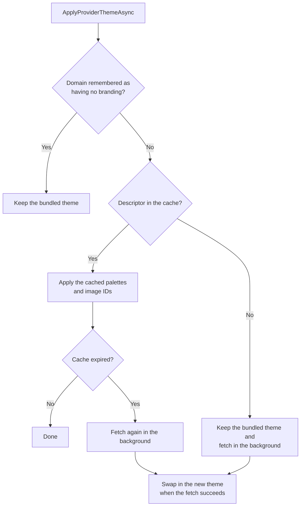
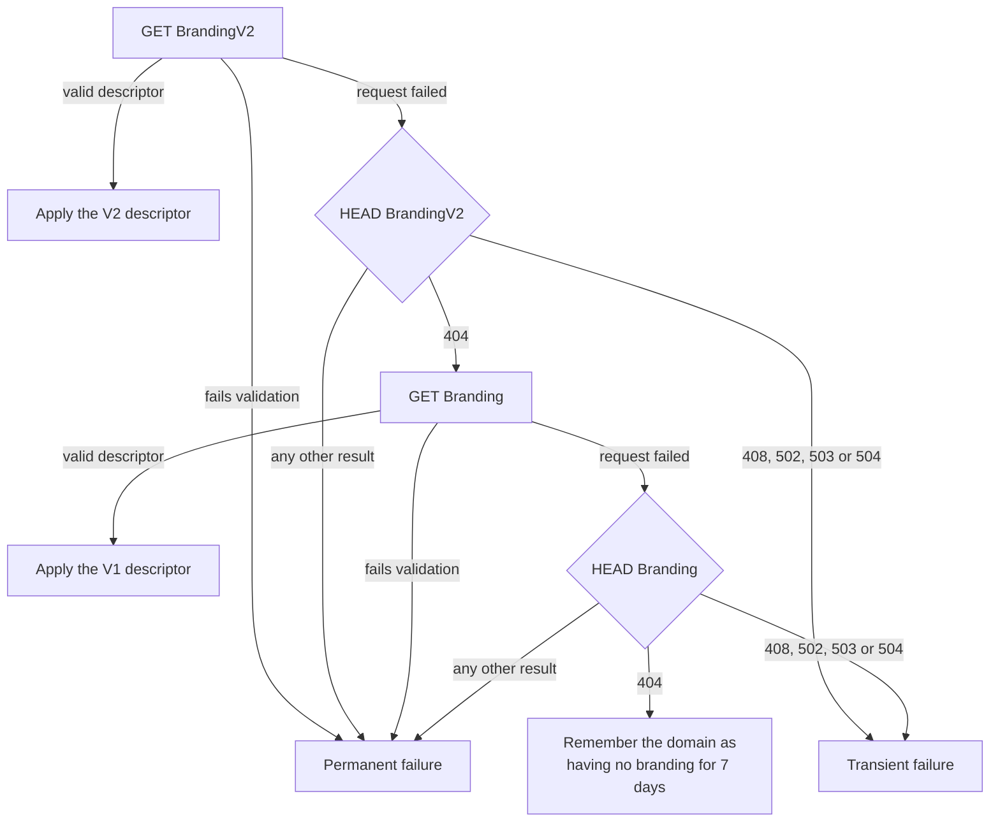

# Branding

Each broker can give Neuro-Access its own colors and banner images without a new app release. This guide explains how the app finds, applies and caches that branding, how to author and publish a theme, and how app code must use colors and images so that branding reaches them. Broker operators need no C#: everything from [The branding descriptor](#the-branding-descriptor) to [Publishing a theme](#publishing-a-theme), plus [Troubleshooting](#troubleshooting), is written for them.

- [How branding works](#how-branding-works)
- [When the app applies branding](#when-the-app-applies-branding)
- [Finding the descriptor](#finding-the-descriptor)
- [The branding descriptor](#the-branding-descriptor)
- [Bundled themes and color keys](#bundled-themes-and-color-keys)
- [Creating color palettes](#creating-color-palettes)
- [Branding images](#branding-images)
- [Caching, refresh and rollout](#caching-refresh-and-rollout)
- [Publishing a theme](#publishing-a-theme)
- [Using theme colors and images in app code](#using-theme-colors-and-images-in-app-code)
- [Troubleshooting](#troubleshooting)
- [Known limitations](#known-limitations)

## How branding works

A broker publishes a small XML file, the branding descriptor, on its Neuron. The descriptor points to two color palettes (one for the light theme, one for the dark theme) and to a set of images, each with an ID. [`ThemeService`](../NeuroAccessMaui/Services/Theme/ThemeService.cs) downloads the descriptor and the palettes, merges the palettes into the app's resources and remembers the image URLs. Pages then ask the service for an image by ID.

Colors are resolved in layers:

1. [`App.xaml`](../NeuroAccessMaui/App.xaml) merges the bundled light palette, [`Light.xaml`](../NeuroAccessMaui/Resources/Styles/Light.xaml), as the base layer. It is never removed.
2. The style dictionaries merged after it (`Styles.xaml`, `LabelStyles.xaml`, `ButtonStyles.xaml` and the others) refer to colors by key with `DynamicResource`.
3. `ThemeService` merges one theme dictionary on top: nothing extra for the bundled light theme, the bundled [`Dark.xaml`](../NeuroAccessMaui/Resources/Styles/Dark.xaml) for the dark theme, or the broker's light or dark palette once branding has been applied.

The top dictionary that defines a key wins. A key that the top dictionary does not define falls through to the bundled light palette, in the dark theme too. Switching theme or applying branding swaps the top dictionary, and every `DynamicResource` reference updates at once.

| Type | Role |
| --- | --- |
| [`IThemeService`](../NeuroAccessMaui/Services/Theme/IThemeService.cs), implemented by [`ThemeService`](../NeuroAccessMaui/Services/Theme/ThemeService.cs) | Applies the bundled and provider themes, and maps image IDs to URLs. Reached through `ServiceRef.ThemeService`. |
| [`ThemeFetchPolicy`](../NeuroAccessMaui/Services/Theme/ThemeFetchPolicy.cs) | How a provider theme is fetched: from cache first, blocking, or forced. |
| [`ThemeApplyOutcome`](../NeuroAccessMaui/Services/Theme/ThemeApplyOutcome.cs) | The result of one attempt to apply a provider theme. |
| [`XmlSchemaValidationService`](../NeuroAccessMaui/Services/Xml/XmlSchemaValidationService.cs) | Validates descriptors against the schemas bundled in [`Resources/Raw/Schemas`](../NeuroAccessMaui/Resources/Raw/Schemas). |
| [`InternetCacheService`](../NeuroAccessMaui/Services/Cache/InternetCache/InternetCacheService.cs) and [`FileCacheManager`](../NeuroAccessMaui/Services/Cache/FileCacheManager.cs) | Download and cache descriptors, palettes and images on the device. |
| [`UriImage`](../NeuroAccessMaui/UI/Controls/Images/UriImage.cs) | The control that shows a branding image from its URL, with caching, SVG support and a fallback image. |
| [`Constants.Branding`](../NeuroAccessMaui/Constants.cs) | The image IDs the app looks up. |

## When the app applies branding

Branding is looked up for the broker domain in the user's profile (`TagProfile.Domain`), and only once the profile has finished onboarding. The onboarding screens always use the bundled theme.

The app applies the bundled theme as soon as the local profile has loaded, before the main page exists. It then tries the provider theme in two places:

1. [`LoadingPage`](../NeuroAccessMaui/UI/Pages/Startup/LoadingPage.xaml.cs) calls `ApplyProviderThemeAsync(ThemeFetchPolicy.BackgroundRefresh)` before it shows the main page. This happens at every cold start of an onboarded profile, and again when onboarding finishes and the app returns to the loading page.
2. The deferred startup work in [`App.xaml.cs`](../NeuroAccessMaui/App.xaml.cs) calls it again about three seconds after the main page has appeared. If that attempt ends in a transient failure, typically a start without network and without cached branding, it runs again at the next foreground activation.

The loading page never waits for the network. With the background refresh policy, one attempt goes like this:



For a returning user, cached branding is applied before the main page appears, so the bundled colors do not flash first. On the first start after onboarding nothing is cached yet: the main page appears in the bundled theme, and the colors change when the background fetch has finished.

Once a theme has been applied for the domain, or the domain is known to have no branding, later calls in the same process return at once. A new process, or a new domain in the profile, starts over.

`ThemeLoaded` is a `TaskCompletionSource` that completes when the first attempt in the process has finished, including the background fetch on a first start. The home page shows a spinner in place of its banner until then. It completes only once per process, so a later background refresh does not signal it again.

### Fetch policies and outcomes

| Policy | Behavior | Request timeout | Used by |
| --- | --- | --- | --- |
| `BackgroundRefresh` | Applies cached branding at once and fetches in the background when the cache is missing or expired. | 2 seconds when refreshing an expired cache, 6 seconds for a first fetch with nothing cached | The loading page and the deferred startup work |
| `BlockingFirstRun` | Fetches and waits for the result before returning. | 6 seconds | Only internally, to time the first background fetch |
| `ManualRefresh` | Ignores the "no branding" marker and is meant to fetch again even when the cache is fresh, but currently still gets unexpired entries from the cache (see [Known limitations](#known-limitations)). | 8 seconds | Nothing in the app yet |

The timeout applies to each download. A follow-up `HEAD` request (see [Finding the descriptor](#finding-the-descriptor)) is capped at 2 seconds.

| Outcome | Meaning |
| --- | --- |
| `SkippedNoDomain` | The profile has no domain, so nothing was fetched. |
| `Applied` | Branding was fetched and applied. |
| `AppliedFromCache` | Cached branding was applied, or the theme was already applied earlier in this process. |
| `NotSupported` | The domain publishes no branding. |
| `FailedTransient` | The attempt failed in a way worth retrying soon, for example no network. A background fetch that is still running also reports this. |
| `FailedPermanent` | The attempt failed in a way that a quick retry will not fix, for example a descriptor that fails validation. |

## Finding the descriptor

The app reads branding over HTTP, not over XMPP. It builds the descriptor URL from the profile's domain:

```text
https://{domain}/PubSub/NeuroAccessBranding/BrandingV2
https://{domain}/PubSub/NeuroAccessBranding/Branding
```

`NeuroAccessBranding` is the PubSub node and `BrandingV2` and `Branding` are item IDs on it. When the domain is `localhost` or an IP address, for example a local development Neuron, the app uses `http://` instead of `https://`.

The app always tries the V2 item first. It falls back to the V1 item only when the V2 item does not exist:



Some details matter when you run the broker:

- When a `GET` fails, the app sends a `HEAD` request to the same URL to tell "not found" from other errors. Only a `404` answer to that `HEAD` request counts as "not found". A server that answers `HEAD` with `405`, or a `HEAD` request that times out, counts as a permanent failure, and the app then neither tries V1 nor remembers the domain as unbranded.
- A V2 descriptor that fails schema validation is a permanent failure. The app does not fall back to V1 in that case.
- Successfully applying a descriptor clears the "no branding" marker for the domain.
- `ThemeService` does not retry a failed request itself. When nothing is cached, any failure leaves the bundled theme in place, and the deferred startup work tries again at the next foreground activation.

Before applying a descriptor, the app validates it against the schema registered for its version, [`NeuroAccessBrandingV2.xsd`](../NeuroAccessMaui/Resources/Raw/Schemas/NeuroAccessBrandingV2.xsd) or [`NeuroAccessBrandingV1.xsd`](../NeuroAccessMaui/Resources/Raw/Schemas/NeuroAccessBrandingV1.xsd). A descriptor that fails validation is removed from the cache.

## The branding descriptor

Publish a V2 descriptor. V1 is still read as a fallback, but it holds both themes in a single palette file.

### V2 format

The root element is `BrandingDescriptor` in the namespace `https://paiwise.tagroot.io/Schema/NeuroAccessBrandingV2.xsd`. Its children must appear in this order: `Version`, then `ColorPalettes`, then `Images`.

| Element or attribute | Schema | What the app does with it |
| --- | --- | --- |
| `Version` with `major`, `minor` and optional `patch` | Required | Nothing. Use it to track your own releases. |
| `ColorPalettes` | Optional | Holds the palette URLs. Always include it (see the note below). |
| `ColorsUri` (text content) | One or more inside `ColorPalettes` | The URL of a palette file. It must be absolute: a relative URL makes the whole attempt fail. |
| `ColorsUri/@theme` | Required: `light`, `dark`, `system` or `highcontrast` | Only `light` and `dark` are read. If a theme appears more than once, the last entry wins. |
| `ColorsUri/@isDefault` | Optional boolean | Ignored. |
| `Images` | Optional | Holds the image references. |
| `ImageRef/@id` | Required, an XML ID | The ID that pages look up. Matched without regard to case. |
| `ImageRef/@uri` | Required | The absolute URL of the image. A relative URL is skipped. |
| `ImageRef/@width`, `@height`, `@contentType` | Optional | Validated, but not used by the app. `contentType` must be `image/png`, `image/jpeg` or `image/svg+xml`, in lower case. |

The root, `ColorsUri` and `ImageRef` elements also accept attributes from other namespaces, which the app ignores.

Always publish both a `light` and a `dark` palette. The app builds a branded dictionary for each theme, and a theme without a palette, or whose palette fails to load, gets an empty one. The colors for that theme then fall through to the bundled light palette, so a missing dark palette shows light colors in the dark theme.

An `id` must be a valid XML ID: it starts with a letter or underscore and contains no spaces or colons. IDs must be unique in the file. Uniqueness is checked with case, but the app looks IDs up without case, so do not publish two IDs that differ only in case.

### Example

This descriptor validates against the bundled V2 schema:

```xml
<?xml version="1.0" encoding="utf-8"?>
<BrandingDescriptor xmlns="https://paiwise.tagroot.io/Schema/NeuroAccessBrandingV2.xsd">
	<Version major="1" minor="0" patch="0" />
	<ColorPalettes>
		<ColorsUri theme="light">https://example.com/branding/v3/colors-light.xaml</ColorsUri>
		<ColorsUri theme="dark">https://example.com/branding/v3/colors-dark.xaml</ColorsUri>
	</ColorPalettes>
	<Images>
		<ImageRef id="banner_large_light" uri="https://example.com/branding/v3/banner-large-light.png" contentType="image/png" width="690" height="690" />
		<ImageRef id="banner_large_dark" uri="https://example.com/branding/v3/banner-large-dark.png" contentType="image/png" width="690" height="690" />
		<ImageRef id="banner_small_light" uri="https://example.com/branding/v3/banner-small-light.svg" contentType="image/svg+xml" />
		<ImageRef id="banner_small_dark" uri="https://example.com/branding/v3/banner-small-dark.svg" contentType="image/svg+xml" />
	</Images>
</BrandingDescriptor>
```

The app also accepts the older V2 namespace `urn:neuroaccess:branding:2.0`, but the bundled schema is written for the `https://` namespace, so a descriptor in the old namespace is not really checked. Use the `https://` namespace.

### V1 format

A V1 descriptor uses the namespace `urn:neuroaccess:branding:1.0` and has a single `ColorsUri` element, directly under the root, that points to one palette file holding both themes. `ImageRef` also accepts an optional `role` attribute (`logo`, `banner`, `icon` or `splash`), which the app ignores.

```xml
<?xml version="1.0" encoding="utf-8"?>
<BrandingDescriptor xmlns="urn:neuroaccess:branding:1.0">
	<Version major="1" minor="0" />
	<ColorsUri>https://example.com/branding/v1/colors.xaml</ColorsUri>
	<Images>
		<ImageRef id="banner_large_light" uri="https://example.com/branding/v1/banner-large-light.png" role="banner" contentType="image/png" />
	</Images>
</BrandingDescriptor>
```

The V1 palette names every key twice, with a `Light` or `Dark` suffix, for example `ContentPrimaryWLLight` and `ContentPrimaryWLDark`. The app strips the suffix and sorts each color into the light or dark dictionary. A key with neither suffix goes into both. [`Colors.xaml`](../NeuroAccessMaui/Resources/Styles/Colors.xaml) in the repository is a complete palette in this format.

## Bundled themes and color keys

The bundled themes are [`Light.xaml`](../NeuroAccessMaui/Resources/Styles/Light.xaml) and [`Dark.xaml`](../NeuroAccessMaui/Resources/Styles/Dark.xaml), each with a small code-behind file that marks it as a theme dictionary. Both define the same set of keys, currently 169, and almost every key is referenced somewhere in the app. They are the source of truth for which keys exist.

The key names come from the variable names in the Figma design file, with spaces, `/`, `&` and `-` removed. They fall into these groups:

| Prefix | Used for |
| --- | --- |
| `BrandColors…` | The base palette: grey scale (`BrandColorsGreyScales…`), the Neuro-Access green (`BrandColorsNeuroAccess…`) and the accent families `NeuroAdmin`, `NeuroAssets`, `NeuroPay`, `NeuroOrange` and `NeuroRed`. |
| `Button…` | Button backgrounds (`…bg…`), content and strokes for each family (`Universal`, `Access`, `Assets`, `Danger`, `Neuro`, `Neutral`, `Pay`), with `Pressed`, `Hold` and `Inactive` states. |
| `Content…` | Text and icon colors, such as `ContentPrimaryWL`, `ContentSecondaryWL`, `ContentAccessWL` and `ContentLinkWL`. |
| `InputFields…` | Entries, pickers and other inputs. |
| `NavMenu…` | The navigation menu. |
| `Surface…` | Page background, elevated surfaces, dividers, strokes, shadows and the scrim. |
| `TnP…` | Status colors (success, warning, danger, info, neutral and accent) as backgrounds, content and figures. |

The most widely used keys are `ContentPrimaryWL`, `SurfaceBackgroundWL`, `ContentSecondaryWL`, `ContentAccessWL`, `SurfaceElevation1WL` and `ButtonAccessPrimarybgWL`. They are a good first check that a palette has taken effect.

The `Resources/Styles` folder also holds [`Colors.xaml`](../NeuroAccessMaui/Resources/Styles/Colors.xaml) (both themes in the V1 format) and [`colors-light.xaml`](../NeuroAccessMaui/Resources/Styles/colors-light.xaml) and [`colors-dark.xaml`](../NeuroAccessMaui/Resources/Styles/colors-dark.xaml) (output of the color generator). The app does not merge these files. They can drift from `Light.xaml` and `Dark.xaml`, so do not treat them as the current key set.

The user picks Light, Dark or the system theme in Settings, and the choice is stored in the profile. When the user follows the system theme, the app picks up a change of system theme the next time it comes to the foreground.

## Creating color palettes

A palette is a .NET MAUI `ResourceDictionary` that the app downloads and loads at run time. A V2 theme needs two palettes, one for light and one for dark.

```xml
<?xml version="1.0" encoding="utf-8"?>
<ResourceDictionary xmlns="http://schemas.microsoft.com/dotnet/2021/maui"
	xmlns:x="http://schemas.microsoft.com/winfx/2009/xaml">
	<Color x:Key="BrandColorsNeuroAccessWL">#1f8acb</Color>
	<Color x:Key="ButtonAccessPrimarybgWL">#145a86</Color>
	<Color x:Key="ButtonAccessPrimaryContentWL">#f5f6f7</Color>
	<Color x:Key="ContentAccessWL">#145a86</Color>
	<Color x:Key="ContentPrimaryWL">#181f25</Color>
	<Color x:Key="SurfaceBackgroundWL">#f5f6f7</Color>
	<!-- ...and every other key in Light.xaml -->
</ResourceDictionary>
```

Follow these rules:

- Define every key that `Light.xaml` defines, in both palettes, even the colors you do not change. A key you leave out shows the bundled light color, which is usually wrong in the dark theme.
- Keep the key names exactly as they are. A misspelled key is ignored, and the bundled color shows instead.
- Write colors as `#RRGGBB`, or `#AARRGGBB` with the alpha first. Figma exports alpha last (`#RRGGBBAA`), so convert those values.
- Put only `Color` entries in a palette. The dictionary is merged above the app's styles, so any other key would override app resources too.
- Do not add `x:Class`, code-behind or custom XML namespaces. The file is parsed at run time, outside the app build.
- Save the file as UTF-8.

If a palette cannot be parsed, the app logs `Failed to load provider ResourceDictionary from {url}`, and every color in that theme falls back to the bundled light palette.

### Starting from the bundled themes

The quickest route is to copy `Light.xaml` and `Dark.xaml`, delete the `x:Class` attribute from the root element and change the values you want to brand. To check that a palette still has the full key set, compare its keys with the bundled light theme:

```sh
grep -o 'x:Key="[^"]*"' NeuroAccessMaui/Resources/Styles/Light.xaml | sort > expected-keys.txt
grep -o 'x:Key="[^"]*"' colors-dark.xaml | sort > palette-keys.txt
diff expected-keys.txt palette-keys.txt
```

No output means the key sets match. `xmllint --noout colors-dark.xaml` confirms that the file is well-formed XML.

### Generating palettes from Figma

[`Build/color_generator.py`](../Build/color_generator.py) turns a JSON export of the Figma color variables into palette files. The `Build/` folder is git-ignored apart from a few tracked scripts, so a fresh clone has the script but no input file. Export `colors.json` from the design file yourself and place it next to the script. The script reads this shape, using only `name` and `value` from each color:

```json
[
	{
		"name": "Colors",
		"values": [
			{ "mode": { "name": "Light" }, "color": [ { "name": "BrandColors/GreyScales/Black-f", "value": "#181f25" } ] },
			{ "mode": { "name": "Dark" }, "color": [ { "name": "BrandColors/GreyScales/Black-f", "value": "#161617" } ] }
		]
	}
]
```

Run it with Python 3.9 or later:

```sh
python Build/color_generator.py      # light from values[0], dark from values[1]
python Build/color_generator.py -a   # light from values[3], dark from values[2]
```

It writes `colors-light.xaml`, `colors-dark.xaml` and `colors-combined.json` into `Build/`. The two `.xaml` files are V2 palettes. To update the bundled themes instead, copy the `<Color>` lines into `Light.xaml` and `Dark.xaml` and keep their `x:Class` headers.

Watch for these pitfalls:

- The script picks modes by position, not by name. Check the mode order in your export, since some exports list the dark mode first.
- It accepts only `#RRGGBB` and `#RRGGBBAA` values. Any other form is written as `None`.
- The comment at the top of the script still describes an older version that wrote `colors.xaml` and compared it with `old_colors.xaml`. The code does neither.

## Branding images

The app looks up these image IDs, defined in [`Constants.Branding`](../NeuroAccessMaui/Constants.cs). The `_light` image is shown when the app uses the light theme and the `_dark` image when it uses the dark theme, so design each for that background.

| ID | Where it shows | Display box (device-independent units) | When the ID is missing |
| --- | --- | --- | --- |
| `banner_large_light`, `banner_large_dark` | Home page | 230 × 230, aspect fit | The bundled Neuro-Access logo |
| `banner_small_light`, `banner_small_dark` | Applications page (30 high), identity page header and KYC process header (100 × 24) | Aspect fit | The bundled `neuro_b` mark on the identity and KYC headers, nothing on the Applications page |
| `logo_light`, `logo_dark` | Not used yet | | |

Provide images that are sharp on high-density screens: at least 690 × 690 pixels for the large banner, and a wide image of about 4:1 for the small banner (for example 400 × 100 pixels), or SVG files.

How images are loaded:

- Each `ImageRef` with an ID and an absolute URL is added to an ID-to-URL map when the descriptor is applied. The map is replaced on each apply, so an ID removed from the descriptor disappears.
- `ThemeService` does not download images. A page passes the URL to a `UriImage` control, which downloads the image when it is shown and caches it on the device.
- PNG and JPEG work as they are. SVG is converted to a bitmap, but only when the URL ends in `.svg`, with no query string after it. The `contentType` attribute is not consulted, so an SVG at any other URL will not display.
- Use `https://` URLs. Older versions of this guide showed `xmpp:` URIs, which the app has no way to fetch.
- If the image cannot be loaded, the page shows the fallback listed above.

You can publish extra IDs for future use. App code reads them with `ServiceRef.ThemeService.GetImageUri("your_id")`, which returns an empty string for an unknown ID.

## Caching, refresh and rollout

Everything the app downloads for branding is cached on the device for 7 days (`Constants.Cache.DefaultImageCache`).

| What | Cached under | Lifetime | Removed by |
| --- | --- | --- | --- |
| Descriptor (`BrandingV2` or `Branding`) | Its URL | 7 days | Settings > Security Settings > Clear cache, or `ThemeService.ClearBrandingCacheForCurrentDomain` |
| Palettes | Their URLs | 7 days | The same |
| "No branding" marker for a domain | The domain | 7 days | The same, and a successful apply |
| Images | Their URLs | 7 days | Clear cache in Settings only |

An expired entry is still used until a refresh replaces it. When a refresh of the descriptor or a palette cannot reach the server, the app keeps using the cached copy and treats it as fresh for another 7 days. An expired image is downloaded again each time it is shown, until a download succeeds.

The app checks for new branding only when its process starts, or when onboarding finishes. A running app that is only sent to the background and back does not check again, unless its last attempt failed with nothing cached.

What this means for a broker rolling out a change:

| Situation | When devices see the change |
| --- | --- |
| New install or new onboarding | At the end of onboarding. The bundled theme shows first, and the branded colors appear when the background fetch finishes. |
| Branding changed on the broker | At the first app start after the device's cached descriptor has expired, 7 days after it was last fetched. The colors change a moment after the main page appears. A device whose app keeps running, or whose refresh fails, sees the change later. |
| Branding published for a domain that had none | Up to 7 days, because devices that already checked remember that the domain had no branding. |
| User runs Clear cache and restarts the app | At that restart. |
| Image or palette changed in place at the same URL | When the cached copy of that file expires, possibly after the descriptor itself has been refreshed. |
| Image or palette published at a new URL, with a new descriptor | As soon as the new descriptor is applied. |
| Branding removed from the broker | Devices that have it cached keep it until the cache is cleared or the app is reinstalled, because each failed refresh renews the cached copy. To withdraw branding, publish a descriptor whose palettes are copies of the bundled themes and that lists no images, rather than deleting the item. |

Give every new version of a palette or image a new URL, for example a versioned folder such as `/branding/v4/`. The new descriptor then always pulls the new files, instead of reusing cached copies of old files at the same URLs. The descriptor URL itself is fixed, so its 7-day cache cannot be bypassed by renaming.

Refreshes of an expired cache use a 2-second timeout per download, so keep descriptors and palettes small and serve them quickly.

To force a change onto a test device, open Settings > Security Settings > Clear cache and restart the app. Clear cache removes every cached download on the device, including cached attachments, and also deletes the user's locally saved KYC drafts and application records, so do not suggest it to end users lightly. It does not change the theme of the running app.

## Publishing a theme

These steps are for broker operators.

1. Create the light and dark palettes as described in [Creating color palettes](#creating-color-palettes).
2. Prepare the banner images, a light and a dark variant of each, as described in [Branding images](#branding-images).
3. Host the palettes and images at absolute `https://` URLs that anyone can read without signing in. Serve them with a correct `Content-Type` header, since the app treats a response without a content type as a failure. Put each release in its own folder, such as `/branding/v4/`.
4. Write the V2 descriptor with those URLs and validate it against the schema in the repository:

   ```sh
   xmllint --noout --schema NeuroAccessMaui/Resources/Raw/Schemas/NeuroAccessBrandingV2.xsd BrandingV2.xml
   ```

   Also check by eye that the root element uses exactly the namespace `https://paiwise.tagroot.io/Schema/NeuroAccessBrandingV2.xsd`. A descriptor in another namespace can pass the app's validation and then be ignored without any error.
5. Publish the descriptor as the item `BrandingV2` on the PubSub node `NeuroAccessBranding` of your broker, using the tools you normally use to publish PubSub items on your Neuron. The node must be readable without signing in. You do not need a V1 `Branding` item: the app reads it only when `BrandingV2` does not exist.
6. Check what the app will see. The first request must return the descriptor XML as the response body. The second, for an item that does not exist, must return `404`:

   ```sh
   curl -i https://example.com/PubSub/NeuroAccessBranding/BrandingV2
   curl -I https://example.com/PubSub/NeuroAccessBranding/NoSuchItem
   ```

7. Verify on a device: install the app, or clear the cache and restart it, sign in with a profile on your domain, and wait for the colors to change after the main page appears. Check the home banner, the buttons and both themes.

## Using theme colors and images in app code

Branding reaches only the parts of the UI that read colors and images through the theme. This section is for developers.

### Colors

- In XAML, refer to colors with `{DynamicResource Key}`, for example `TextColor="{DynamicResource ContentPrimaryWL}"`. The app has no `StaticResource` references to color keys, and should not get any, because a static reference is resolved once and never follows a theme switch or branding.
- Do not hard-code color values, and do not use `AppThemeBinding` with literal colors. The theme dictionaries already switch between light and dark, and a literal value bypasses branding.
- In C#, bind a property to a key with `SetDynamicResource`, as [`CompositeInputView`](../NeuroAccessMaui/UI/Controls/Inputs/CompositeInputView.cs) does with `this.hintLabel.SetDynamicResource(Label.TextColorProperty, "ContentSecondaryWL")`.
- [`AppColors`](../NeuroAccessMaui/UI/AppColors.cs) and `AppStyles.TryGetResource<Color>()` return a color value, not a reference. A control that gets such a value does not update when the theme or branding changes, and several `AppColors` properties keep the first value they read for the rest of the process. Prefer dynamic resources.
- To change the theme, call `ServiceRef.ThemeService.SetTheme(AppTheme.Dark)`. It stores the choice in the profile and swaps the theme dictionary. Setting `Application.Current.UserAppTheme` directly does not swap the dictionaries.
- When you add a color key, add it to both `Light.xaml` and `Dark.xaml`. Brokers' existing palettes do not have the new key, so under their branding it shows the bundled light value until they add it. Mention new keys in the changelog so that brokers can update their palettes.

### Images

A view model looks the image up by ID, picks the variant for the effective theme, and raises a property change when the theme changes and when branding has loaded. Use `Application.Current.RequestedTheme`, which is the effective theme, rather than `UserAppTheme`, which is `Unspecified` when the user follows the system theme.

```csharp
using NeuroAccessMaui.Services;

namespace NeuroAccessMaui.UI.Pages.Example
{
	/// <summary>
	/// View model for a page that shows the provider's small banner.
	/// </summary>
	public partial class ExampleViewModel : BaseViewModel
	{
		/// <summary>
		/// URI of the provider banner for the current theme, or an empty string if the provider has none.
		/// </summary>
		public string BannerUri
		{
			get
			{
				bool IsDark = Application.Current?.RequestedTheme == AppTheme.Dark;
				string Id = IsDark ? Constants.Branding.BannerSmallDark : Constants.Branding.BannerSmallLight;
				return ServiceRef.ThemeService.GetImageUri(Id);
			}
		}

		/// <inheritdoc/>
		public override async Task OnAppearingAsync()
		{
			await base.OnAppearingAsync();

			if (Application.Current is not null)
				Application.Current.RequestedThemeChanged += this.Application_RequestedThemeChanged;

			_ = this.RefreshBannerWhenThemeLoadedAsync();
		}

		/// <inheritdoc/>
		public override async Task OnDisappearingAsync()
		{
			if (Application.Current is not null)
				Application.Current.RequestedThemeChanged -= this.Application_RequestedThemeChanged;

			await base.OnDisappearingAsync();
		}

		/// <summary>
		/// Raises a change of <see cref="BannerUri"/> once provider branding has loaded.
		/// </summary>
		private async Task RefreshBannerWhenThemeLoadedAsync()
		{
			try
			{
				await ServiceRef.ThemeService.ThemeLoaded.Task;
				MainThread.BeginInvokeOnMainThread(() => this.OnPropertyChanged(nameof(this.BannerUri)));
			}
			catch (Exception Ex)
			{
				ServiceRef.LogService.LogException(Ex);
			}
		}

		private void Application_RequestedThemeChanged(object? Sender, AppThemeChangedEventArgs Args)
		{
			MainThread.BeginInvokeOnMainThread(() => this.OnPropertyChanged(nameof(this.BannerUri)));
		}
	}
}
```

In XAML, show the image with `UriImage` and give it a bundled fallback. The control handles caching, SVG conversion and the fallback:

```xml
<controls:UriImage
	HeightRequest="24"
	WidthRequest="100"
	Aspect="AspectFit"
	ErrorPlaceholder="neuro_b"
	Source="{Binding BannerUri}" />
```

Here `controls` maps to `clr-namespace:NeuroAccessMaui.UI.Controls`. For a new image slot, add its ID to `Constants.Branding`, and tell brokers about it.

## Troubleshooting

The app writes the log entries named below through `ServiceRef.LogService`. Entries that start with `ApplyProviderThemeAsync` are debug entries.

### No branding at all

- Fetch `https://{domain}/PubSub/NeuroAccessBranding/BrandingV2` with `curl -i`. It must return `200`, a `Content-Type` header and the descriptor XML as the body.
- If the device checked the domain before branding was published, it remembers for 7 days that the domain had none. The debug log shows `ApplyProviderThemeAsync: Unsupported cached for {domain}`. Clear the cache and restart.
- Check the root namespace. A descriptor in the wrong namespace passes validation but is then ignored, and the app reports it as applied.
- An error while applying a descriptor fetched in the background, such as a relative `ColorsUri`, is logged as `Background provider theme refresh failed for {domain}`.
- Branding applies only to onboarded profiles, so onboarding screens never show it.

### Validation errors

A descriptor that breaks the schema is logged as `XmlValidationFailed`, with the line, position and message, followed by `BrandingXmlValidationBothFailed` for V2 or `BrandingXmlValidationV1Failed` for V1. Common causes are elements in the wrong order, an `id` that starts with a digit, an upper-case `contentType` such as `Image/png`, and a missing `theme` attribute. Run `xmllint` against the bundled schema to see the same errors before you publish. A V2 descriptor that fails validation is not replaced by the V1 item.

### Some colors are wrong, or dark mode shows light colors

The palette for that theme is missing keys, failed to load, or is not referenced in the descriptor. In each case the missing colors come from the bundled light palette. Compare the key set as shown in [Starting from the bundled themes](#starting-from-the-bundled-themes), and look for `Failed to load provider ResourceDictionary from {url}` in the log.

### Images are missing

- The ID must match one the app looks up, such as `banner_large_dark`.
- The `uri` must be an absolute `https://` URL. Relative URLs are skipped.
- An SVG must be at a URL that ends in `.svg`, with no query string.
- `UriImage: Failed to load image from '{url}'` in the log means the download failed or returned no data.

### Changes do not show up

Cached files are used for 7 days, and a failed refresh extends that. Clear the cache and restart the app to check the new version, and publish changed files at new URLs. See [Caching, refresh and rollout](#caching-refresh-and-rollout).

### The colors change a few seconds after start

This is expected on the first start after onboarding, and after the cache has expired: the app shows what it has, fetches in the background and swaps the theme when the fetch succeeds.

### V1 is never tried, or devices keep retrying an unbranded domain

Check that the server answers a `HEAD` request for a missing item with `404`. Any other answer, such as `405`, counts as a permanent failure, so the app neither falls back to V1 nor remembers that the domain has no branding.

## Known limitations

- A V2 descriptor without a dark palette, or whose dark palette fails to load, shows the bundled light colors in the dark theme.
- A refresh that fails, including one that gets a `404` because the branding was removed, returns the stale cached copy, which is then stored again with a new 7-day expiry. `ManualRefresh` cannot bypass a cache entry that has not expired.
- The schema check passes a document whose root namespace has no matching schema. Such a descriptor is then ignored, but the attempt is reported as `Applied`.
- Only a `404` answer to the `HEAD` check counts as "not found". A `HEAD` request that times out, or any status other than 404, 408, 502, 503 and 504, is a permanent failure, and a permanent failure for V2 skips V1.
- Falling back to the bundled theme reapplies the dictionaries the service already holds. After a provider theme has been applied in a process, for example before a change of domain, that provider's colors stay until the app restarts.
- The home and Applications pages choose the banner with `UserAppTheme`, so a user who follows a dark system theme sees the light banner there. The identity and KYC pages use the effective theme.
- The first group of `AppColors` properties, such as `TnPSuccessBg` and `ContentPrimary`, caches the first value it reads and does not follow theme or branding changes.
- No handler swaps the color dictionaries when the system theme changes while the app is in the foreground. It happens at the next foreground activation.
- On iOS the status bar color is set when the theme is set, not when branding is applied, so it can show the bundled background color until the next foreground activation.

## Related docs

- [Architecture](architecture.md)
- [Services](services.md)
- [Onboarding](onboarding.md)
- [KYC](kyc.md)
- [Getting started](getting-started.md)
- [Contributing](contributing.md)
- [Docs index](README.md)
- [AGENTS.md](../AGENTS.md), the code style and app patterns
