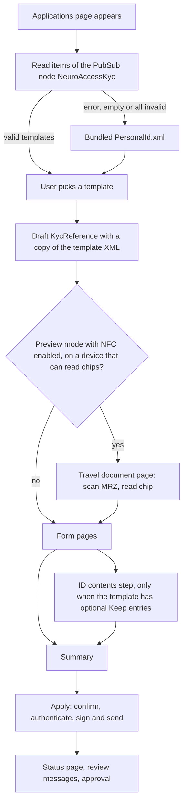
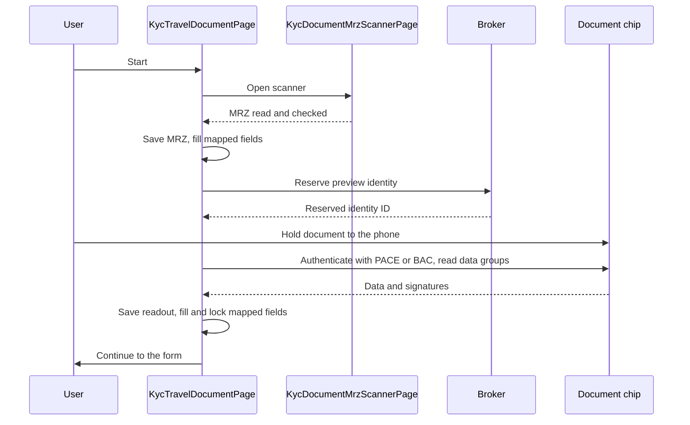
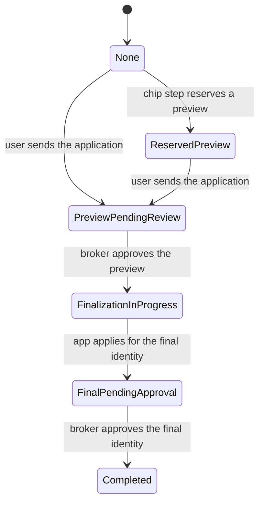

# KYC

Neuro-Access builds its identity application forms at run time from XML templates that each broker publishes. This guide explains how the app finds a template, turns it into pages, saves the user's progress, reads travel documents, and sends the application. It also tells broker operators how to write and publish a template, and those sections need no C#.

- [How an application works](#how-an-application-works)
- [Where the code lives](#where-the-code-lives)
- [Finding templates](#finding-templates)
- [Writing a template](#writing-a-template)
- [Publishing a template](#publishing-a-template)
- [The form at run time](#the-form-at-run-time)
- [Travel document steps](#travel-document-steps)
- [Submitting the application](#submitting-the-application)
- [Review and status](#review-and-status)
- [Extending the flow](#extending-the-flow)
- [Troubleshooting](#troubleshooting)
- [Known limitations](#known-limitations)

## How an application works

A template describes pages of fields. Each field can map its value to a property or an attachment of the legal identity that the app applies for. The app does not store the template list. It asks the broker for templates every time the Applications page appears, and copies the chosen template into a local draft, so a draft keeps working even if the broker changes or removes the template later.



A template chooses one of two application modes:

- **Direct.** The app sends one application with everything the form produced. The operator approves or rejects it.
- **Preview.** The app first sends a preview application for review. When the operator approves the preview, the app sends a final application that carries only the content the template says to keep. Reading a passport or ID card chip over NFC works only in this mode.

## Where the code lives

| Area | Files |
| --- | --- |
| Service | [`IKycService`](../NeuroAccessMaui/Services/Kyc/IKycService.cs) and [`KycService`](../NeuroAccessMaui/Services/Kyc/KycService.cs): template discovery, validation, drafts, autosave, building properties and attachments, submission state |
| Template parsing | [`KycProcessParser`](../NeuroAccessMaui/Services/Kyc/KycProcessParser.cs), [`KycApplicationItem`](../NeuroAccessMaui/Services/Kyc/KycApplicationItem.cs) and the models in [`Services/Kyc/Models`](../NeuroAccessMaui/Services/Kyc/Models) |
| Field view models | [`Services/Kyc/ViewModels`](../NeuroAccessMaui/Services/Kyc/ViewModels), one `Observable*Field` class per field type, all derived from [`ObservableKycField`](../NeuroAccessMaui/Services/Kyc/ViewModels/ObservableKycField.cs) |
| Validation rules | [`KycRules`](../NeuroAccessMaui/Services/Kyc/Models/KycRules.cs) |
| Transforms | [`IKycTransform` and `KycTransformRegistry`](../NeuroAccessMaui/Services/Kyc/Transforms/IKycTransform.cs) |
| Draft storage | [`KycReference`](../NeuroAccessMaui/Services/Kyc/KycReference.cs) and [`KycReferenceSnapshot`](../NeuroAccessMaui/Services/Kyc/KycReferenceSnapshot.cs) |
| Flow state | [`KycDomain`](../NeuroAccessMaui/Services/Kyc/Domain/KycDomain.cs), [`KycTransitions`](../NeuroAccessMaui/Services/Kyc/Domain/KycTransitions.cs), [`KycSummary`](../NeuroAccessMaui/Services/Kyc/Domain/KycSummary.cs), [`KycOrderingComparer`](../NeuroAccessMaui/Services/Kyc/Domain/KycOrderingComparer.cs) |
| Application policy | [`KycContentPolicyService`](../NeuroAccessMaui/Services/Kyc/KycContentPolicyService.cs), [`KycPreviewPromotionService`](../NeuroAccessMaui/Services/Kyc/KycPreviewPromotionService.cs), [`KycEvidenceValidationService`](../NeuroAccessMaui/Services/Kyc/KycEvidenceValidationService.cs), [`KycApplicationStatus`](../NeuroAccessMaui/Services/Kyc/KycApplicationStatus.cs) |
| Page actions | [`Services/Kyc/Actions`](../NeuroAccessMaui/Services/Kyc/Actions) |
| Pages | [`ApplicationsPage`](../NeuroAccessMaui/UI/Pages/Applications/Applications/ApplicationsViewModel.cs), [`KycProcessPage`](../NeuroAccessMaui/UI/Pages/Kyc/KycProcessViewModel.cs), [`KycApplicationStatusPage`](../NeuroAccessMaui/UI/Pages/Kyc/KycApplicationStatusViewModel.cs), [`KycTravelDocumentPage`](../NeuroAccessMaui/UI/Pages/Kyc/KycTravelDocumentViewModel.cs), [`KycDocumentMrzScannerPage`](../NeuroAccessMaui/UI/Pages/Kyc/KycDocumentMrzScannerViewModel.cs), [`KycProfilePhotoCameraPage`](../NeuroAccessMaui/UI/Pages/Kyc/KycProfilePhotoCameraViewModel.cs) |
| Field templates | [`KycProcessPage.xaml`](../NeuroAccessMaui/UI/Pages/Kyc/KycProcessPage.xaml), [`KycFieldTemplateSelector`](../NeuroAccessMaui/UI/Pages/Kyc/KycFieldTemplateSelector.cs), [`KycImageFieldView`](../NeuroAccessMaui/UI/Pages/Kyc/Views/KycImageFieldView.xaml) |
| Travel documents | [`Services/TravelDocuments`](../NeuroAccessMaui/Services/TravelDocuments), [`Services/Nfc`](../NeuroAccessMaui/Services/Nfc), the [`NeuroAccess.Nfc`](../NeuroAccess.Nfc) project and the [`NeuroAccessMaui.OCR`](../NeuroAccessMaui.OCR) project |
| Schema and bundled template | [`NeuroAccessKycProcess.xsd`](../NeuroAccessMaui/Resources/Raw/Schemas/NeuroAccessKycProcess.xsd) and [`PersonalId.xml`](../NeuroAccessMaui/Resources/Raw/Schemas/PersonalId.xml) |

The services are registered as singletons in [`PageAppExtension`](../NeuroAccessMaui/UI/PageAppExtension.cs), and code reaches the KYC service through `ServiceRef.KycService`. See [services.md](services.md) for how services are resolved.

## Finding templates

`KycService.LoadKycApplicationsPageAsync` reads the items of the PubSub node `NeuroAccessKyc` on the broker's PubSub service. The service address is `TagProfile.PubSubJid`, which the app sets during XMPP service discovery to the component that supports PubSub. If that request returns nothing, the app tries once more without an address. The Applications page asks for 10 templates at a time and offers "load more" while the broker has more items.

For each item the app:

1. Takes the item payload. A payload wrapped in a PubSub `<item>` element is unwrapped.
2. Validates the XML against [`NeuroAccessKycProcess.xsd`](../NeuroAccessMaui/Resources/Raw/Schemas/NeuroAccessKycProcess.xsd). The schema is registered under two keys in `App.xaml.cs`, `https://paiwise.tagroot.io/Schema/NeuroAccessKycProcess.xsd` and the legacy `urn:neuroaccess:kyc:1.0`, and both point to the same file. An item that fails validation is skipped, and the log gets `XmlValidationFailed` with the line, position and message, followed by `KycXmlValidationBothFailed`.
3. Parses the template with `KycProcessParser`. An item that throws while parsing is skipped and the exception is logged.
4. Picks a display name: the first text of the template's `<Name>`, then the PubSub item ID, then "KYC Application".

If the first request fails, returns no items, or returns no valid template, the app shows the bundled [`PersonalId.xml`](../NeuroAccessMaui/Resources/Raw/Schemas/PersonalId.xml) instead. Later pages never fall back. Because a broker whose templates are all invalid still sees a template in the app, check the log before you conclude that yours loaded.

When the user starts an application, `LoadKycReferenceAsync` creates the draft, a [`KycReference`](../NeuroAccessMaui/Services/Kyc/KycReference.cs) stored in the `KycReferences` collection of the local database. It copies the template XML into the draft and records the PubSub item ID as `KycTemplateId`. The app keeps one draft only: loading the draft deletes any others, and starting a new application deletes the old draft after it has obsoleted a pending identity application or adopted an approved one.

## Writing a template

This section is for broker operators. A template is an XML document in the namespace `https://paiwise.tagroot.io/Schema/NeuroAccessKycProcess.xsd` with the root element `KYCProcess`.

### Document structure

The schema fixes the order of elements, and a template with elements out of order fails validation and is skipped.

| Element | Child elements, in this order |
| --- | --- |
| `KYCProcess` | `Name`?, `IdentityApplication`?, `Evidence`?, then one or more `Page` |
| `Page` | `Title`?, `Description`?, `Condition`?, `Metadata`?, then any mix of `Field` and `Section` |
| `Section` | `Label`?, `Description`?, then any number of `Field` |
| `Field` | `Label`?, `Hint`?, `Placeholder`?, `Description`?, `Default`?, `Metadata`?, `ValidationRules`?, `Options`?, `Condition`?, then any number of `Mapping` |

A `?` marks an optional element.

A page has a required `id` attribute. A field has the required attributes `id` and `type`, and the optional `required` (default `false`). Keep page and field IDs unique. The schema declares this, but its uniqueness checks do not match namespaced elements, so a duplicate ID passes validation and makes fields overwrite each other's values.

The parser ignores these attributes, although the schema allows them: `title` on `Page`, `label` on `Section` and `specialType` on `Field`. Use the `Title` and `Label` elements instead.

### Localized text

`Name`, `Title`, `Label`, `Hint`, `Placeholder`, `Description` and validation `Message` elements hold one `<Text lang="xx">` child per language, where `xx` is a two-letter language code. The app shows the text for the device language, then English, then the first entry. An element with no `<Text>` children uses its own text as English.

```xml
<Label>
	<Text lang="en">First names</Text>
	<Text lang="sv">Förnamn</Text>
</Label>
```

### Pages and sections

The user moves through the pages in template order. A page with a `Condition` is shown only while the condition holds. A section is a titled group of fields inside a page. It has no condition of its own and is hidden when none of its fields are visible.

### Field types

The `type` attribute accepts each value in lowercase or with a capital first letter, such as `text` or `Text`.

| Type | Shown as | Stored value |
| --- | --- | --- |
| `text` | Text entry | The text |
| `email`, `phone` | Text entry. The app does not check the format, so add a `RegexRule` if you need one. | The text |
| `integer`, `decimal` | Numeric entry | The number |
| `date` | Date picker | `yyyy-MM-dd` |
| `boolean` | A switch with the `Hint` text beside it. When `required="true"`, the switch must be on, which suits a confirmation. | `true` or `false` |
| `picker` | Drop-down list of the `Options` | The chosen option's `value` |
| `radio` | Radio buttons for the `Options` | The chosen option's `value` |
| `checkbox` | One check box per option | The chosen values, separated by commas |
| `country` | Drop-down list. Without `Options` it lists every country by ISO 3166-1 alpha-2 code, with the country of the user's current identity first. An optional country field also gets an empty "not specified" choice. | The country code, such as `SE` |
| `gender` | Drop-down list. Without `Options` it lists the ISO 5218 genders. | The ISO 5218 letter |
| `image` | Photo card with camera and, where allowed, gallery buttons. See [Photo fields](#photo-fields). | The JPEG image |
| `label` | The `Label` text as a heading. No input. | None |
| `info` | The `Label` and `Description` in a box. No input. | None |
| `file` | Placeholder buttons that do nothing yet. Do not use this type. | None |

A field whose ID is `country` starts with the country of the phone number the user verified during onboarding, or else the country of the current identity. When its value changes, personal-number fields update their placeholder and are validated again.

### Options and defaults

`picker`, `radio` and `checkbox` fields need an `Options` element with at least one `<Option value="...">`. Give every option `<Text>` children, since they are the text the user sees.

`Default` sets the starting value. A `date` field accepts `now()` for today, or a date such as `1990-01-31`. `boolean`, `integer` and `decimal` fields parse the text, and other types take it as is.

### Conditions

A `Condition` names another field with `FieldRef`, and optionally a value with `Equals`.

- Without `Equals`, the condition holds when the referenced field has any value.
- With `Equals`, it holds when the value equals the text, ignoring case.
- A condition that refers to a field ID that does not exist never holds. The schema does not catch this.
- A `checkbox` value is a comma-separated list, so `Equals` matches only when exactly that set of options is chosen. A single-option check box, as in the example below, works well.

Fields that are hidden by a condition are neither validated nor sent.

The app also sets the value `evidence.travelDocument.nfc.completed` to `true` or `false`, depending on whether a passport or ID card chip has been read. Use it as a `FieldRef` to show photo pages only to users who did not read the chip, as the bundled template does. You do not need to declare a field with that ID.

### Validation rules

Every field with `required="true"` must have a value. `ValidationRules` adds one or more of these rules:

| Rule | Settings | Checks |
| --- | --- | --- |
| `LengthRule` | Attributes `min` and `max`, both optional | The number of characters |
| `RegexRule` | A `Regex` child with a .NET regular expression | That the pattern matches the value. An invalid pattern is ignored. |
| `DateRangeRule` | Attributes `min` and `max` as `yyyy-MM-dd`, both optional | That the date is within the range |
| `PersonalNumberRule` | An optional `CountryFieldReference` child with the ID of a country field | That the value is a valid personal number for the country. The country comes from the referenced field, then from the field with ID `country`, then from the user's profile. Without a country the rule passes. |

Each rule takes an optional localized `Message`. Without one, the app shows a built-in English message. The app validates a field half a second after the user stops typing, and validates the whole page again when the user taps Next.

### Mappings and transforms

A `Mapping` sends the field's value as an identity property with the name in `key`. A field can have several mappings, and a field without mappings is shown but not sent. Empty values are not sent.

Each mapping can run `Transform` steps in order:

| Transform | Result |
| --- | --- |
| `trim` | Removes leading and trailing white space |
| `uppercase`, `lowercase` | Changes the case |
| `day`, `month`, `year` | The day, month or year of a date, as a number |
| `ageAbove` | The highest of the ages 13, 15, 16, 18, 20 and 21 that the person has reached, from a birth date. Empty for anyone younger than 13 or older than 120. |
| `personalNumberNormalize` | The personal number in its normalized form for the country, or the original value if it is not valid |

Transform names ignore case. An unknown transform is skipped, and a mapping whose result is empty is not sent. A mapping to `PNR`, and any mapping on a field with ID `personalNumber`, gets `personalNumberNormalize` added at the end.

Use these property keys so that the app, the summary and the reviewers recognize the values. The scanner and the chip reader fill fields that map to the keys marked with an asterisk.

| Data | Keys |
| --- | --- |
| Name | `FIRST`\*, `MIDDLE`\*, `LAST`\* |
| Birth | `BDAY`\*, `BMONTH`\*, `BYEAR`\* (map a single `date` field to all three with the `day`, `month` and `year` transforms), `AGEABOVE` |
| Person | `PNR`\*, `GENDER`\*, `NATIONALITY`\*, `COUNTRY`\* |
| Address | `ADDR`, `ADDR2`, `ZIP`, `AREA`, `CITY`, `REGION` |
| Organization | `ORGNAME`, `ORGNR`, `ORGDEPT`, `ORGROLE`, `ORGADDR`, `ORGADDR2`, `ORGZIP`, `ORGAREA`, `ORGCITY`, `ORGREGION`, `ORGCOUNTRY` |
| Contact | `PHONE`, `EMAIL`. The app adds these from the profile when no field maps them. |

### Photo fields

An `image` field becomes an attachment named after its first mapping key plus `.jpg`, so a field mapped to `ProfilePhoto` produces `ProfilePhoto.jpg`. Give every image field a mapping. The app compresses the photo to at most 1920 pixels on the longest side at JPEG quality 80, unless `PreserveOriginalCapture` is set.

`Metadata` tunes the field. Each child element is one setting, and its text is the value.

| Setting | Value | Effect |
| --- | --- | --- |
| `CaptureProfile` | `Selfie`, `Passport`, `IdCardFront`, `IdCardBack` or `Generic` | The camera guide and preview shape. Without it, the app infers the profile from the mapping key: `ProfilePhoto` gives `Selfie`, `Passport` gives `Passport`, `IdCardFront` and `DriverLicenseFront` give `IdCardFront`, and the matching `Back` keys give `IdCardBack`. |
| `CameraOnly` | `true` or `false` | Opens the app's own camera page and hides the gallery button |
| `AllowUpload` | `true` or `false` | Whether the user can pick a photo from the gallery. `CameraOnly` overrides it. |
| `ShouldCrop` | `true` or `false` | Set to `false` to skip the cropping page |
| `PreserveOriginalCapture` | `true` or `false` | Sends the photo without cropping or compression |
| `AspectRatio` | A decimal number with a decimal point, such as `1.5` | The width divided by the height of the preview card. A whole number such as `1` is read as an integer and ignored, so write `1.0`. |
| `TargetWidth`, `TargetHeight` | Whole numbers | Used only to work out a preview shape when there is no profile and no `AspectRatio` |

The bundled template also uses `MinDpi`, which the app ignores.

### Other field metadata

| Setting | Field types | Effect |
| --- | --- | --- |
| `Placeholder` with the value `pnr` | `text` | Shows an example personal number for the selected country as the placeholder |

Unknown settings are allowed by the schema and ignored by the app. `MaxFileSizeMB` and `AllowedFileTypes` are read but not used.

### Identity application policy

`IdentityApplication` chooses the mode and, in `Content`, which properties and attachments go where. Without it the template uses `Direct` mode and sends everything.

```xml
<IdentityApplication>
	<Mode>Preview</Mode>
	<Content>
		<Keep key="FIRST" />
		<Keep key="NATIONALITY" optional="true" default="false" />
		<Include key="ADDR" />
		<IncludeAttachment name="NFC.xml" />
		<IncludeAttachment tag="Passport" />
		<KeepAttachment tag="ProfilePhoto" />
	</Content>
</IdentityApplication>
```

| Entry | First application | Final identity (Preview mode) |
| --- | --- | --- |
| `Include key` | Sent | Not sent |
| `Keep key` | Sent | Sent |
| `Keep key optional="true"` | Sent | Sent unless the user leaves it out in the ID contents step. `default` says whether it is kept when the user has not chosen, and is `true` when omitted. |
| `IncludeAttachment` | Sent | Not sent |
| `KeepAttachment` | Sent | Sent |

An attachment entry matches by `name`, the whole file name such as `NFC.xml`, or by `tag`, the file name without its extension such as `Passport` for `Passport.jpg`.

When `Content` lists at least one entry, the first application carries only the listed properties and attachments, plus the properties the app always adds (see [App-added properties](#app-added-properties)). When `Content` is empty or missing, it carries everything. The routing columns describe what the app sends. Whether the broker keeps or discards a value is up to the broker.

The ID contents step shows one switch per optional `Keep` entry, and groups `BDAY`, `BMONTH` and `BYEAR` into one birth date switch. It appears after the last form page in Preview mode, when the template has at least one optional `Keep` entry.

### Evidence policy

`Evidence` turns on reading the travel document chip.

```xml
<Evidence>
	<TravelDocument>
		<Nfc enabled="true" required="false" />
	</TravelDocument>
</Evidence>
```

| Attribute of `Nfc` | Default | Effect |
| --- | --- | --- |
| `enabled` | `false` | Offers the chip read. It works only in Preview mode. |
| `required` | `false` | Blocks sending the application until the chip has been read |
| `attachmentName` | `NFC.xml` | The file name of the chip readout attachment |
| `contentType` | `text/xml` | The content type of that attachment |

The `required` attribute on `TravelDocument` is parsed but has no effect.

### Page actions

A page can show a built-in action card through its `Metadata`:

```xml
<Metadata>
	<Action>TravelDocumentNfc</Action>
</Metadata>
```

`TravelDocumentNfc` is the only action. It shows a card that opens the chip reader. The card is visible in Preview mode when `Nfc enabled="true"`, the device can read chips, and no chip has been read yet. An unknown action name shows a disabled card that says the service is unavailable. `RequiredEvidence` children are parsed and not used. The bundled template uses no page actions, because a new application opens the chip reader before the form when chips can be read.

### Example template

This template validates against the schema. It asks for a name, a birth date, a country and a personal number, a home address, an optional organization, a selfie taken with the app's camera, and a confirmation.

```xml
<?xml version="1.0" encoding="utf-8"?>
<KYCProcess xmlns="https://paiwise.tagroot.io/Schema/NeuroAccessKycProcess.xsd">
	<Name>
		<Text lang="en">Basic ID</Text>
		<Text lang="sv">Grundläggande ID</Text>
	</Name>
	<IdentityApplication>
		<Mode>Direct</Mode>
	</IdentityApplication>
	<Page id="person">
		<Title>
			<Text lang="en">About you</Text>
			<Text lang="sv">Om dig</Text>
		</Title>
		<Field id="firstNames" type="text" required="true">
			<Label>
				<Text lang="en">First names</Text>
				<Text lang="sv">Förnamn</Text>
			</Label>
			<ValidationRules>
				<LengthRule max="100">
					<Message>
						<Text lang="en">Use at most 100 characters.</Text>
						<Text lang="sv">Använd högst 100 tecken.</Text>
					</Message>
				</LengthRule>
			</ValidationRules>
			<Mapping key="FIRST">
				<Transform name="trim" />
			</Mapping>
		</Field>
		<Field id="lastNames" type="text" required="true">
			<Label>
				<Text lang="en">Last names</Text>
				<Text lang="sv">Efternamn</Text>
			</Label>
			<Mapping key="LAST">
				<Transform name="trim" />
			</Mapping>
		</Field>
		<Field id="dob" type="date" required="true">
			<Label>
				<Text lang="en">Date of birth</Text>
				<Text lang="sv">Födelsedatum</Text>
			</Label>
			<ValidationRules>
				<DateRangeRule min="1900-01-01">
					<Message>
						<Text lang="en">Enter a date after 1900.</Text>
					</Message>
				</DateRangeRule>
			</ValidationRules>
			<Mapping key="BDAY">
				<Transform name="day" />
			</Mapping>
			<Mapping key="BMONTH">
				<Transform name="month" />
			</Mapping>
			<Mapping key="BYEAR">
				<Transform name="year" />
			</Mapping>
			<Mapping key="AGEABOVE">
				<Transform name="ageAbove" />
			</Mapping>
		</Field>
		<Field id="country" type="country" required="true">
			<Label>
				<Text lang="en">Country</Text>
				<Text lang="sv">Land</Text>
			</Label>
			<Mapping key="COUNTRY" />
		</Field>
		<Field id="personalNumber" type="text" required="true">
			<Label>
				<Text lang="en">Personal number</Text>
				<Text lang="sv">Personnummer</Text>
			</Label>
			<Metadata>
				<Placeholder>pnr</Placeholder>
			</Metadata>
			<ValidationRules>
				<PersonalNumberRule>
					<CountryFieldReference>country</CountryFieldReference>
					<Message>
						<Text lang="en">This is not a valid personal number for the selected country.</Text>
					</Message>
				</PersonalNumberRule>
			</ValidationRules>
			<Mapping key="PNR" />
		</Field>
	</Page>
	<Page id="address">
		<Title>
			<Text lang="en">Address</Text>
			<Text lang="sv">Adress</Text>
		</Title>
		<Section>
			<Label>
				<Text lang="en">Home address</Text>
				<Text lang="sv">Hemadress</Text>
			</Label>
			<Field id="address" type="text" required="true">
				<Label>
					<Text lang="en">Street address</Text>
				</Label>
				<Mapping key="ADDR" />
			</Field>
			<Field id="zip" type="text" required="true">
				<Label>
					<Text lang="en">Postal code</Text>
				</Label>
				<ValidationRules>
					<RegexRule>
						<Regex>^[0-9A-Za-z \-]{3,10}$</Regex>
						<Message>
							<Text lang="en">Enter a valid postal code.</Text>
						</Message>
					</RegexRule>
				</ValidationRules>
				<Mapping key="ZIP" />
			</Field>
			<Field id="city" type="text" required="true">
				<Label>
					<Text lang="en">City</Text>
				</Label>
				<Mapping key="CITY" />
			</Field>
		</Section>
	</Page>
	<Page id="organization">
		<Title>
			<Text lang="en">Organization</Text>
		</Title>
		<Field id="isOrg" type="checkbox">
			<Label>
				<Text lang="en">Do you represent an organization?</Text>
			</Label>
			<Options>
				<Option value="yes">
					<Text lang="en">Yes, I represent an organization</Text>
				</Option>
			</Options>
		</Field>
		<Field id="orgName" type="text" required="true">
			<Label>
				<Text lang="en">Organization name</Text>
			</Label>
			<Condition>
				<FieldRef>isOrg</FieldRef>
				<Equals>yes</Equals>
			</Condition>
			<Mapping key="ORGNAME" />
		</Field>
	</Page>
	<Page id="photo">
		<Title>
			<Text lang="en">Photo</Text>
		</Title>
		<Field id="profilePhoto" type="image" required="true">
			<Label>
				<Text lang="en">A photo of your face</Text>
			</Label>
			<Hint>
				<Text lang="en">Look straight into the camera in good light.</Text>
			</Hint>
			<Metadata>
				<CameraOnly>true</CameraOnly>
				<CaptureProfile>Selfie</CaptureProfile>
			</Metadata>
			<Mapping key="ProfilePhoto" />
		</Field>
	</Page>
	<Page id="confirm">
		<Title>
			<Text lang="en">Confirm</Text>
		</Title>
		<Field id="confirmInfo" type="info">
			<Label>
				<Text lang="en">Before you send</Text>
			</Label>
			<Description>
				<Text lang="en">Your provider reviews the application. You get a notification when it is approved or rejected.</Text>
			</Description>
		</Field>
		<Field id="confirm" type="boolean" required="true">
			<Label>
				<Text lang="en">Confirmation</Text>
			</Label>
			<Hint>
				<Text lang="en">The information I have given is correct.</Text>
			</Hint>
		</Field>
	</Page>
</KYCProcess>
```

For a Preview-mode template with chip reading, document photos for users who did not read the chip, and optional content, read the bundled [`PersonalId.xml`](../NeuroAccessMaui/Resources/Raw/Schemas/PersonalId.xml). It is the template the app falls back to.

## Publishing a template

These steps are for broker operators.

1. Write the template and validate it against the schema in the repository:

   ```sh
   xmllint --noout --schema NeuroAccessMaui/Resources/Raw/Schemas/NeuroAccessKycProcess.xsd MyTemplate.xml
   ```

   Also check that the root element uses exactly the namespace `https://paiwise.tagroot.io/Schema/NeuroAccessKycProcess.xsd`, and check by hand that page and field IDs are unique and that every `FieldRef` names an existing field, since the schema does not catch those mistakes.
2. Publish the template XML as the payload of an item on the PubSub node `NeuroAccessKyc` of your broker's PubSub service, using the tools you normally use to publish PubSub items on your Neuron. Users must be able to read the node with their own accounts. Each item is one template, and the item ID identifies it in the app's telemetry, so give it a stable, readable ID such as `PersonalId`.
3. Open the Applications page on a device signed in to your broker. The list is read each time the page appears, so no cache needs clearing. Your template appears under its `Name`.

To change a template, publish a new version of the item. New applications use it at once. A draft that the user has already started keeps the copy of the template it was started with, and switches to the new version only when the user starts a new application. To withdraw a template, delete its item.

Clearing the cache in Settings deletes the local draft, among other things. It is not needed to pick up template changes.

## The form at run time

This section is for developers.

### Loading and resuming

`KycProcessPage` gets the draft in [`KycProcessNavigationArgs`](../NeuroAccessMaui/UI/Pages/Kyc/KycProcessNavigationArgs.cs). `KycReference.GetProcess` parses the stored template XML with the current UI language, restores the saved field values and applies the evidence state: it sets `evidence.travelDocument.nfc.completed` and makes the fields filled from the chip read-only.

Unless the application is pending or rejected, empty editable fields with a mapping are filled from the properties of the user's current legal identity. Photo fields, and fields that map to an optional `Keep` entry that is left out by default, are not filled.

The view model then picks where to resume:

- A rejected application opens the summary with the review issues.
- A draft last left on the summary opens the summary, or the first invalid page if any page is invalid.
- A draft with a chip readout opens the first invalid page, or the summary.
- Otherwise the draft opens the page the user last visited.

`ForceFormResume` in the navigation arguments opens the form instead of the summary. `AbandonTravelDocumentAttempt` discards the scanned MRZ, the chip readout and the reserved preview identity. The travel document page sets both when the user leaves it without a completed chip read.

### Flow states

[`KycDomain`](../NeuroAccessMaui/Services/Kyc/Domain/KycDomain.cs) defines the states `Form`, `IdContents`, `Summary`, `EditingFromSummary`, `PendingSummary` and `RejectedSummary`, and [`KycTransitions`](../NeuroAccessMaui/Services/Kyc/Domain/KycTransitions.cs) moves between them. Next validates the page, saves, and moves to the next visible page. After the last page it builds the property list and goes to the ID contents step when it applies, or to the summary. The summary groups values into personal, address, organization, organization address, organization representative and attachment sections, and tapping a value opens the page that holds it. Leaving before the summary asks for confirmation.

### Autosave

Field changes are saved half a second after the last edit, and the page list is refreshed a quarter of a second after a change. `ScheduleSnapshotAsync` queues a snapshot on a background channel that keeps only the latest snapshot per draft, and `FlushSnapshotAsync` writes at once. The view model flushes on Next, when it moves to the summary, when the user changes a choice in the ID contents step, and on exit.

A form snapshot writes only the field values, the progress, the last page, the mode and a version number. Identity and review state in the draft are left alone, so an autosave never overwrites a submission. A snapshot with an older version than the stored draft is skipped and logged as `KycSnapshotStaleSkipped`, and a written snapshot is logged as `KycSnapshotPersisted`.

## Travel document steps

When the template uses Preview mode with `Nfc enabled="true"` and the device can read ISO-DEP chips, a new application, or a draft with no field values and no saved MRZ or readout, opens [`KycTravelDocumentPage`](../NeuroAccessMaui/UI/Pages/Kyc/KycTravelDocumentViewModel.cs) before the form. On a device without chip support the page goes straight to the form. The page moves through the states `Intro`, `MrzGuide`, `MrzCapture`, `MrzCaptured`, `NfcReady`, `NfcReading`, `Success` and `Error`, and reopening it resumes at the right state from what the draft has saved.



### Scanning the MRZ

[`KycDocumentMrzScannerPage`](../NeuroAccessMaui/UI/Pages/Kyc/KycDocumentMrzScannerViewModel.cs) reads the machine readable zone on the device. Nothing is sent to a server.

- The camera view from [`NeuroAccessMaui.Camera`](../NeuroAccessMaui.Camera) delivers grayscale frames about every 150 ms from the rear camera, and the torch can be switched on.
- [`MrzPreviewAnalysisService`](../NeuroAccessMaui.OCR/Services/MrzPreviewAnalysisService.cs) runs each frame through two ONNX models, one that finds the MRZ and one that reads its characters. The models ship in `NeuroAccessMaui/Resources/Raw/OcrModels`, which `ocr_models_manifest.json` describes, and `MauiProgram.cs` registers the OCR services with `RegisterOcrServices`.
- Each read is checked against the MRZ check digits. [`MrzReadConsensus`](../NeuroAccessMaui.OCR/Pipeline/MrzReadConsensus.cs) combines reads over several frames before it accepts a result.
- The scanner guides the user with hints such as moving closer, reducing glare and holding steady.
- An accepted read must be a passport (`P`) or identity card (`I`) with readable birth and expiry dates. An expired document shows an overlay, and so does an unsupported document type once the same document has been seen three times. TD1, TD2 and TD3 layouts are recognized.

The scanner returns its result through a `TaskCompletionSource` in [`KycDocumentMrzScannerNavigationArgs`](../NeuroAccessMaui/UI/Pages/Kyc/KycDocumentMrzScannerNavigationArgs.cs), with one of the outcomes in [`KycDocumentMrzScannerOutcome`](../NeuroAccessMaui/UI/Pages/Kyc/KycDocumentMrzScannerOutcome.cs): `Accepted`, `Cancelled`, `CameraPermissionDenied`, `CameraUnavailable` or `Failed`.

After a successful scan the travel document page saves the MRZ in the draft and fills fields that map to `LAST`, `FIRST`, `MIDDLE`, `COUNTRY` (from the issuing state), `NATIONALITY`, `GENDER`, `PNR` (from the optional data, when it is a valid personal number for the issuing state) and the birth date keys. A full MRZ is 72, 88 or 90 characters without line breaks, and a shorter saved MRZ sends the user back to scan again.

The older [`OcrService`](../NeuroAccessMaui/Services/Ocr/OcrService.cs) in `Services/Ocr` sends images to a Tesseract endpoint on the broker. Nothing in the KYC flow uses it.

### Reading the chip

1. The page reserves a preview identity on the broker with `XmppService.ApplyPreviewLegalIdentity`, sending the properties the form has at that moment. It reuses an earlier reservation when the current signing keys can still sign for it. The reserved identity ID is passed to the chip reader as a key seed, which ties the readout to this application.
2. [`INfcIsoDepSessionService`](../NeuroAccessMaui/Services/Nfc/NfcIsoDepSessionService.cs) starts a platform session: [`AndroidNfcIsoDepSessionService`](../NeuroAccessMaui/Platforms/Android/Nfc/AndroidNfcIsoDepSessionService.cs) or [`IosNfcIsoDepSessionService`](../NeuroAccessMaui/Platforms/iOS/Nfc/IosNfcIsoDepSessionService.cs). Other platforms get `DefaultNfcIsoDepSessionService`, which reports that chips are not supported. On iOS 16 and later, a read that fails to authenticate, or loses the connection during the PACE key exchange, is retried once with PACE polling.
3. [`TravelDocumentReadoutService`](../NeuroAccessMaui/Services/TravelDocuments/TravelDocumentReadoutService.cs) runs `TravelDocumentsClient` from [`NeuroAccess.Nfc`](../NeuroAccess.Nfc/TravelDocuments/TravelDocumentsClient.cs). It authenticates with PACE when the chip supports it and with BAC otherwise, using keys derived from the MRZ. It then reads the data groups, checks their hashes against the document security object, and checks the signing certificates and their revocation status. Network traffic during the read goes through the broker's HTTP proxy.
4. The whole exchange with the chip is recorded as XML in Waher's sniffer format, starting with the MRZ. This record is the chip readout. The page saves it in the draft as `NfcReadoutXml`, fills the mapped fields from the chip data and makes them read-only.

The page reports progress in the stages of [`TravelDocumentReadStage`](../NeuroAccessMaui/Services/TravelDocuments/TravelDocumentReadStage.cs): detect, secure, read and verify. It expands placement help after 12 seconds without a chip, and announces changes to screen readers.

When the user sends the application, the readout is attached as `NFC.xml`, or the `attachmentName` of the evidence policy.

### Failures and recovery

[`TravelDocumentFailureFactory`](../NeuroAccessMaui/Services/TravelDocuments/TravelDocumentFailureFactory.cs) turns platform and chip errors into a [`TravelDocumentFailureCode`](../NeuroAccessMaui/Services/TravelDocuments/TravelDocumentFailureCode.cs) and a suggested [`TravelDocumentRecoveryAction`](../NeuroAccessMaui/Services/TravelDocuments/TravelDocumentRecoveryAction.cs):

| Recovery action | Typical causes | What the page does |
| --- | --- | --- |
| `RetryCurrentStep` | Lost connection, timeout, the user cancelled the system sheet, revocation status unknown | Starts the chip read again |
| `RestartFlow` | Authentication failed, often because the MRZ was misread | Opens the scanner again |
| `UseAnotherDocument` | A revoked certificate | Opens the scanner for another document |
| `CloseFlow` | No NFC on the device, a missing iOS entitlement | Continues to the form without the chip |
| `ContactSupport` | Data that does not match its hash, data groups that cannot be parsed, an invalid certificate, an old document type the reader does not support | Closes the page and keeps the scanned details |

After a failed read the page uploads the partial readout to the reserved preview identity, so the broker can see what went wrong.

Each attempt is logged as the telemetry event `TravelDocumentNfcScanTelemetry` with the template ID, outcome, failure code and duration.

### Taking photos

An `image` field with `CameraOnly` opens [`KycProfilePhotoCameraPage`](../NeuroAccessMaui/UI/Pages/Kyc/KycProfilePhotoCameraViewModel.cs). It uses the front camera for a selfie and the rear camera for documents, draws a guide for the capture profile (a frame of 1.42:1 for a passport page and 1.586:1 for an ID card, with an illustration), and lets the user retake the photo or use it. The page returns the JPEG through the `TaskCompletionSource` in its navigation arguments.

Without `CameraOnly`, the field uses the system camera or the photo gallery, through `MediaPicker`, followed by the cropping page unless cropping is turned off.

## Submitting the application

### Sending

`ExecuteApplyAsync` in [`KycProcessViewModel`](../NeuroAccessMaui/UI/Pages/Kyc/KycProcessViewModel.cs) sends the application:

1. Checks the evidence policy with [`KycEvidenceValidationService`](../NeuroAccessMaui/Services/Kyc/KycEvidenceValidationService.cs). Only `Nfc enabled="true" required="true"` without a readout blocks sending.
2. Asks the user to confirm and to authenticate.
3. Adds the chip readout attachment and applies the content policy for the first application.
4. Sends the application:
   - In Direct mode, with `XmppService.AddLegalIdentity`.
   - In Preview mode without a reservation, with `XmppService.AddPreviewLegalIdentity`, which applies for a preview, uploads the attachments and marks it ready for approval.
   - In Preview mode with a reserved preview, with `XmppService.CompletePreviewLegalIdentity`, which uploads the attachments to the reserved identity and marks it ready for approval. The properties of the reserved identity are the ones sent when it was reserved.
5. Records the submission in the draft, caches the attachments, and shows the summary in its pending state, with options to ask a peer or a service provider to review the application.

### Building properties and attachments

`KycService.PreparePropertiesAndAttachmentsAsync` walks the visible pages and their visible fields, including fields in sections. For each field with a value it applies the mappings and transforms, and image fields become attachments. The result is sorted in template order.

### App-added properties

The app always adds `DEVICE_ID`. It adds `JID`, `PHONE` and `EMAIL` from the profile when no field maps them, and `COUNTRY` from the onboarding country when no field maps it. The content policy always lets these through.

### Preview promotion



The states are the values of `KycIdentityApplicationStage` in [`KycReference`](../NeuroAccessMaui/Services/Kyc/KycReference.cs). When the preview is approved, [`KycPreviewPromotionService`](../NeuroAccessMaui/Services/Kyc/KycPreviewPromotionService.cs) builds the final application from the saved form: the `Keep` properties minus those the user left out, the app-added properties, the `KeepAttachment` attachments, the `AGEABOVE` value of the preview, and a `PREVIEW` property with the preview identity's ID. It sends this with `AddLegalIdentity`, reusing the existing keys. The service runs when `XmppService` sees the preview identity change to approved, and again for pending applications each time the app connects, so a promotion that was interrupted completes later.

## Review and status

The broker sends review feedback as an XMPP client message. `XmppService` turns it into an application review with a message, a code and the lists of invalid claims and photos, stores it in the draft with `ApplyApplicationReviewAsync`, and updates the open KYC page. A review with any code other than `ManualReview` counts as a rejection. A rejected application opens the summary with the issues listed, and the user can correct the fields and send again.

The Applications page opens an application by its state:

| State | Opens |
| --- | --- |
| Approved | The identity page |
| Created (pending), rejected, obsoleted or compromised | [`KycApplicationStatusPage`](../NeuroAccessMaui/UI/Pages/Kyc/KycApplicationStatusViewModel.cs), a timeline of submitted, in review and approved, with a button that opens the identity or the form |
| Anything else | The form, resumed |

[`KycApplicationStatusResolver`](../NeuroAccessMaui/Services/Kyc/KycApplicationStatus.cs) works out the state from the draft, the profile's legal identity and its identity application.

The service logs the telemetry events `IdApplicationSubmittedTelemetry`, `IdApprovedTelemetry` and `IdRejectedTelemetry` with the template ID and whether the chip or photos were used.

## Extending the flow

### Adding a transform

Implement [`IKycTransform`](../NeuroAccessMaui/Services/Kyc/Transforms/IKycTransform.cs) and register it in `KycTransformRegistry.EnsureInit`, next to the built-in transforms. Templates can then use its name.

```csharp
using NeuroAccessMaui.Services.Kyc.Models;
using NeuroAccessMaui.Services.Kyc.ViewModels;

namespace NeuroAccessMaui.Services.Kyc.Transforms
{
	/// <summary>
	/// Removes all spaces from a value, such as an IBAN.
	/// </summary>
	internal sealed class RemoveSpacesTransform : IKycTransform
	{
		/// <inheritdoc/>
		public string Name => "removeSpaces";

		/// <inheritdoc/>
		public Task<string> ApplyAsync(ObservableKycField Field, KycProcess Process, string CurrentValue, CancellationToken CancellationToken)
		{
			string Result = CurrentValue.Replace(" ", string.Empty, StringComparison.Ordinal);
			return Task.FromResult(Result);
		}
	}
}
```

### Adding a page action

1. Implement [`IKycPageAction`](../NeuroAccessMaui/Services/Kyc/Actions/IKycPageAction.cs). `Name` is the value of `<Action>` in the page metadata. `GetStateAsync` returns a [`KycPageActionState`](../NeuroAccessMaui/Services/Kyc/Actions/KycPageActionState.cs) with the card's visibility, texts and enabled state, and `ExecuteAsync` runs when the user taps the card. [`TravelDocumentNfcAction`](../NeuroAccessMaui/Services/Kyc/Actions/TravelDocumentNfcAction.cs) is the model to follow.
2. Register it in `PageAppExtension` with `Builder.Services.AddSingleton<IKycPageAction, MyAction>();`. [`KycActionRegistry`](../NeuroAccessMaui/Services/Kyc/Actions/KycActionRegistry.cs) collects every registered action and throws at startup if two share a name.
3. Add the localized texts to `AppResources.resx`.

### Adding a field type or rule

A new field type needs a value in the `FieldType` enumeration in `ObservableKycField.cs`, an `Observable*Field` class, a case in `KycProcessParser.ParseField`, a template in `KycProcessPage.xaml` with a case in `KycFieldTemplateSelector`, a case in `RequiredRule`, and the new value in the `FieldTypeName` enumeration of the schema. A new rule needs a class in `KycRules.cs` that implements `IKycRule` (or `IAsyncKycRule` for checks that wait on something), a case in the parser's `ValidationRules` switch, and an element in the schema's `ValidationRulesType`. Brokers' templates with the new element fail validation in older app versions, so announce schema changes in the changelog.

## Troubleshooting

| Symptom | Cause and fix |
| --- | --- |
| The Applications page shows "Personal ID" instead of your template | The request failed, the node has no items, or none of them validated. Look in the log for `XmlValidationFailed` (with line and position), `KycXmlValidationBothFailed` and exceptions from `LoadKycApplicationsPageAsync`. Check that the user's account can read the node. |
| One template is missing and others show | That item failed validation or parsing. Validate it with `xmllint`. A common mistake is an element out of order, such as `Mapping` before `ValidationRules` or `Condition`. |
| A change to a template does not show | The user has a draft started from the old version. Starting a new application picks up the new version. |
| A field never appears | Its `Condition` refers to a field ID that does not exist, or uses `Equals` with a value the referenced field never has. Remember that check boxes store a comma-separated list. |
| A value is missing from the identity | The field has no `Mapping`, was hidden when the user moved on, was empty, a transform returned an empty value, or the `Content` policy does not list the key. |
| A photo is missing from the identity | The `Content` policy does not list its file name or tag, or, in Preview mode, the final identity gets only `KeepAttachment` entries. |
| The chip read is never offered | The template is not in Preview mode, `Nfc enabled` is not `true`, or the device has no NFC. The NFC tester under Apps, available with beta features turned on, shows whether the device sees the chip. |
| The chip read fails at authentication | The MRZ was misread. Scan the document again. |
| Templates parse but texts are in English | The template has no `<Text>` for the device language. |

To look at what the scanner sees, build with the compile symbol `OCR_DEBUG_ARTIFACTS_NATIVE_SHARE` in a debug configuration. The scanner then shows a button that shares the frames and diagnostics.

## Known limitations

- `file` fields cannot be filled in, because their template has no working buttons.
- `email` and `phone` fields are not checked for format. `EmailRule`, `PhoneRule`, `NumericRangeRule` and `CountryRule` exist in `KycRules.cs` but the parser never adds them.
- Built-in validation messages, and the quick "is required" message shown while typing, are in English only.
- A required `country` field that the user never touches may pass page validation, because `RequiredRule` checks for `ObservableCountryField` while the parser creates `ObservablePickerField` for country fields.
- The schema's uniqueness and reference checks for IDs do not take effect, so duplicate IDs and dangling `FieldRef` values pass validation.
- If a schema file is missing or cannot be loaded, the app treats every template as valid.
- `TravelDocument required`, page `RequiredEvidence`, field `specialType`, `MinDpi`, `MaxFileSizeMB` and `AllowedFileTypes` are parsed or allowed but have no effect.
- `personalNumberNormalize` takes the country from the first field whose ID contains "country", which can be the organization's country.
- With a reserved preview, the preview identity carries the properties the form had when the chip step started, and the content policy is not applied to them. Values the user enters after that reach the broker only in the final identity.
- The app keeps a single draft.

## Related docs

- [Getting started](getting-started.md)
- [Architecture](architecture.md)
- [Services](services.md)
- [Navigation](navigation.md)
- [Animations](animations.md)
- [Notifications](notifications.md)
- [Onboarding](onboarding.md)
- [Branding](branding.md)
- [Contributing](contributing.md)
- [AGENTS.md](../AGENTS.md), the code style and app patterns
