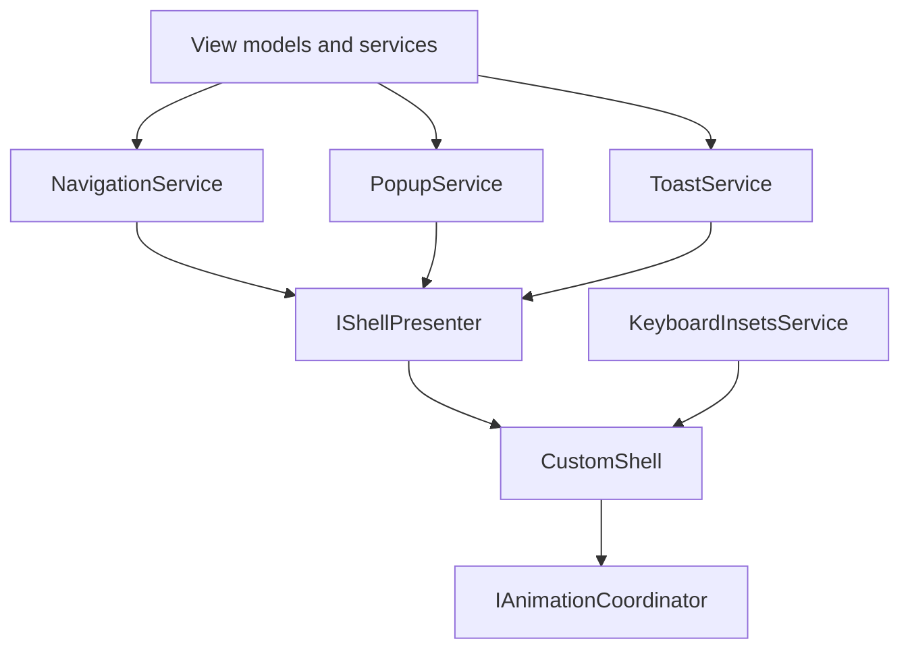
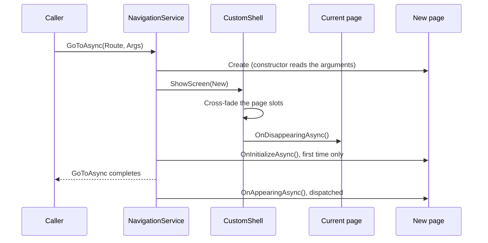
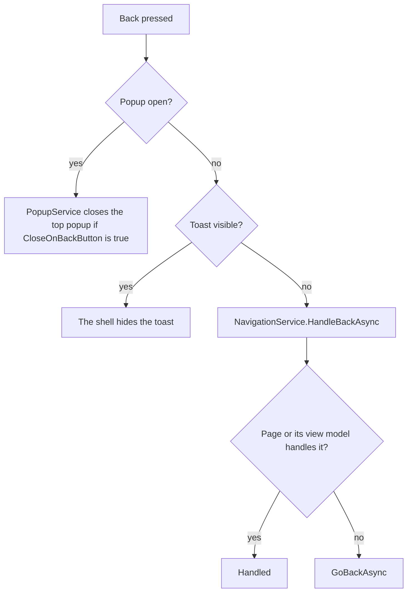

# Navigation and presentation

This guide explains how Neuro-Access shows pages, popups and toasts, how back presses are handled, and how pages get out of the way of the safe areas and the keyboard. Read it before you add a page or a popup, navigate from a view model or service, or change how anything is presented on screen.

- [How the presentation layer fits together](#how-the-presentation-layer-fits-together)
- [Adding a page](#adding-a-page)
- [Navigating between pages](#navigating-between-pages)
- [Page lifecycle](#page-lifecycle)
- [Back handling](#back-handling)
- [Popups](#popups)
- [Toasts](#toasts)
- [Top and bottom bars](#top-and-bottom-bars)
- [Safe areas and the keyboard](#safe-areas-and-the-keyboard)
- [Pitfalls](#pitfalls)
- [Known issues](#known-issues)

## How the presentation layer fits together

The app does not use MAUI `Shell` or `NavigationPage`. The window's root page is [`CustomShell`](../NeuroAccessMaui/Services/UI/CustomShell.cs), a `ContentPage` that implements [`IShellPresenter`](../NeuroAccessMaui/Services/UI/IShellPresenter.cs). It hosts every screen of the app in one layout. A "page" in this app is a [`BaseContentPage`](../NeuroAccessMaui/UI/Pages/BaseContentPage.cs), which derives from `ContentView`, not from `Page`.

Three services decide what is shown, and `CustomShell` draws it:

| Component | Role |
| --- | --- |
| [`NavigationService`](../NeuroAccessMaui/Services/UI/NavigationService.cs) (`ServiceRef.NavigationService`) | Keeps the stack of pages and their navigation arguments, runs page lifecycle callbacks and handles back presses. |
| [`PopupService`](../NeuroAccessMaui/Services/UI/Popups/PopupService.cs) (`ServiceRef.PopupService`) | Keeps a stack of popups, creates them from dependency injection, applies [`PopupOptions`](../NeuroAccessMaui/Services/UI/Popups/PopupOptions.cs) and returns popup results. |
| [`ToastService`](../NeuroAccessMaui/Services/UI/Toasts/ToastService.cs) (`ServiceRef.ToastService`) | Shows one toast at a time and hides it after a delay. |
| [`CustomShell`](../NeuroAccessMaui/Services/UI/CustomShell.cs) | The visual host. Plays transitions through the [animation system](animations.md), applies safe-area and keyboard insets, and routes the hardware back button. |
| [`IShellPresenter`](../NeuroAccessMaui/Services/UI/IShellPresenter.cs) | The contract between the services and the host: `ShowScreen`, `ShowPopup`, `HidePopup`, `ShowToast`, `HideToast`, `UpdateBars`, and the `PopupBackgroundTapped` and `PopupBackRequested` events. |
| [`UiPageResolver`](../NeuroAccessMaui/Services/UI/UiPageResolver.cs) | Finds the presenter from the current window. The services use it instead of the obsolete `Application.MainPage`. |



`CustomShell` stacks these layers in one grid, from back to front:

1. A top bar row, two page slots that take turns holding the current page (so the old and new page can cross-fade), and a bottom bar row.
2. The popup overlay: a black backdrop whose opacity follows the top popup, and a host that holds the popup views.
3. The toast layer, with a row at the top and a row at the bottom.

Always go through the services. Never set `Window.Page`, push a MAUI page, or call the presenter directly. Each service runs its work through its own queue on the main thread, one operation at a time, so overlapping transitions cannot happen and the services can be called from any thread.

### Startup

`App.CreateWindow` resolves `CustomShell` from dependency injection, where it is a singleton (a `BootstrapErrorPage` takes its place if startup failed). The shell shows [`LoadingPage`](../NeuroAccessMaui/UI/Pages/Startup/LoadingPage.xaml.cs) directly, outside the navigation stack. When services are ready, `LoadingPage` calls `SetRootAsync` with `OnboardingPage` or `MainPage`. Until that first call, `ServiceRef.NavigationService.CurrentPage` is `null`.

## Adding a page

Pages live in `NeuroAccessMaui/UI/Pages/<Area>/<Feature>/`, with the XAML, code-behind, view model and navigation arguments side by side (see [AGENTS.md](../AGENTS.md)).

1. Create the page with `base:BaseContentPage` as the XAML root, and a view model that derives from [`BaseViewModel`](../NeuroAccessMaui/UI/Pages/BaseViewModel.cs).
2. If the page takes input, add a class that derives from [`NavigationArgs`](../NeuroAccessMaui/Services/UI/NavigationArgs.cs). It needs a public parameterless constructor, because the navigation methods have a `new()` constraint.
3. In the page constructor, read the arguments and set the view model, as in [`CalculatorPage`](../NeuroAccessMaui/UI/Pages/Main/Calculator/CalculatorPage.xaml.cs):

   ```csharp
   public CalculatorPage()
   {
   	this.ContentPageModel = new CalculatorViewModel(ServiceRef.NavigationService.PopLatestArgs<CalculatorNavigationArgs>());
   	this.InitializeComponent();
   }
   ```

4. Register the route in `App.RegisterRoutes` in [`App.xaml.cs`](../NeuroAccessMaui/App.xaml.cs). The route is always the class name:

   ```csharp
   Routing.RegisterRoute(nameof(CalculatorPage), typeof(CalculatorPage));
   ```

5. Register the page and its view model in `RegisterPages` in [`PageAppExtension`](../NeuroAccessMaui/UI/PageAppExtension.cs):

   ```csharp
   Builder.Services.AddTransient<CalculatorPage, CalculatorViewModel>();
   ```

`NavigationService` creates pages with `Routing.GetOrCreateContent(Route, ServiceRef.Provider)`, so a page that takes its view model as a constructor parameter (like [`MainPage`](../NeuroAccessMaui/UI/Pages/Main/MainPage.xaml.cs)) gets it from the container. A route that was never registered makes the navigation call throw an `InvalidOperationException`.

## Navigating between pages

### The navigation API

All methods are on [`INavigationService`](../NeuroAccessMaui/Services/UI/INavigationService.cs):

| Member | What it does |
| --- | --- |
| `GoToAsync(string Route)` | Pushes the page for the route, with default arguments. |
| `GoToAsync(string Route, BackMethod BackMethod, string? UniqueId = null)` | The same, with a back method. |
| `GoToAsync<TArgs>(string Route, TArgs? Args)` | Pushes the page with navigation arguments. |
| `GoToAsync<TArgs>(string Route, TArgs? Args, BackMethod BackMethod, string? UniqueId = null)` | The same, with a back method. |
| `GoToAsync(BaseContentPage Page)` | Pushes a page instance you created yourself. No arguments are stored. |
| `SetRootAsync(string Route)`, `SetRootAsync<TArgs>(string Route, TArgs? Args)`, `SetRootAsync(BaseContentPage Page)` | Replaces the whole stack with one page. Back cannot return to the removed pages. |
| `GoBackAsync()` | Goes back as far as the current page's back method says. Does nothing on the root page. |
| `PopToRootAsync()` | Removes every page above the root. |
| `CurrentPage` | The page on top of the stack, or `null` before the first `SetRootAsync`. |
| `PopLatestArgs<TArgs>()` | Returns the arguments of the latest navigation and clears them. |

Every navigation uses the cross-fade page transition. The `Animated` property on `NavigationArgs` and the slide values of `TransitionType` are not used by `NavigationService`.

### Go to a page with arguments

This command opens the calculator for one of the view model's properties, as [`BuyEDalerViewModel`](../NeuroAccessMaui/UI/Pages/Wallet/BuyEDaler/BuyEDalerViewModel.cs) does:

```csharp
[RelayCommand]
private async Task OpenCalculatorAsync()
{
	try
	{
		CalculatorNavigationArgs Args = new(this, nameof(this.AmountText));
		await ServiceRef.NavigationService.GoToAsync(nameof(CalculatorPage), Args, BackMethod.Pop);
	}
	catch (Exception Ex)
	{
		ServiceRef.LogService.LogException(Ex);
		await ServiceRef.UiService.DisplayException(Ex);
	}
}
```

A navigation arguments class is a plain class with read-only properties and a parameterless constructor:

```csharp
using NeuroAccessMaui.Services.UI;

namespace NeuroAccessMaui.UI.Pages.Wallet.Receipt
{
	/// <summary>
	/// Navigation arguments for the receipt page.
	/// </summary>
	public class ReceiptNavigationArgs : NavigationArgs
	{
		/// <summary>
		/// Creates empty arguments, as required by the navigation service.
		/// </summary>
		public ReceiptNavigationArgs()
			: this(null)
		{
		}

		/// <summary>
		/// Creates arguments for a transaction.
		/// </summary>
		/// <param name="TransactionId">ID of the transaction to show.</param>
		public ReceiptNavigationArgs(string? TransactionId)
		{
			this.TransactionId = TransactionId;
		}

		/// <summary>
		/// ID of the transaction to show.
		/// </summary>
		public string? TransactionId { get; }
	}
}
```

How the arguments reach the page:

- `GoToAsync` stores the arguments as the latest arguments before it creates the page, so `PopLatestArgs<TArgs>()` in the page or view model constructor returns them. Call it once: it clears what it returns.
- It returns `null` when the page was opened without arguments of that type, for example with plain `GoToAsync(Route)`. Pages must cope with that.
- A `UniqueId` passed to `GoToAsync` ends up in `Args.UniqueId`, so a page can tell which instance it is. [`ChatViewModel`](../NeuroAccessMaui/UI/Pages/Contacts/Chat/ChatViewModel.cs) reads it this way.

### Wait for a page, or get a result back

`GoToAsync` completes when the transition has finished. The new page's `OnInitializeAsync` may still be running, and `OnAppearingAsync` runs after that. To wait until the page has appeared, await `Args.GetNavigationCompletionTask()` on the arguments you passed. It completes for the route-based `GoToAsync` and `SetRootAsync<TArgs>` overloads.

There is no built-in "page result". The pattern in the app is to put a `TaskCompletionSource` on the arguments, await it after navigating, and let the page's view model set it before it goes back. [`QrService`](../NeuroAccessMaui/Services/UI/QR/QrService.cs) does this with [`ScanQrCodeNavigationArgs.QrCodeScanned`](../NeuroAccessMaui/UI/Pages/Main/QR/ScanQrCodeNavigationArgs.cs), and [`VerifyCodeViewModel`](../NeuroAccessMaui/UI/Pages/Main/VerifyCode/VerifyCodeViewModel.cs) sets its result when the page closes. For a short choice, a popup that returns a value is usually simpler (see [Show a popup and await its result](#show-a-popup-and-await-its-result)).

### Back methods

The [`BackMethod`](../NeuroAccessMaui/Services/UI/BackMethod.cs) passed to `GoToAsync` decides how many pages a later back press from the new page removes:

| Value | Back from the new page |
| --- | --- |
| `Inherited` (default) | Uses the back method of the nearest earlier page that set one, or `Pop` if none did. |
| `Pop` | Removes the new page. |
| `Pop2` | Removes the new page and the one below it. |
| `Pop3` | Removes three pages. |
| `CurrentPage` | Meant to return to the page that started the flow, also from later pages opened with `Inherited`. Today it behaves like `Pop` (see [Known issues](#known-issues)). |
| `PopToRoot` | Not handled. Behaves like `Pop`. Call `PopToRootAsync` instead. |

For example, after a contract has been created, [`NewContractViewModel`](../NeuroAccessMaui/UI/Pages/Contracts/NewContract/NewContractViewModel.cs) opens the contract with `BackMethod.Pop3`, so back from the contract skips the creation pages.

## Page lifecycle

`BaseContentPage` implements [`ILifeCycleView`](../NeuroAccessMaui/UI/Pages/ILifeCycleView.cs). The services call these methods instead of the MAUI `OnAppearing` and `OnDisappearing` methods:

| Method | When | What `BaseContentPage` does |
| --- | --- | --- |
| `OnInitializeAsync` | Once, the first time the page is shown | Forwards to the view model. |
| `OnAppearingAsync` | Each time the page becomes the visible page, including after back | Calls the view model's `OnAppearingAsync`, then `RestoreState`, then raises `OnBeforeAppearing`. |
| `OnDisappearingAsync` | Each time it stops being the visible page | Calls `SaveState`, then the view model's `OnDisappearingAsync`, then raises `OnAfterDisappearing`. |
| `OnDisposeAsync` | Once, when the page is removed from the stack | Forwards to the view model. The page is then disposed if it implements `IDisposable` or `IAsyncDisposable`. |

`BaseViewModel` passes each call on to its child view models (see `AddChildViewModel`). Override the view model methods for state and subscriptions, and the page methods only for visual work.

When you go to a page:



When you go back, the target page gets `OnAppearingAsync` again (not `OnInitializeAsync`), the page you leave gets `OnDisappearingAsync`, and after the transition every removed page gets `OnDisposeAsync` and is disposed. `SetRootAsync` and `PopToRootAsync` clean up the removed pages the same way.

Pages are created again on every navigation (they are registered as transient), so do not keep state in a page instance between visits. Use the view model's `SaveState` and `RestoreState`, or a service.

## Back handling

### Software back

Bind the back button in a page header to `GoBackCommand`, which `BaseViewModel` generates from its virtual `GoBack` method:

```xml
<controls:SvgButton
	Command="{Binding GoBackCommand}" />
```

From code, call `await ServiceRef.NavigationService.GoBackAsync();`.

### Hardware back

On Android, `CustomShell.OnBackButtonPressed` routes the press:



`HandleBackAsync` first asks the page, then its view model, if they implement [`IBackButtonHandler`](../NeuroAccessMaui/Services/UI/IBackButtonHandler.cs). Every `BaseViewModel` does: it runs `GoBackCommand` and returns `true`. So a hardware back press and a software back button both end in the view model's `GoBack` method. Presses that arrive while a navigation is running are ignored.

The shell always consumes the press. On the root page nothing happens, and the app does not close or move to the background.

### Customizing back

Override `GoBack` in the view model. That covers both kinds of back. [`SettingsViewModel`](../NeuroAccessMaui/UI/Pages/Main/Settings/SettingsViewModel.cs) restarts the app instead when a setting needs it:

```csharp
/// <inheritdoc/>
public override async Task GoBack()
{
	if (this.RestartNeeded)
		await App.StopAsync();
	else
		await base.GoBack();
}
```

[`OnboardingViewModel`](../NeuroAccessMaui/UI/Pages/Onboarding/OnboardingViewModel.cs) uses the same override to step back between onboarding steps. Prefer this over implementing `IBackButtonHandler` on a page, because the handler runs inside the navigation queue (see [Pitfalls](#pitfalls)).

## Popups

### Building blocks

| Type | Role |
| --- | --- |
| [`BasePopupView`](../NeuroAccessMaui/UI/Popups/BasePopupView.cs) | A full-screen surface that places its `PopupContent` by `Placement`, `AnchorPoint`, `PopupMargin` and `PopupPadding`, and raises `BackgroundTapped` for taps outside the content. Implements `ILifeCycleView`. |
| [`BasicPopup`](../NeuroAccessMaui/UI/Popups/BasicPopup.cs) | A `BasePopupView` with a card (`Border` with the `PopupBorder` style). Its XAML content goes in the card. `CardWidthFraction` (default 0.875) and `CardMaxHeightFraction` (default 0.8) size it. |
| [`BasePopup`](../NeuroAccessMaui/UI/Popups/BasePopup.cs) | A `BasicPopup` kept from the move away from Mopups. It only adds `CustomContent` as another name for the card content. All popups in the app use it. |
| [`BasePopupViewModel`](../NeuroAccessMaui/UI/Popups/BasePopupViewModel.cs) | Base view model. `OnPopAsync` runs when the popup is dismissed for any reason, and the `Popped` task completes after it. |
| [`ReturningPopupViewModel<TReturn>`](../NeuroAccessMaui/UI/Popups/ReturningPopupViewModel.cs) | A popup view model with a result. Set it with `TrySetResult`. If the popup closes without a result, the result is `default`. |
| [`PopupOptions`](../NeuroAccessMaui/Services/UI/Popups/PopupOptions.cs) | How a popup is shown and dismissed. |
| [`PopupPlacement`](../NeuroAccessMaui/UI/Popups/PopupPlacement.cs) | `Center`, `Top`, `Bottom`, `Left`, `Right`, `Anchor`, `Fill` and the four corners. |

A minimal popup in XAML, with its content inside the card:

```xml
<base:BasePopup
	x:Class="NeuroAccessMaui.UI.Popups.Receipt.ReceiptPopup"
	x:DataType="viewmodel:ReceiptPopupViewModel"
	xmlns="http://schemas.microsoft.com/dotnet/2021/maui"
	xmlns:x="http://schemas.microsoft.com/winfx/2009/xaml"
	xmlns:l="clr-namespace:NeuroAccessMaui.Services.Localization"
	xmlns:base="clr-namespace:NeuroAccessMaui.UI.Popups"
	xmlns:viewmodel="clr-namespace:NeuroAccessMaui.UI.Popups.Receipt"
	xmlns:controls="clr-namespace:NeuroAccessMaui.UI.Controls">
	<VerticalStackLayout
		Spacing="{DynamicResource MediumSpacing}">
		<Label
			Style="{DynamicResource PageTitleLabel}"
			Text="{l:Localize Confirm}" />
		<controls:TextButton
			Command="{Binding CloseCommand}"
			Style="{DynamicResource FilledTextButton}"
			LabelData="{l:Localize Close}" />
	</VerticalStackLayout>
</base:BasePopup>
```

### Showing a popup

[`IPopupService`](../NeuroAccessMaui/Services/UI/Popups/IPopupService.cs) has these overloads:

| Overload | Creates |
| --- | --- |
| `PushAsync<TPopup>(Options)` | The view from dependency injection. |
| `PushAsync<TPopup, TViewModel>(Options)` | The view and the view model from dependency injection. |
| `PushAsync<TPopup, TViewModel>(ViewModel, Options)` | The view from dependency injection, bound to your view model. |
| `PushAsync<TPopup, TViewModel, TReturn>(Options)` and `PushAsync<TPopup, TViewModel, TReturn>(ViewModel, Options)` | The same, for a `ReturningPopupViewModel<TReturn>`. Returns the result. |
| `PushAsync(ContentView Popup, Options)` | Nothing. Shows the instance you pass. |

Types that the service resolves must be registered in `RegisterPages` in [`PageAppExtension`](../NeuroAccessMaui/UI/PageAppExtension.cs), under the popups section.

The overloads without a result complete when the popup is closed, not when it is shown. If you do not want to wait, discard the task on purpose: `_ = ServiceRef.PopupService.PushAsync(Popup);`. The overloads with a result complete as soon as the view model sets its result, which is usually just before it pops.

To close the top popup, call `PopAsync`. When a popup closes itself after asynchronous work, call `PopIfTopAsync(this)` from its view model instead, so it never closes another popup that was pushed on top in the meantime. `HasOpenPopups` and the `PopupStackChanged` event tell you whether any popup is open.

### Show a popup and await its result

The view model derives from `ReturningPopupViewModel<TReturn>`, sets the result, then pops. A static helper keeps the call site short. This is trimmed from [`SigningBlockersViewModel`](../NeuroAccessMaui/UI/Pages/Contracts/SigningBlockers/SigningBlockersViewModel.cs):

```csharp
public partial class SigningBlockersViewModel : ReturningPopupViewModel<bool>
{
	/// <summary>
	/// Shows the sheet, and waits until the user closes it or chooses an action.
	/// </summary>
	/// <param name="Blockers">What stops the user from signing.</param>
	/// <returns>True if the user chose an action.</returns>
	public static async Task<bool> ShowAsync(IEnumerable<ContractSigningBlocker> Blockers)
	{
		SigningBlockersViewModel ViewModel = new(Blockers);
		return await ServiceRef.PopupService.PushAsync<SigningBlockersPopup, SigningBlockersViewModel, bool>(ViewModel);
	}

	[RelayCommand]
	private async Task CloseAsync()
	{
		this.TrySetResult(false);
		await ServiceRef.PopupService.PopAsync();
	}
}
```

The caller then writes `bool ActionChosen = await SigningBlockersViewModel.ShowAsync(Blockers);`. If the user dismisses the popup with the back button or a background tap, the result is `default`, which is `false` here. Override `OnPopAsync` if a dismissal needs another result. Setting the result does not close the popup by itself.

### Popup options

| Option | Default | Effect |
| --- | --- | --- |
| `ShowTransition` | `Scale` | `None`, `Fade`, `Scale` or `SlideUp`. |
| `HideTransition` | `Fade` | The same values. |
| `OverlayOpacity` | 0.7 | Opacity of the black backdrop, clamped to 0 to 1. |
| `CloseOnBackgroundTap` | `true` | A tap outside the content closes the popup. |
| `DisableBackgroundTap` | `false` | Turns background taps off, whatever `CloseOnBackgroundTap` says. |
| `CloseOnBackButton` | `true` | The hardware back button closes the popup. |
| `IsBlocking` | `false` | See below. |
| `Placement`, `AnchorPoint`, `Margin`, `Padding` | `Center`, none, 0, 0 | Where the content sits. Copied onto the `BasePopupView` when the popup is pushed. |

The service copies `Placement`, `AnchorPoint`, `Margin`, `Padding` and the background tap setting onto every `BasePopupView` when it is pushed, so values set in the popup's XAML or constructor are replaced. Set them in the options:

```csharp
PopupOptions Options = new()
{
	Placement = PopupPlacement.Bottom,
	ShowTransition = PopupTransition.SlideUp,
	HideTransition = PopupTransition.SlideUp
};

await ServiceRef.PopupService.PushAsync(new NoteCommandPopup(ViewModel), Options);
```

`PopupOptions.CreateModal(overlayOpacity, closeOnBackButton)` returns options for a blocking popup. A blocking popup:

- Closes every popup that is already open, blocking or not, before it is shown.
- Never closes on a background tap.
- Gets an overlay opacity of at least 0.3 (lower values become 0.7).
- Still closes on the back button unless `CloseOnBackButton` is `false`.

A popup pushed while a blocking popup is open is stacked on top of it as usual.

### Popup lifecycle

When a popup is pushed, the service calls `OnInitializeAsync` on the view and the view model, shows the popup, then calls `OnAppearingAsync` on both. When it is dismissed (by `PopAsync`, a background tap or the back button), it calls `OnDisappearingAsync` on both, then the view model's `OnPopAsync`, plays the hide transition, then calls `OnDisposeAsync` on both and disposes the view model if it is disposable. Popup view models do not get `RestoreState` and `SaveState`.

### Alerts and prompts

For a plain message or question, use `ServiceRef.UiService.DisplayAlert`, `DisplayPrompt` and `DisplayException` on [`IUiService`](../NeuroAccessMaui/Services/UI/IUiService.cs). They show the platform's own dialog on top of `CustomShell` and do not go through `PopupService`. See [Services](services.md).

## Toasts

A toast is a short message over the current page. Only one is shown at a time. Showing a new toast replaces the current one.

### Show a toast

For a text message, use the `ShowTextAsync` extension in [`ToastServiceExtensions`](../NeuroAccessMaui/Services/UI/Toasts/ToastServiceExtensions.cs). It creates a [`NotificationToastView`](../NeuroAccessMaui/UI/Controls/Toasts/NotificationToastView.xaml.cs) on the main thread, logs errors instead of throwing, and does nothing while no page is shown yet:

```csharp
await ServiceRef.ToastService.ShowTextAsync(ServiceRef.Localizer[nameof(AppResources.TokenCreated)]);
```

The optional second parameter is a `Func<Task>` to run when the user taps the toast. The toast is hidden first.

To show your own view or change the options, call `ShowAsync` on [`IToastService`](../NeuroAccessMaui/Services/UI/Toasts/IToastService.cs). Create the view on the main thread. [`ContractOrchestratorService`](../NeuroAccessMaui/Services/Contracts/ContractOrchestratorService.cs) does this for notification toasts:

```csharp
await ServiceRef.ToastService.ShowAsync(Toast, new ToastOptions()
{
	Duration = TimeSpan.FromSeconds(6)
});
```

| [`ToastOptions`](../NeuroAccessMaui/Services/UI/Toasts/ToastOptions.cs) | Default | Effect |
| --- | --- | --- |
| `ShowTransition`, `HideTransition` | `SlideFromTop` | `Fade`, `SlideFromTop` or `SlideFromBottom`. `SlideFromTop` on a bottom toast slides from the bottom. |
| `Placement` | `Top` | `Top` or `Bottom`. |
| `AutoDismiss` | `true` | Hide the toast after `Duration`. |
| `Duration` | 3 seconds | How long the toast stays. |

`ShowAsync` completes when the toast is shown. `HideAsync` hides it early. `HasActiveToast` and the `ToastChanged` event report the current state. When no popup is open, the hardware back button hides a visible toast instead of going back.

## Top and bottom bars

`CustomShell` has a top bar row above the page and a bottom bar row below it. After each navigation it calls `UpdateBars` for the new page, which reads two attached properties from [`NavigationBars`](../NeuroAccessMaui/Services/UI/CustomShell.cs) (`TopBarVisible` and `NavBarVisible`, both `false` by default) and, if the page implements `IBarContentProvider`, takes the bar content from its `TopBarContent` and `NavBarContent`. The shell pads the top bar with the top safe area and the bottom bar with the bottom safe area.

No page uses these bars today, so both rows stay hidden. Pages draw their own header, usually with a back button bound to `GoBackCommand`. [`MainPage`](../NeuroAccessMaui/UI/Pages/Main/MainPage.xaml) draws its own bottom tab bar: a `TabNavigationHost` selects between the home, wallet and apps views in a `ViewSwitcher`. To open the main page on a given tab, navigate to it with [`MainNavigationArgs`](../NeuroAccessMaui/UI/Pages/Main/MainNavigationArgs.cs) and set `TargetTabKey` (`home`, `wallet` or `apps`) or `TargetTabIndex`. The page reads them in `OnAppearingAsync`.

## Safe areas and the keyboard

`CustomShell` turns off MAUI's own safe-area handling (it sets `SafeAreaEdges` to `None`) and pads the page slot itself. Never hard-code safe-area margins, and do not use MAUI's `SafeAreaEdges` on pages.

### Safe areas

Set the [`SafeArea`](../NeuroAccessMaui/UI/SafeArea.cs) attached properties on the page root. The shell reads them only from the page, not from views inside it.

| `SafeArea.Mode` | Padding |
| --- | --- |
| `Default` (not set) or `All` | All four insets. |
| `Top`, `Bottom`, `TopAndBottom`, `Left`, `Right`, `RightAndLeft` | Only those edges. |
| `Ignore` | None. The page draws under the system bars. |
| `Custom` | The `SafeArea.CustomPadding` value. |

A page that leaves an edge to its own layout can place single elements with [`SafeInsetsExtension`](../NeuroAccessMaui/MarkupExtensions/SafeInsetsExtension.cs), which returns a `Thickness` for the edges you name (`Top`, `Bottom`, `TopAndBottom` (the default), `Left`, `Right`, `RightAndLeft` or `All`):

```xml
<base:BaseContentPage
	x:Class="NeuroAccessMaui.UI.Pages.Kyc.KycProfilePhotoCameraPage"
	xmlns="http://schemas.microsoft.com/dotnet/2021/maui"
	xmlns:x="http://schemas.microsoft.com/winfx/2009/xaml"
	xmlns:ui="clr-namespace:NeuroAccessMaui.UI"
	xmlns:base="clr-namespace:NeuroAccessMaui.UI.Pages"
	xmlns:ext="clr-namespace:NeuroAccessMaui.MarkupExtensions"
	ui:KeyboardInsets.Mode="Ignore"
	ui:SafeArea.Mode="Ignore">
	<Grid>
		<!-- The camera preview fills the whole screen. -->
		<Grid
			VerticalOptions="Start"
			Margin="{ext:SafeInsets Type=Top}" />
	</Grid>
</base:BaseContentPage>
```

`SafeInsetsExtension` reads the insets once, when the XAML loads. The shell's own padding is applied again on every navigation and size change.

### Keyboard insets

[`KeyboardInsetsService`](../NeuroAccessMaui/Services/UI/KeyboardInsetsService.cs) (`ServiceRef.KeyboardInsetsService`) turns the platform's keyboard events into a `KeyboardHeight`, an `IsKeyboardVisible` flag and a `KeyboardInsetChanged` event, raised on the main thread. `CustomShell` listens to it and adds the keyboard height to the bottom padding of the page, the popup overlay and the toast layer, with a short animation. On iOS it first subtracts the bottom safe area, which the reported keyboard height already includes. Tapping outside an entry hides the keyboard.

Set [`KeyboardInsets.Mode`](../NeuroAccessMaui/UI/KeyboardInsets.cs) on the page root to change this for a page:

| `KeyboardInsets.Mode` | Effect |
| --- | --- |
| `Automatic` (default) | The shell adds the keyboard height to the page's bottom padding. |
| `Manual` | The shell does not pad the page. The page handles the keyboard itself. |
| `Ignore` | The shell does not pad the page. |

`Manual` and `Ignore` behave the same in the shell. Use `Manual` to say that the page reacts to the keyboard itself. To react, implement [`IKeyboardInsetAware`](../NeuroAccessMaui/UI/KeyboardInsets.cs) on the page or its view model. The shell calls `OnKeyboardInsetChanged` on the current page and its binding context, on each open popup and its binding context, and on the active toast, whatever the mode. [`KycProcessViewModel`](../NeuroAccessMaui/UI/Pages/Kyc/KycProcessViewModel.cs) uses it to hide its bottom bar while the keyboard is open:

```csharp
/// <inheritdoc/>
public void OnKeyboardInsetChanged(KeyboardInsetChangedEventArgs Args)
{
	bool Visible = Args.IsVisible;
	if (this.isKeyboardVisible == Visible)
		return;

	this.isKeyboardVisible = Visible;
	this.OnPropertyChanged(nameof(this.IsKeyboardVisible));
	this.OnPropertyChanged(nameof(this.ShowBottomBar));
}
```

For a view inside a page that should follow the keyboard on its own, [`KeyboardInsetsPaddingBehavior`](../NeuroAccessMaui/UI/Behaviors/KeyboardInsetsPaddingBehavior.cs) adds the keyboard height to that view's bottom padding. Nothing uses it yet.

Popups and toasts already move above the keyboard, so leave that alone unless you have a clear reason.

## Pitfalls

- **Awaiting the queue from inside the queue.** Some callbacks run inside a service's queue, and that queue cannot start the next operation until the callback returns. Awaiting a navigation from a page's `OnDisappearingAsync` or `OnDisposeAsync`, or from an `IBackButtonHandler` on a page, never completes. The same goes for awaiting a `PopupService` call from a popup's `OnInitializeAsync`, `OnAppearingAsync`, `OnDisappearingAsync`, `OnPopAsync` or `OnDisposeAsync`. Navigating from `OnAppearingAsync` or from a command is fine, as `LoadingPage` does. If you must start work from one of these callbacks, discard the task with `_ =`.
- **Forgetting that `PushAsync` waits for the popup to close.** A command that awaits a popup stays busy until the user closes it.
- **Using the old navigation methods on `IUiService`.** `GoToAsync`, `GoBackAsync`, `PopLatestArgs`, `TryGetArgs` and `CurrentPage` on `IUiService` belong to the earlier MAUI Shell navigation and do not work with `CustomShell`. Use `INavigationService`.
- **Setting popup placement in XAML.** `PopupService` replaces it with the `PopupOptions` values. Pass the options instead.
- **Overlay opacity.** Each popup's options set the backdrop opacity. When the top popup closes, the backdrop fades to the opacity of the popup below it.

## Known issues

These come from reading the code and are worth fixing:

- `NavigationArgs.GetBackRoute` reassigns its local `BackMethod` before the `CurrentPage` case tests it, so `BackMethod.CurrentPage` always returns `..` and behaves like `Pop`. `BackMethod.PopToRoot` has no case and also behaves like `Pop`.
- The popup overlay and the toast layer are padded with the current page's safe area, not the device's. On a page with `SafeArea.Mode="Ignore"`, popups and toasts can sit under the status bar.
- `NoteCommandPopup` sets `Placement="Bottom"` in XAML but is pushed without options, so `PopupService` resets it to `Center`. The same reset replaces the 16 unit margin that `BasicPopup` sets in its constructor with the default of 0.
- When the hardware back button hides a toast, the shell bypasses `ToastService`, so `HasActiveToast` stays `true` and `ToastChanged` is not raised until the auto-dismiss timer runs.
- Some code still uses the MAUI Shell APIs, which fail because the window hosts `CustomShell`: `TokenItem.Clicked` calls `ServiceRef.UiService.GoBackAsync()`, `XmppService` reads `Shell.Current.CurrentState` when a discarded identity is received, and `WalletViewModel.ViewMainPage` calls `Application.Current.MainPage.Navigation.PopToRootAsync()`.
- `IShellPresenter.ShowScreen` defaults to `TransitionType.None`, while `CustomShell.ShowScreen` defaults to `Fade`.

## Related docs

- [Architecture](architecture.md)
- [Services](services.md)
- [Animations](animations.md)
- [Onboarding](onboarding.md)
- [KYC](kyc.md)
- [Notifications](notifications.md)
- [Contributing](contributing.md)
- [AGENTS.md](../AGENTS.md), the code style and app patterns
