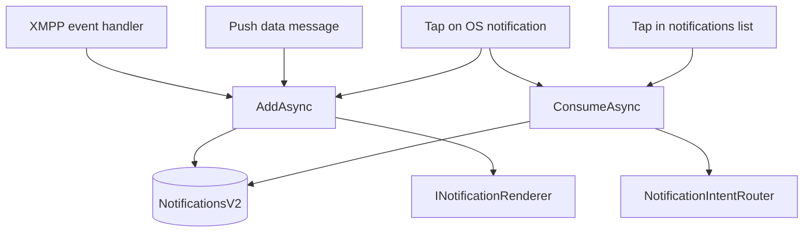
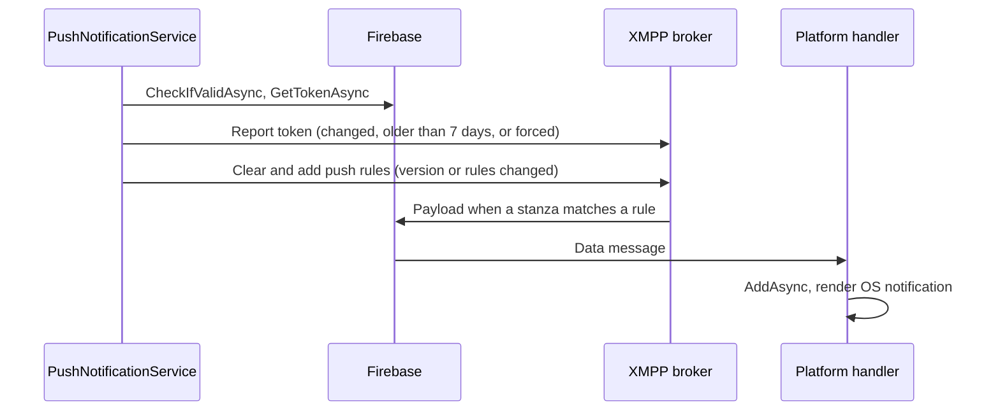

# Notifications

This guide explains how Neuro-Access turns XMPP events and push messages into stored notifications, when it shows an OS notification, and how a tap opens the right page. Read it before you add a notification type or an action, touch the push pipeline, or debug a notification that does not show, merges wrongly or does not navigate.

- [The pieces at a glance](#the-pieces-at-a-glance)
- [The notification model](#the-notification-model)
- [How notifications enter the app](#how-notifications-enter-the-app)
- [Storing, merging and pruning](#storing-merging-and-pruning)
- [Who shows what](#who-shows-what)
- [Taps, actions and routing](#taps-actions-and-routing)
- [The notifications page and other readers](#the-notifications-page-and-other-readers)
- [Push notifications end to end](#push-notifications-end-to-end)
- [Permissions](#permissions)
- [Adding a notification type or an action](#adding-a-notification-type-or-an-action)
- [Troubleshooting](#troubleshooting)
- [Known limitations](#known-limitations)

## The pieces at a glance

| Type | Role |
| --- | --- |
| [`INotificationServiceV2`](../NeuroAccessMaui/Services/Notification/INotificationServiceV2.cs), implemented by [`NotificationServiceV2`](../NeuroAccessMaui/Services/Notification/NotificationServiceV2.cs) | Stores, merges, prunes and consumes notifications. The single entry point for every producer. |
| [`NotificationIntent`](../NeuroAccessMaui/Services/Notification/NotificationIntent.cs) | What a producer hands to the service: text, channel, action and routing data. |
| [`NotificationRecord`](../NeuroAccessMaui/Services/Notification/NotificationRecord.cs) | The stored form, in the `NotificationsV2` collection of the local Waher database. |
| [`INotificationRenderer`](../NeuroAccessMaui/Services/Push/INotificationRenderer.cs) | Shows an OS notification. One implementation per platform. |
| [`NotificationIntentRouter`](../NeuroAccessMaui/Services/Notification/NotificationIntentRouter.cs) | Maps an intent's action to a page and navigates there. |
| [`NotificationFilterRegistry`](../NeuroAccessMaui/Services/Notification/NotificationFilterRegistry.cs) | Runtime ignore rules that can skip storing, rendering or routing. |
| [`PushNotificationService`](../NeuroAccessMaui/Services/Push/PushNotificationService.cs) | Gets the Firebase token, reports it to the broker and registers the push rules. |
| [`PushRuleDefinitions`](../NeuroAccessMaui/Services/Push/PushRuleDefinition.cs) | The rules the broker uses to turn XMPP stanzas into push payloads. |

All of these are singletons registered in `RegisterTypes` in [`PageAppExtension`](../NeuroAccessMaui/UI/PageAppExtension.cs). `INotificationServiceV2` has no `ServiceRef` property. Inject it in the constructor, as [`NotificationsViewModel`](../NeuroAccessMaui/UI/Pages/Notifications/NotificationsViewModel.cs) does, or resolve it with `ServiceRef.Provider.GetRequiredService<INotificationServiceV2>()`.

`ServiceRef.NotificationService` is a different, older service ([`NotificationService`](../NeuroAccessMaui/Services/Notification/NotificationService.cs) with `NotificationEvent` classes). Nothing creates new events in it any more, but some contact, thing and wallet views still read the events it stored in earlier versions. Do not use it for new work.

## The notification model

### Intents

A producer describes an event as a `NotificationIntent`:

| Property | Meaning |
| --- | --- |
| `Channel` | One of the constants in `Constants.PushChannels` in [`Constants.cs`](../NeuroAccessMaui/Constants.cs). Groups notifications, picks the Android channel and the list icon. |
| `Title`, `Body` | Localized, user-facing text. |
| `Action` | A [`NotificationAction`](../NeuroAccessMaui/Services/Notification/NotificationAction.cs) that says what a tap opens. Defaults to `Unknown`, which opens nothing. |
| `EntityId` | The main routing value, such as a JID, a contract ID or a token ID. |
| `CorrelationId` | A stable ID for the logical event. Records are merged by it, so the XMPP producer and the push rule for the same event must set the same value. |
| `Extras` | String key/value pairs with any further routing or display data. |
| `Presentation` | Whether to store, render, both or neither. Defaults to `StoreOnly`. |
| `Version` | Schema version, stored as `SchemaVersion`. Currently always 1. |
| `DeepLink` | Defined but not used anywhere. |

### Channels

| Constant | Value | Used for |
| --- | --- | --- |
| `Messages` | `Messages` | Chat messages |
| `Petitions` | `Petitions` | Requests to see an identity, sign data or see a contract |
| `Identities` | `Identities` | Changes to the user's legal identity |
| `Contracts` | `Contracts` | Contract invitations, signatures, updates, deletions and access answers |
| `EDaler` | `eDaler` | Wallet balance changes |
| `Tokens` | `Tokens` | Neuro-Feature tokens added, removed or changing state |
| `Provisioning` | `Provisioning` | Requests for presence, read or control access to things |

### Presentation

| Value | Stored | Rendered as an OS notification |
| --- | --- | --- |
| `StoreOnly` (default) | Yes | No |
| `RenderAndStore` | Yes | Yes |
| `RenderOnly` | No | Yes |
| `Transient` | No | No |

`AddAsync` calls the renderer itself when the presentation allows it, so a producer never calls `INotificationRenderer` directly. Every XMPP producer in the app uses `StoreOnly`. The push handlers use `RenderAndStore`, or `StoreOnly` when the payload is marked silent.

### States

[`NotificationState`](../NeuroAccessMaui/Services/Notification/NotificationState.cs) has four values:

| State | Set when |
| --- | --- |
| `New` | A repeated event is merged into an existing record. |
| `Delivered` | A new record is inserted. |
| `Read` | `MarkReadAsync` is called, unless the record is already `Read` or `Consumed`. |
| `Consumed` | `ConsumeAsync` or `MarkConsumedAsync` is called. This also resets `OccurrenceCount` to 1. |

The UI treats `New` and `Delivered` alike as unread. Because a merge sets the state back to `New` and clears `ReadAt` and `ConsumedAt`, a repeated event makes a handled record unread again.

### Sources

[`NotificationSource`](../NeuroAccessMaui/Services/Notification/NotificationSource.cs) is `Xmpp`, `Push` or `Local`. It is stored on the record, shown nowhere in the UI, and is part of the record ID. Nothing uses `Local` today.

## How notifications enter the app

Notifications reach `AddAsync` from three places: XMPP event handlers while the app is connected, push messages handled by the platform code, and taps on OS notifications. Taps in the in-app list go straight to `ConsumeAsync`.



### XMPP events

These handlers build intents from live XMPP events:

| Event | Producer | Channel | Action | `EntityId` | `CorrelationId` |
| --- | --- | --- | --- | --- | --- |
| Chat message, unless that chat is open | [`XmppService`](../NeuroAccessMaui/Services/Xmpp/XmppService.cs) | `Messages` | `OpenChat` | Sender's bare JID | Sender's bare JID |
| One of the user's identities becomes approved, obsoleted, rejected or compromised | `XmppService` | `Identities` | `OpenIdentity` | Identity ID | Identity ID |
| Request to see an identity | `XmppService` | `Petitions` | `OpenPetition` | Requestor's full JID | Petition ID |
| Request to sign data | `XmppService` | `Petitions` | `OpenPetition` | Requestor's full JID | Petition ID |
| Balance changed | `XmppService` | `EDaler` | `OpenBalance` | Currency | Currency |
| Token added or removed | `XmppService` | `Tokens` | `OpenToken` | Token ID | Token ID |
| Token state changed | `XmppService` | `Tokens` | `OpenToken` | Token ID | Token ID plus `/state` |
| Presence, read or control access request | `XmppService` | `Provisioning` | `OpenPresenceRequest` | Requestor's JID | Request key |
| Contract invitation, signed, updated, deleted, access granted | [`ContractOrchestratorService`](../NeuroAccessMaui/Services/Contracts/ContractOrchestratorService.cs) | `Contracts` | `OpenContract` | Contract ID | Contract ID |
| Request to see a contract | `ContractOrchestratorService` | `Petitions` | `OpenPetition` | Requestor's full JID | Petition ID |

Petition producers put the details the petition pages need into `Extras` (`petitionId`, `requestedIdentityId`, `signatoryId`, `contentToSign`, `contractId`, `requestorIdentityId`, `purpose`). Identity and contract petitions also keep the requestor's identity XML as the raw payload.

### Push messages

A push arrives as an FCM data message. The Android and iOS handlers turn its key/value data into an intent and call `AddAsync` with `NotificationSource.Push`. See [Push notifications end to end](#push-notifications-end-to-end) for the keys they read.

`AddAsync` waits for `App.WaitForCoreAsync` before it touches the database, and so does `ConsumeAsync`. A push or a tap that starts the process is therefore stored once local storage is ready instead of being lost.

### Taps on OS notifications

Both renderers attach the serialized intent to the OS notification. When the user taps a notification, the platform code rebuilds the intent (from that attachment, or on iOS from the push keys of a notification the system showed), calls `AddAsync` so a record exists, computes the record ID with `ComputeId(Intent, NotificationSource.Push)` and calls `ConsumeAsync` with it.

## Storing, merging and pruning

`AddAsync(Intent, Source, RawPayload, CancellationToken)` does the following:

1. Asks the filter registry for a decision, then works out whether to store and whether to render from `Presentation`. `IgnoreStore` turns off storing and `IgnoreRender` turns off rendering.
2. If nothing is to be stored, it renders when allowed, logs "Notification ignored" and returns. Rendering still happens when only `IgnoreStore` was set.
3. Looks for a stored record with the same `CorrelationId`, in any channel.
4. If one exists and has the same `Action`, `EntityId` and `CorrelationId`, it merges: title, body, extras, source and presentation are replaced by the new values, the raw payload is replaced when the new one is not null, `TimestampCreated` is set to now, the state goes back to `New` and `OccurrenceCount` goes up by one. The record keeps its ID. It logs "Notification merged".
5. Otherwise it inserts a new record in the `Delivered` state, logs "Notification stored" and prunes.
6. Raises `OnNotificationAdded`, then renders if allowed.

An intent without a `CorrelationId` never merges. Each one becomes a new record.

### Record IDs

The ID is the hex SHA-256 hash of the channel, action, entity ID, correlation ID, title, body, the extras sorted by key, and the source. `ComputeId` returns this hash, so code that built the same intent can find the record again.

Two cases break that. When a record with the same correlation ID exists but is not merge-compatible, the new record's ID gets a random salt. When an intent is merged, the record keeps the ID of the event that created it, which may have a different source, title or extras. Code that needs to find records for an event after merges should query by channel, action and correlation ID, as `MarkNotificationsConsumedAsync` in `ContractOrchestratorService` does.

### Retention

After each insert, `PruneAsync` keeps at most 100 records per channel and 1000 in total, deleting the oldest by `TimestampCreated` regardless of state. Merges do not prune.

### Filters

A filter is a function from `NotificationIntent` to [`NotificationFilterDecision`](../NeuroAccessMaui/Services/Notification/NotificationFilterDecision.cs), with three flags: `IgnoreRender`, `IgnoreStore` and `IgnoreRoute`. The decisions of all filters are combined with OR. `AddAsync` uses the first two, and the router turns `IgnoreRoute` into `NotificationRouteResult.Ignored`.

Register a filter with `AddIgnoreFilter` and dispose the handle to remove it. Filters run for every intent, so keep them cheap.

```csharp
INotificationServiceV2 NotificationService = ServiceRef.Provider.GetRequiredService<INotificationServiceV2>();

this.identityFilter = NotificationService.AddIgnoreFilter((NotificationIntent Intent) =>
{
	if (!string.Equals(Intent.Channel, Constants.PushChannels.Identities, StringComparison.OrdinalIgnoreCase))
		return NotificationFilterDecision.None;

	if (!string.Equals(Intent.EntityId, this.identityId, StringComparison.OrdinalIgnoreCase))
		return NotificationFilterDecision.None;

	return new NotificationFilterDecision(true, true, true);
});
```

The app registers two filters today, both for the life of the process. `XmppService` ignores notifications about the old identity once a new one is approved, and the account creation step in onboarding ignores those about the identity it is replacing. The check that skips chat notifications while that chat is open is done in `XmppService` itself, not with a filter.

### Waiting for a notification

`WaitForAsync` returns the first record that matches a predicate, looking at stored records of any age first and then waiting up to a timeout for new ones. `ExpectAsync` registers a predicate for a time window and consumes (and so routes) the first matching record. Nothing in the app calls either one yet. An expectation only routes stored records, because `ConsumeAsync` looks the record up by ID.

## Who shows what

| Situation | OS notification | In the app |
| --- | --- | --- |
| XMPP event while the app runs | None, because producers use `StoreOnly`. | The record appears in the list and the Home badge. Contract invitations, requests to see a contract and granted access also show a [`NotificationToastView`](../NeuroAccessMaui/UI/Controls/Toasts/NotificationToastView.xaml.cs) toast for six seconds. Tapping the toast marks the matching records consumed and routes the intent. Requests to see an identity or sign data open their petition page directly when the requestor's identity is known. |
| Data push on Android, any app state | Yes, from [`AndroidNotificationRenderer`](../NeuroAccessMaui/Platforms/Android/Services/Push/AndroidNotificationRenderer.cs), unless the push is silent. | The record is stored. |
| Push on iOS, app in the foreground | No banner. `NotificationDelegate.WillPresentNotification` stores the push and answers with no presentation options, which also hides the local notification `AddAsync` schedules. | The record is stored. |
| Data push on iOS delivered in the background to `DidReceiveRemoteNotification` | `AddAsync` schedules a local notification through [`IosNotificationRenderer`](../NeuroAccessMaui/Platforms/iOS/Services/Push/IosNotificationRenderer.cs), unless the push is silent. | The record is stored. |
| Windows | None. [`DefaultNotificationRenderer`](../NeuroAccessMaui/Services/Push/DefaultNotificationRenderer.cs) does nothing and there is no push. | XMPP records appear as on the other platforms. |

On Android, `MainActivity.OnResume` cancels all of the app's OS notifications, so opening the app clears its entries in the notification shade.

## Taps, actions and routing

`ConsumeAsync(Id, CancellationToken)` marks the record `Consumed`, rebuilds an intent from it and calls `INotificationIntentRouter.RouteAsync` with `FromUserInteraction` set to true. `MarkConsumedAsync` does the same without routing, for code that has already opened the page.

The router returns a [`NotificationRouteResult`](../NeuroAccessMaui/Services/Notification/NotificationRouteResult.cs):

| Result | Meaning |
| --- | --- |
| `Success` | Navigation happened. |
| `NoHandler` | The action is `Unknown`, or required data such as the entity ID is missing. |
| `Failed` | An exception was logged, or the petition is no longer available (the user sees an alert). |
| `Deferred` | No page is showing yet. `ConsumeAsync` queues the intent. |
| `Ignored` | A filter set `IgnoreRoute`. |

A tap that starts the app arrives before any page exists, so it is deferred. [`LoadingPage`](../NeuroAccessMaui/UI/Pages/Startup/LoadingPage.xaml.cs) calls `ProcessPendingAsync` after it has shown `MainPage` for an onboarded user, and `ConsumeAsync` drains the queue itself if a page appeared in the meantime. Routing goes through `ServiceRef.NavigationService`, see [Navigation](navigation.md).

### Routing table

| Action | Opens | Reads |
| --- | --- | --- |
| `OpenChat` | `ChatPage` | `EntityId` as the JID. Looks up the contact for its name and legal ID. |
| `OpenIdentity` | `KycApplicationStatusPage` when a KYC application exists for the identity and is not approved, otherwise `ViewIdentityPage` | `EntityId` as the identity ID, extra `state` |
| `OpenContract` | The contract, through `ContractOrchestratorService.OpenContractAsync`. `MyContractsPage` when there is no ID or the contract cannot be opened. | `EntityId` or extra `contractId`. Extras `kind` set to `invitation`, `role`, `fromJid` and `message` for invitations. |
| `OpenToken` | Token details through `NeuroWalletOrchestratorService.OpenTokenFromNotificationAsync`, or the token list with a message when the token is gone | `EntityId` or extra `tokenId` |
| `OpenBalance` | `MainPage` on the wallet tab | Nothing |
| `OpenPetition` | `PetitionIdentityPage` (extra `requestedIdentityId`), `PetitionSignaturePage` (extras `signatoryId` and `contentToSign`) or `PetitionContractPage` (extra `contractId`). `MyContactsPage` otherwise. | Extras, completed from stored `Petitions` records with the same petition ID, and their raw payload as the requestor's identity |
| `OpenPresenceRequest` | `MyContactsPage` | Nothing |
| `OpenProfile` | `MyContactsPage`, the same as `OpenPresenceRequest` | Nothing |
| `OpenSettings` | `SettingsPage` | Nothing |

A push carries less data than the XMPP stanza, which is why the petition route first looks for a stored XMPP record of the same petition.

## The notifications page and other readers

[`NotificationsPage`](../NeuroAccessMaui/UI/Pages/Notifications/NotificationsPage.xaml) is opened from the bell on Home (`OpenNotificationsCommand` in [`HomeViewModel`](../NeuroAccessMaui/UI/Pages/Main/HomeViewModel.cs)). Home shows the number of unread records and refreshes it on `OnNotificationAdded`.

The page:

- Loads records newest first, 15 at a time, as the user scrolls.
- Filters between all and unread records, and searches the loaded records by title, body and channel.
- Shows a channel icon from [`NotificationChannelToSvgConverter`](../NeuroAccessMaui/UI/Pages/Notifications/NotificationChannelToSvgConverter.cs) and a count when the same event arrived more than once.
- Opens a record with `ConsumeAsync`, and offers mark as read, delete and clear all. Clear all deletes the records currently listed.
- Reloads on `OnNotificationAdded` while it is visible.

Other features read notification records as data, so a change to a producer's channel, action, correlation ID or extras can break them:

- [`TokenUnreadTracker`](../NeuroAccessMaui/Services/Wallet/Tokens/TokenUnreadTracker.cs) counts unread `Tokens` records per token ID and marks them read when the token's details are opened.
- `MyContractsViewModel` lists unanswered requests to see a contract from `Petitions` records that have a `contractId` extra.
- `ContractOrchestratorService` marks petition records consumed when it opens a petition page or the user answers a request to see a contract, and deletes a contract's records when the user declines the invitation.

Reading records looks like this:

```csharp
INotificationServiceV2 NotificationService = ServiceRef.Provider.GetRequiredService<INotificationServiceV2>();
IReadOnlyList<NotificationRecord> Unread = await NotificationService.GetAsync(new NotificationQuery()
{
	Channels = [Constants.PushChannels.Tokens],
	States = [NotificationState.New, NotificationState.Delivered]
}, CancellationToken.None);
```

`OnNotificationAdded` is the only event. It is raised when a record is inserted, merged, marked read, consumed or deleted, and the arguments do not say which.

## Push notifications end to end



### Firebase setup

Push uses Firebase Cloud Messaging through Plugin.Firebase. The config files are not in the repository:

| File | Platform | Location |
| --- | --- | --- |
| `google-services.json` | Android | `NeuroAccessMaui/`, next to the `.csproj` |
| `GoogleService-Info.plist` | iOS | `NeuroAccessMaui/`, next to the `.csproj` |

[`NeuroAccessMaui.csproj`](../NeuroAccessMaui/NeuroAccessMaui.csproj) includes each file only when it exists, as a `GoogleServicesJson` item for Android and a `BundleResource` for iOS. Both are git-ignored and must never be committed (see [AGENTS.md](../AGENTS.md)). Without them the app builds, but it gets no push token, so it receives no push.

`MauiProgram` calls `Builder.RegisterFirebaseServices()` from [`FirebaseAppExtension`](../NeuroAccessMaui/Services/Push/FirebaseAppExtension.cs). On iOS it calls `CrossFirebase.Initialize()` in `WillFinishLaunching` and sets `NotificationDelegate` as the `UNUserNotificationCenter` delegate, ignoring the error when the plist is missing. On Android it calls `CrossFirebase.Initialize(activity)` when the activity is created.

The broker sends the pushes, so it needs server credentials for the same Firebase project. That is configured on the broker, not in this repository.

### Broker support

`XmppService` checks with service discovery whether the broker supports push (`PushNotificationClient.MessagePushNamespace`), stores the answer in `TagProfile.SupportsPushNotification`, and creates a `PushNotificationClient` only when it does. `IXmppService.SupportsPushNotification` is true when that client exists. Without it, no token is reported and no rules are registered.

### Token acquisition and reporting

`PushNotificationService` is loaded during process start. It subscribes to `App.AppActivated` (Android resume, iOS and Windows activation) and to the token-changed event of [`FirebasePushTransport`](../NeuroAccessMaui/Services/Push/FirebasePushTransport.cs), which wraps `CrossFirebaseCloudMessaging.Current.TokenChanged` on Android and iOS. Load, activation and token changes all call `CheckPushNotificationToken`, which:

1. Waits up to 10 seconds for the XMPP connection.
2. Continues only if the client is online, the broker supports push, and the last check in this process was at least an hour ago.
3. Gets the token from `IPlatformSpecific.GetPushNotificationToken`, unless the token-changed event supplied it. On Android and iOS this calls `CheckIfValidAsync` and `GetTokenAsync` on `CrossFirebaseCloudMessaging.Current`, logs any error and returns an empty token on failure. An empty token ends the check.
4. Hands the token to [`PushTokenRegistrar`](../NeuroAccessMaui/Services/Push/PushTokenRegistrar.cs). It reports the token when forced, when the token differs from the one stored in `RuntimeSettings`, or when the last report is more than 7 days old. It makes up to 3 attempts with exponential back-off, and stores the token and report date after a successful report.
5. Re-registers the rules when the app version and build, or the rule-set hash, differ from what was stored after the last registration. The report in step 4 is forced in that case.

The settings involved are `PUSH.TOKEN`, `PUSH.REPORT_DATE`, `PUSH.CONFIG_VERSION` and `PUSH.RULES_HASH`, named in `Constants.Settings`. The client type reported is `ClientType.Android` or `ClientType.iOS`, with `PushMessagingService.Firebase`.

### Push rules

Each `PushRuleDefinition` names a message type, a stanza element and namespace, a channel and a content script. The broker runs the script on matching stanzas and sends the result as a push. Re-registration clears all rules on the broker and adds every rule in `PushRuleDefinitions.All`.

| Stanza element | Channel | Action | Correlation ID |
| --- | --- | --- | --- |
| Any chat message | `Messages` | `OpenChat` | Sender (`from`) |
| `petitionIdentityMsg` | `Petitions` | `OpenPetition` | Petition ID |
| `petitionContractMsg` | `Petitions` | `OpenPetition` | Petition ID |
| `petitionSignatureMsg` | `Petitions` | `OpenProfile` | The element's `petitionId` attribute |
| `identity`, for the states Approved, Obsoleted, Rejected and Compromised | `Identities` | `OpenIdentity` | Identity ID |
| `contractCreated`, `contractSigned`, `contractUpdated`, `contractDeleted`, `contractProposal` | `Contracts` | `OpenContract` | Contract ID |
| `balance` | `EDaler` | `OpenBalance` | Currency |
| `tokenAdded`, `tokenRemoved` | `Tokens` | `OpenToken` | Token ID |
| `isFriend`, `canRead`, `canControl` | `Provisioning` | `OpenPresenceRequest` | None |

A content script returns an object with `payloadKind` set to `PushNotificationPayload`, `payloadVersion`, `visual` (title and body), `action` (type, entity ID, correlation ID), `channel`, `delivery` (priority and an optional `silent` flag), `context` and `data`. A shortened rule looks like this:

```csharp
Definitions.Add(new PushRuleDefinition(
	MessageType.Normal,
	"balance",
	EDalerClient.NamespaceEDaler,
	Constants.PushChannels.EDaler,
	"Stanza",
	string.Empty,
	Script(
		"E:=GetElement(Stanza,'balance');",
		$"TitleText:='{NotificationBalanceUpdatedTitle}';",
		$"BodyText:='{NotificationBalanceUpdatedBody}';",
		"{",
		"'payloadKind': 'PushNotificationPayload',",
		"'payloadVersion': 1,",
		"'visual': { 'title': TitleText, 'body': BodyText },",
		$"'action': {{ 'type': '{NotificationAction.OpenBalance}', 'entityId': GetAttribute(E,'currency'), 'correlationId': GetAttribute(E,'currency') }},",
		$"'channel': {{ 'channelId': '{Constants.PushChannels.EDaler}' }},",
		"'delivery': { 'priority': 'High' },",
		"'data': { 'currency': GetAttribute(E,'currency') }",
		"}")));
```

Titles and bodies are localized with `ServiceRef.Localizer` and baked into the scripts when `PushRuleDefinitions` is first used. The rule-set hash covers the scripts, so the rules are registered again in the new language the next time the process starts after a language change.

### Payload keys on the device

The broker turns the rule's payload into FCM data. Comments in the handlers say it sends `data` and `context` entries as top-level keys and names the action `actionType`. That mapping happens on the broker. The handlers read these keys:

| Key | Becomes |
| --- | --- |
| `myTitle` | `Title` |
| `myBody` | `Body` |
| `channelId` | `Channel`. Android falls back to `Messages`; iOS ignores a push without it. |
| `action` or `actionType` | `Action`, parsed by enum name |
| `entityId` | `EntityId` |
| `correlationId` | `CorrelationId` |
| `silent` or `delivery.silent` | `StoreOnly` presentation when the value is `1`, `true` or `yes` |
| `notificationIntent` | A serialized `NotificationIntent` that replaces all of the above. Set by the app's own renderers; read by the iOS parser and by `MainActivity`. |

When there is no `notificationIntent`, every key is also copied into `Extras`. The whole data set is stored as the raw payload.

### Android

- `MessagingService` in [`Platforms/Android/PushNotificationService.cs`](../NeuroAccessMaui/Platforms/Android/PushNotificationService.cs) is a `FirebaseMessagingService`. `OnMessageReceived` builds the intent and calls `AddAsync`, which renders it.
- `AndroidNotificationRenderer` posts to the channel named by the intent (or `default`), with the `ic_stat_appiconfg` icon, high priority and a fresh notification ID each time. Its tap intent opens `MainActivity` with the serialized intent in the `notificationIntent` extra.
- `MainActivity.CreateNotificationChannels` creates the `Messages`, `Petitions`, `Identities`, `Contracts`, `eDaler` and `Tokens` channels on Android 8 and later. The renderer creates any other channel, such as `Provisioning`, the first time it is used, with the channel ID as its name.
- `MainActivity.HandleIntent`, called from `OnCreate` and `OnNewIntent`, handles a `notificationIntent` extra with `AddAsync` and `ConsumeAsync`. A launch intent with `gcm.notification.body` (a notification message the system displayed) is stored as a record with title, body and channel only, so it has no action and does not navigate.

### iOS

- `Info.plist` enables the `remote-notification` and `fetch` background modes and sets `FirebaseAppDelegateProxyEnabled` to false, and `Entitlements.plist` sets `aps-environment`.
- Because the proxy is off, [`AppDelegate`](../NeuroAccessMaui/Platforms/iOS/AppDelegate.cs) passes the APNs device token to Firebase in `RegisteredForRemoteNotifications`.
- `AppDelegate.DidReceiveRemoteNotification` passes data pushes to `NotificationDelegate.ProcessSilentNotificationAsync`, which stores them, and calls the completion handler once storing has finished or failed.
- [`NotificationDelegate`](../NeuroAccessMaui/Platforms/iOS/NotificationDelegate.cs) stores foreground notifications in `WillPresentNotification` without showing a banner, and handles taps in `DidReceiveNotificationResponse` by storing and then consuming the notification.
- `IosNotificationRenderer` schedules an immediate local notification with the default sound. Its `UserInfo` holds the same flat keys as a push plus `notificationIntent`.

### Windows

There is no push on Windows. `GetPushNotificationToken` returns an empty token, so the token check stops there, `FirebasePushTransport` subscribes to nothing, and the renderer does nothing. Notifications from XMPP events are still stored and listed.

## Permissions

[`NotificationPermission`](../NeuroAccessMaui/CustomPermissions/NotificationPermission.cs) is a custom MAUI permission:

| Platform | Check | Request |
| --- | --- | --- |
| iOS | `UNUserNotificationCenter` authorization status | Asks for alert, badge and sound. When granted, calls `RegisterForRemoteNotifications`. |
| Android 13 and later | `POST_NOTIFICATIONS` | Requests `Permissions.PostNotifications`. |
| Android 12 and earlier | Always granted | Nothing to ask |
| Windows | Unknown | Nothing to ask |

`PermissionService.CheckNotificationPermissionAsync` in [`PermissionService`](../NeuroAccessMaui/Services/AppPermissions/PermissionService.cs) requests the permission and, when it is not granted, shows `ShowPermissionPopup` explaining how to turn it on before checking again. `HomeViewModel.OnAppearingAsync` calls it the first time Home appears after installation and then sets `Constants.Settings.PushNotificationAsked`, so the app asks only once. After that the user changes it in the system settings.

The app's own `AndroidManifest.xml` does not list `POST_NOTIFICATIONS`. If the permission check reports that it is not declared, add `<uses-permission android:name="android.permission.POST_NOTIFICATIONS" />` to [`AndroidManifest.xml`](../NeuroAccessMaui/Platforms/Android/AndroidManifest.xml).

## Adding a notification type or an action

### A new notification type

1. Pick a channel in `Constants.PushChannels`. For a new channel, add the constant, an Android channel in `MainActivity.CreateNotificationChannels`, and an icon case in `NotificationChannelToSvgConverter`.
2. Pick an action. If none fits, add one (see the next list).
3. Choose the `CorrelationId` that identifies the logical event, and the `EntityId` and extras the route needs. The push rule must produce the same action, entity ID and correlation ID, or the two records will not merge.
4. Add the title and body to `AppResources.resx` and `AppResources.Designer.cs`, as described in [AGENTS.md](../AGENTS.md).
5. Build the intent in the XMPP event handler and call `AddAsync` with `NotificationSource.Xmpp`. Use `StoreOnly`, like the other XMPP producers, unless you mean to show an OS notification while the app runs. Catch and log errors so a notification failure never breaks the event handler:

	```csharp
	NotificationIntent Intent = new()
	{
		Channel = Constants.PushChannels.Contracts,
		Title = ServiceRef.Localizer[nameof(AppResources.NotificationContractWasUpdatedTitle), Name],
		Body = ServiceRef.Localizer[nameof(AppResources.NotificationContractUpdatedBody)],
		Action = NotificationAction.OpenContract,
		EntityId = ContractId,
		CorrelationId = ContractId,
		Presentation = NotificationPresentation.StoreOnly
	};

	Intent.Extras["contractId"] = ContractId;

	try
	{
		INotificationServiceV2 NotificationService = ServiceRef.Provider.GetRequiredService<INotificationServiceV2>();
		await NotificationService.AddAsync(Intent, NotificationSource.Xmpp, null, CancellationToken.None);
	}
	catch (Exception Ex)
	{
		ServiceRef.LogService.LogException(Ex);
	}
	```

6. If the event should reach the user while the app is closed, add a `PushRuleDefinition` in `PushRuleDefinitions.Build`, with localized strings encoded with `JSON.Encode`. The rule-set hash changes, so every installed app registers the new rules on its next token check.
7. Test the event live over XMPP, as a push with the app closed, as a tap on the OS notification and as a tap in the list. Check that the XMPP and push copies end up as one record.

### A new action

1. Add a member to `NotificationAction` with the next unused number. Never rename or renumber existing members: stored records keep the action by name, push rules send it by name, and serialized intents on Android and iOS carry it as a number.
2. Add a case to the switch in `NotificationIntentRouter.RouteAsync` and a handler that navigates with `ServiceRef.NavigationService` and returns a `NotificationRouteResult`. The settings handler is the simplest model:

	```csharp
	private async Task<NotificationRouteResult> RouteSettingsAsync(CancellationToken CancellationToken)
	{
		await ServiceRef.NavigationService.GoToAsync(nameof(SettingsPage));
		return NotificationRouteResult.Success;
	}
	```

3. Return `NoHandler` when required data is missing, and only return `Deferred` when nothing was opened, since a deferred intent is routed again later.
4. Set the action in every producer and push rule for the event.

## Troubleshooting

### No push arrives

- Check that the Firebase config file for the platform is in `NeuroAccessMaui/` and that the build picked it up.
- Look in the log for "Push token reported." or "Push token registration failed after retries.". Neither appears when no report was needed (the same token was reported in the last 7 days), or when the check stopped early: no XMPP connection within 10 seconds, no push support on the broker, an empty token, or a check less than an hour earlier in the same process. Token errors from Firebase are logged as exceptions.
- Check the notification permission in the system settings, and on Android that the channel is not turned off.
- If the rules on the broker may be out of date, a new build number or any change to a rule re-registers them. `PUSH.CONFIG_VERSION` is cleared before registration and set after it, so an interrupted registration is retried on the next check.
- On Windows, push is not supported.

### A notification is stored but no OS notification shows

- XMPP producers use `StoreOnly`, so this is expected while the app is connected.
- The push may be silent, or a filter may have set `IgnoreRender`.
- On iOS, banners are always hidden while the app is in the foreground.

### Two records for one event

- One side has no `CorrelationId`, or the XMPP producer and the push rule use different values.
- The action or entity ID differ. A record with the same correlation ID but a different action or entity ID is stored separately with a salted ID.

### Records merge that should not

Every record with the same correlation ID, action and entity ID is one logical event. Make the correlation ID more specific, as the token state notifications do with the `/state` suffix.

### A tap does not navigate

- The action is `Unknown`, for example on a push without an `action` key, or on the Android fallback for system-displayed notification messages.
- The router has no case for the action, or required data is missing (`NoHandler`).
- A filter set `IgnoreRoute`.
- The tap came during start-up and the user is not onboarded, so the deferred intent is never processed.
- On a tap from an OS notification, `ComputeId` did not match the stored record because it was merged into a record created from a different source.

The service logs every store, merge and ignore with the notification ID, channel, action, entity ID, correlation ID, presentation and source, which is usually enough to see which case applies.

## Known limitations

- There is no push on Windows.
- Old `NotificationEvent` records were not migrated. The legacy service still loads them for some contact, thing and wallet views, and only old token events are deleted, once.
- The service looks records up by correlation ID and by ID with `Database.FindFirstDeleteRest`, which keeps one match and deletes the others. A record stored with a salted ID can be deleted by the next lookup of its correlation ID. Identical intents without a correlation ID are inserted with the same ID, and are collapsed into one the next time that ID is looked up.
- Some push rules do not match their XMPP producers: the provisioning rules set no correlation ID, and the signature petition rule uses `OpenProfile` instead of `OpenPetition`. Their push and XMPP records do not merge.
- Two balance records are stored for each balance change: one by `XmppService` and one, without a correlation ID, by `NeuroWalletOrchestratorService`.
- Tap handlers on both platforms pass the intent to `AddAsync` with its original presentation, so the renderer is called again for the tapped notification.
- The `OpenPresenceRequest` and `OpenProfile` routes navigate and then return `Deferred`, so the intent is queued and `MyContactsPage` is opened a second time.
- The token check runs at most once an hour per process, including when Firebase reports a new token.
- The state labels on the notifications page ("New", "Read", "Opened") and the Android channel names are not localized.
- `ChannelCounts` is not rebuilt from the database at start-up, because nothing calls `NotificationServiceV2.Load`, so it only reflects changes made in the current process. `WaitForAsync`, `ExpectAsync`, `DeepLink`, `NotificationSource.Local`, `RenderOnly` and `Transient` are not used by the app.
- `IPushNotificationService.NewToken`, `OnNewToken` and `TryGetToken`, and the `Show*Notification` methods on `IPlatformSpecific`, are unused leftovers of the earlier push implementation.

## Related docs

- [Architecture](architecture.md)
- [Services](services.md)
- [Navigation](navigation.md)
- [Getting started](getting-started.md)
- [Onboarding](onboarding.md)
- [KYC](kyc.md)
- [Contributing](contributing.md)
- [AGENTS.md](../AGENTS.md), the code style and app patterns
