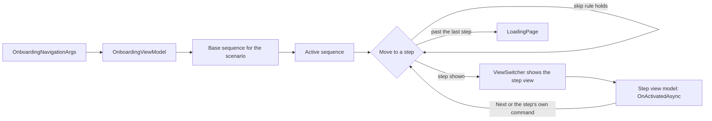

# Onboarding

Onboarding is the flow that takes a new user from a fresh install to a working app: it picks a provider, verifies a phone number and an email address, creates an XMPP account, applies for a basic legal identity, and sets a local password and biometrics. The same flow, with fewer steps, changes the password and verifies the user again after the identity has been revoked or reported as compromised. This guide explains how the flow is built, what each step does, and how to change it.

- [How the flow is built](#how-the-flow-is-built)
- [Scenarios](#scenarios)
- [Steps](#steps)
- [Skip rules](#skip-rules)
- [Invitations and transfers](#invitations-and-transfers)
- [Temporary OTPs and test numbers](#temporary-otps-and-test-numbers)
- [Adding or changing a step](#adding-or-changing-a-step)
- [Debugging](#debugging)
- [Related files](#related-files)

## How the flow is built

[`OnboardingPage`](../NeuroAccessMaui/UI/Pages/Onboarding/OnboardingPage.xaml) is one page with a `ViewSwitcher` that holds one view per step. Each `ViewSwitcherStateView` has a `StateKey` equal to the name of an [`OnboardingStep`](../NeuroAccessMaui/UI/Pages/Onboarding/OnboardingStep.cs) value, and creates its view with `x:FactoryMethod="Create"`, which resolves the view and its view model from dependency injection.

[`OnboardingViewModel`](../NeuroAccessMaui/UI/Pages/Onboarding/OnboardingViewModel.cs) is the coordinator. The page's constructor registers every step view model with it through `RegisterStep`, which also gives each step a reference to the coordinator. Step view models derive from [`BaseOnboardingStepViewModel`](../NeuroAccessMaui/UI/Pages/Onboarding/ViewModels/BaseOnboardingStepViewModel.cs) and step views from [`BaseOnboardingView`](../NeuroAccessMaui/UI/Pages/Onboarding/BaseOnboardingView.cs).

The coordinator reads [`OnboardingNavigationArgs`](../NeuroAccessMaui/UI/Pages/Onboarding/OnboardingNavigationArgs.cs), which carry the `Scenario`, an optional `PendingIntentUri` with an invitation link, and an optional `PreparedInvitation` that has already been read. Without arguments it logs a warning and uses `FullSetup`.



How the coordinator moves:

1. Each scenario has a fixed base sequence (`GetBaseSequence`). `InitializeDescriptors` registers a descriptor per step that says whether the step belongs to the scenario and whether it should be skipped now.
2. `BuildActiveSequence` lists the steps that belong to the scenario, in the order the descriptors were registered. Skipped steps stay in the list. The coordinator rebuilds the list before every move, so it reflects the current profile.
3. `MoveToStepAsync` asks `ResolveStepWithSkipping` for the target. If the target should be skipped, the coordinator walks on in the direction of travel until it finds a step that should not. `Finalize` is never skipped.
4. The coordinator sets `CurrentStep`, which switches the view through `SelectedStateKey`, updates the header title and the back button, and calls the step's `OnActivatedAsync`. The `ViewSwitcher` calls the step's `OnInitializeAsync` the first time it shows the view.
5. The shared Next command calls the current step's `OnNextAsync`, which can return `false` to stay. Many steps instead move on their own with `GoToStepCommand` when their work is done, such as after a code has been verified.
6. When there is no step after the current one, `CompleteOnboardingAsync` shows `Finalize`, waits 300 ms, and sets [`LoadingPage`](../NeuroAccessMaui/UI/Pages/Startup/LoadingPage.xaml.cs) as the root. `LoadingPage` opens the main page when `TagProfile.IsComplete()` is true, that is when the profile has a legal identity and a local password, and opens onboarding again otherwise.

If every step of the scenario except `Finalize` should be skipped when the page opens, the coordinator goes straight to `Finalize` and completes.

The back button is disabled on `DefinePassword`, `Biometrics` and `Finalize`, so a user cannot go back once the password step has started. On other steps, back goes to the previous step that is not skipped.

## Scenarios

| Scenario | Started from | Base sequence | First step |
| --- | --- | --- | --- |
| `FullSetup` | `LoadingPage` when the profile is not complete. An `obinfo:` link. The home page when the identity gate says onboarding is needed. `ContractOrchestratorService` when the stored identity belongs to another account. `XmppService` after this device's identity has been transferred to another device. | `Welcome`, `ValidatePhone`, `ValidateEmail`, `NameEntry`, `CreateAccount`, `DefinePassword`, `Biometrics`, `Finalize` | `DefinePassword` if the profile has an approved or pending identity, `ValidatePhone` if it has an account but no identity, `Welcome` otherwise |
| `ChangePin` | Settings, change password, after the user has authenticated and the app has changed the XMPP account password | `DefinePassword`, `Biometrics`, `Finalize` | `DefinePassword` |
| `ReverifyIdentity` | Settings, after the user revokes the identity or reports it as compromised | `ValidatePhone`, `ValidateEmail`, `CreateAccount`, `Finalize` | `ValidatePhone` |

## Steps

The view models are in [`UI/Pages/Onboarding/ViewModels`](../NeuroAccessMaui/UI/Pages/Onboarding/ViewModels) and the views in [`UI/Pages/Onboarding/Views`](../NeuroAccessMaui/UI/Pages/Onboarding/Views). The enum also has a `ContactSupport` value with a descriptor, but no scenario includes it and it has no view.

### Welcome

[`WelcomeOnboardingStepViewModel`](../NeuroAccessMaui/UI/Pages/Onboarding/ViewModels/WelcomeOnboardingStepViewModel.cs) offers three ways forward, and has no Next button:

- **Enter or paste an invitation code.** The code is checked for the `obinfo:` format as the user types, and processed half a second after the last change. See [Invitations and transfers](#invitations-and-transfers).
- **Scan a QR code.** `QrService.ScanInvitationAsync` reads and checks the invitation before the scanner closes.
- **Let the app choose.** `SelectForMe` clears any provider domain, API key and secret, and goes to `ValidatePhone`. The phone verification service then assigns a provider.

The question mark button in the page header, shown only on this step, opens [`OnboardingHelpPopup`](../NeuroAccessMaui/UI/Popups/OnboardingHelp/OnboardingHelpViewModel.cs). The popup, titled Recover Account, explains how to move an existing account from another device and offers to email support.

### ValidatePhone

[`ValidatePhoneOnboardingStepViewModel`](../NeuroAccessMaui/UI/Pages/Onboarding/ViewModels/ValidatePhoneOnboardingStepViewModel.cs) verifies a phone number with the service on `id.tagroot.io`:

1. When the profile has no phone number, the step asks `https://id.tagroot.io/ID/CountryCode.ws` for the user's country and preselects its dialing code. Otherwise it shows the stored number.
2. The number must be digits only, at least four of them. For Swedish numbers (+46), a leading zero is dropped.
3. Send code posts the number, the app name and the language to `/ID/SendVerificationMessage.ws`. The response says whether the code is temporary (see [Temporary OTPs and test numbers](#temporary-otps-and-test-numbers)).
4. The step opens `VerifyCodePage` and posts the entered code to `/ID/VerifyNumber.ws`. The request marks the attempt as a test when the profile's purpose is educational or experimental.
5. On success the step stores the number and its country in the profile. If no provider has been chosen yet, it stores the provider domain, API key and secret from the response. It then moves to the next step.

The number is read-only in `ReverifyIdentity`, and in `FullSetup` when the profile already has an account, so that the user verifies the number already on file. The code can be sent again after 300 seconds, or 10 seconds in debug builds.

### ValidateEmail

[`ValidateEmailOnboardingStepViewModel`](../NeuroAccessMaui/UI/Pages/Onboarding/ViewModels/ValidateEmailOnboardingStepViewModel.cs) works like the phone step, with the same two endpoints and the email address in the `EMail` field. The address must match `^[^@\s]+@[^@\s]+\.[^@\s]+$`, and the code can be sent again after 30 seconds.

On success the step stores the address in the profile. If an account transfer is waiting, it connects to the transferred account and goes to `DefinePassword`. Otherwise it goes to `NameEntry`, and the coordinator passes on to `CreateAccount` when `NameEntry` is skipped or not part of the scenario.

### NameEntry

[`NameEntryOnboardingStepViewModel`](../NeuroAccessMaui/UI/Pages/Onboarding/ViewModels/NameEntryOnboardingStepViewModel.cs) creates the XMPP account. The user picks a user name, which must not contain characters that XMPP addresses forbid, such as spaces, `@`, `/` and `:`. The step generates a random password, calls `XmppService.TryConnectAndCreateAccount` with the provider's API key and secret, stores the account in the profile when it connects, and goes to `CreateAccount`. If the name is taken, the step suggests one of the alternatives the server returns. After each attempt the button waits three seconds.

If the profile already has an account when the step first appears, it goes straight to `CreateAccount`.

### CreateAccount

Despite its name, [`CreateAccountOnboardingStepViewModel`](../NeuroAccessMaui/UI/Pages/Onboarding/ViewModels/CreateAccountOnboardingStepViewModel.cs) applies for a legal identity on the account the previous step created:

1. In `ReverifyIdentity`, it first clears an approved identity from the profile.
2. It waits up to 10 seconds for the XMPP connection, and runs service discovery if the profile needs it.
3. It builds a [`RegisterIdentityModel`](../NeuroAccessMaui/UI/Pages/Onboarding/RegisterIdentityModel.cs) with the verified phone number, email address and country, and calls `XmppService.AddLegalIdentity` with new keys and no attachments. It retries every 5 seconds for up to 30 seconds.
4. When the application is sent, the step stores the identity in the profile and adds a notification filter so the user is not notified about this identity.
5. It then follows the identity's state. `Approved` moves to `DefinePassword`. `Created` shows that the application has been sent and waits. `Rejected`, `Obsoleted` and `Compromised` show an error, clear the identity and go back to `ValidatePhone`.

The provider decides whether and when to approve this identity. The full identity application with personal details is a separate flow, described in [kyc.md](kyc.md).

### DefinePassword

[`DefinePasswordOnboardingStepViewModel`](../NeuroAccessMaui/UI/Pages/Onboarding/ViewModels/DefinePasswordOnboardingStepViewModel.cs) sets the local password, called a PIN in the interface. It starts with a numeric keyboard, and the user can switch to letters and digits. The strength meter uses `TagProfile.CalculatePasswordScore`. Of the results of `TagProfile.ValidatePasswordStrength`, too few character classes is a warning, while too short, repeated or sequenced characters, and a password that contains the user's name, address, personal number, phone number or email address block Continue. The user types the password twice, and the two entries must match. Continue stores the password as `TagProfile.LocalPassword` and moves on. If a temporary OTP was used, the step then shows the `TestOtpUsed` warning.

### Biometrics

[`BiometricsOnboardingStepViewModel`](../NeuroAccessMaui/UI/Pages/Onboarding/ViewModels/BiometricsOnboardingStepViewModel.cs) asks whether to use fingerprint or face authentication. Enable sets `TagProfile.AuthenticationMethod` to `Fingerprint`, and Later sets it to `Password`. Both mark the step as completed and go to `Finalize`.

### Finalize

[`FinalizeOnboardingStepViewModel`](../NeuroAccessMaui/UI/Pages/Onboarding/ViewModels/FinalizeOnboardingStepViewModel.cs) shows a success screen. Continue completes onboarding and returns to `LoadingPage`.

## Skip rules

`TryGetSkipReason` in `OnboardingViewModel` decides whether a step is passed over. The coordinator evaluates it on every move, so a step that becomes unnecessary during the flow is skipped from then on.

| Step | Skipped when | Reason in the log |
| --- | --- | --- |
| Any step | The step has been marked as completed with `MarkStepCompleted`. Only `Biometrics` does this. | `StepCompleted` |
| `Welcome` | Never | |
| `ValidatePhone` | The scenario is not `ReverifyIdentity`, and a pending transfer includes a legal identity or the profile has an approved or pending identity | `IdentityAlreadyEstablished` |
| `ValidateEmail` | A temporary OTP was used on the phone step | `TemporaryOtpUsed` |
| `ValidateEmail` | The same condition as `ValidatePhone` | `IdentityAlreadyEstablished` |
| `NameEntry` | The scenario is not `ReverifyIdentity`, and the profile has an account or a transfer is pending | `AccountAlreadySelected` or `AccountTransferred` |
| `CreateAccount` | The scenario is not `ReverifyIdentity`, and a pending transfer includes a legal identity or the profile has an approved identity | `AccountTransferred` or `IdentityAlreadyPresent` |
| `DefinePassword` | The scenario is not `ChangePin` and the profile has a local password | `PasswordAlreadyDefined` |
| `Biometrics` | Biometric authentication is already on | `BiometricsAlreadyEnabled` |
| `Biometrics` | The device does not support it | `BiometricsUnavailable` |
| `Finalize` | Never | |

## Invitations and transfers

An invitation is a link of the form:

```text
obinfo:<domain>:<code>:<key>:<iv>
```

`<key>` and `<iv>` are Base64. The key must be 16, 24 or 32 bytes and the IV 16 bytes. Invitations that choose a provider are created by the provider. Invitations that move an identity to a new device are created by the app, as described in [Transferring an identity to another device](#transferring-an-identity-to-another-device).

### Reading an invitation

[`OnboardingLink`](../NeuroAccessMaui/Links/OnboardingLink.cs) reads an invitation in these stages:

1. Checks the structure. The domain must be a DNS name with a dot that does not end in `.local` or `.localhost`.
2. Posts the code as `text/plain` to `https://<domain>/Onboarding/GetInfo`, with a 15 second timeout and a 2 MB limit on the response.
3. Decodes the Base64 response and decrypts it with AES in CBC mode with PKCS7 padding, using the key and IV from the link.
4. Parses the XML with DTDs prohibited. The root element must be in the onboarding namespace of `ContractsClient`, and the document must contain an `ApiKey` element or an `Account` element with `userName`, `password` and `domain`.

A failure is logged as `OnboardingInvitationReadFailed` with the stage and the exception type only, since the message could reveal the invitation.

The Welcome step then processes the elements of the invitation:

| Element | Attributes | Effect |
| --- | --- | --- |
| `ApiKey` | `key`, `secret`, `domain` | Selects the provider with an API key and secret. Without `domain`, the app asks for the provider's address, which is meant for developers and testers. |
| `Account` | `userName`, `password`, `passwordMethod`, `domain` | Selects the provider and prepares to sign in to the existing account |
| `LegalId` | | The exported signing keys, imported when the app signs in |
| `Transfer` | | Contains the other elements, which are processed in turn |
| Any other element | | Logged as unexpected and ignored. This includes the `Pin` element that a transfer contains. |

An invitation with an `Account` creates an [`OnboardingTransferContext`](../NeuroAccessMaui/UI/Pages/Onboarding/OnboardingTransferContext.cs) and connects at once through `OnboardingViewModel.ConnectToAccountAsync`, which:

1. Signs in with the transferred credentials and runs service discovery if needed.
2. Imports the keys from `LegalId`, if present.
3. Fetches the account's identities, and picks an approved identity, or else a pending one, that is valid today, has a valid client signature, and whose private key the app now holds.
4. Stores the account and the chosen identity in the profile, and obsoletes the account's other approved and pending identities.

If the connection succeeds and the invitation contained an identity, onboarding goes to `DefinePassword`. Otherwise it moves to the next step, and an invitation with only an `ApiKey` moves to `ValidatePhone`. An invitation with neither is rejected as invalid.

### Where invitations come from

- The Welcome step, by typing, pasting or scanning a QR code.
- A link that opens the app before onboarding is complete. [`IntentService`](../NeuroAccessMaui/Services/Intents/IntentService.cs) queues it, `LoadingPage` passes it as `PendingIntentUri`, and the coordinator hands it to the Welcome step when it starts.
- A link that opens while the app runs. `OnboardingLink.PrepareAsync` reads the invitation first and opens onboarding with it as `PreparedInvitation`, so it is not fetched twice. The link can be claimed only while the profile has no account and its registration step is `GetStarted` or `ContactSupport`. Otherwise opening the link shows `ThisCodeCannotBeClaimedAtThisTime`.

### Transferring an identity to another device

Transfer in Settings, handled by `SettingsViewModel.Transfer`, moves the user's account and identity to a new device:

1. After the user confirms and enters the password, the old device writes a `Transfer` element with the exported signing keys, a `Pin` element and an `Account` element with the domain, user name, password hash and hash method.
2. It encrypts the XML with AES-CBC under a random key and IV, and sends it in an `Info` element marked `once="true"` and expiring after one minute to `onboarding.id.tagroot.io`, which returns a code.
3. It builds `obinfo:id.tagroot.io:<code>:<key>:<iv>`, remembers the code, and shows it as a QR code on `TransferIdentityPage`.
4. The new device scans the code within the minute and onboards as described above. It ignores the `Pin`, so the user sets a new password there.
5. When the code has been used, the server sends the old device a `Delivered` message. `XmppService.TransferIdDelivered` checks that the code is one it created, disconnects, clears the profile, and opens onboarding with `FullSetup`.

## Temporary OTPs and test numbers

The verification service on `id.tagroot.io` decides whether a phone number gets a temporary code. It says so in the `IsTemporary` field of the send response and the `Temporary` field of the verify response. The app has no list of test numbers, so ask the team that runs the service which numbers are set up for testing.

After a temporary code:

- The app stores the time in `TagProfile.TestOtpTimestamp`.
- `ValidateEmail` is skipped.
- `DefinePassword` shows the `TestOtpUsed` warning, which tells the user that the app will stop working in about a week. The app itself does not enforce this.
- If the profile already has a phone number that was not verified with a temporary code, the phone step refuses a number that would get one, with `SwitchingToTestPhoneNumberNotAllowed`.

## Adding or changing a step

1. Add a value to [`OnboardingStep`](../NeuroAccessMaui/UI/Pages/Onboarding/OnboardingStep.cs). The numbers are spaced by ten to leave room, but the order of steps comes from the descriptors, not from the numbers.
2. Add the step to `GetBaseSequence` for each scenario that should include it.
3. Call `AddDescriptor` for it in `InitializeDescriptors`, at the position where it belongs. Keep this order and the base sequences in the same order, since the coordinator uses both to tell forward from backward.
4. Add a case to `TryGetSkipReason` if the step can be skipped, to `ResolveInitialStep` if a scenario should start there, and to `IsBackRestrictedStep` if the user must not go back from it.
5. Write the view model. Derive from `BaseOnboardingStepViewModel`, pass the step to the base constructor, and override `Title`, `OnActivatedAsync`, `OnNextAsync` or `OnBackAsync` as needed.
6. Write the view. Derive from `BaseOnboardingView`, add a static `Create` method, and take the view model in the constructor.
7. Add a `ViewSwitcherStateView` to `OnboardingPage.xaml` whose `StateKey` is exactly the enum name, with the view created by `x:FactoryMethod="Create"`.
8. Register the view and view model in [`PageAppExtension`](../NeuroAccessMaui/UI/PageAppExtension.cs). Without this, `Create` fails when the page is built.
9. Add the texts to `AppResources.resx` and the other languages, as described in [contributing.md](contributing.md).

The examples below add a step where the user accepts terms of use. `OnboardingStep.Terms` and the `OnboardingTermsPageTitle` text do not exist yet; they are the values that steps 1 and 9 add. A view model for a step that must be confirmed before Next works:

```csharp
using CommunityToolkit.Mvvm.ComponentModel;
using NeuroAccessMaui.Resources.Languages;
using NeuroAccessMaui.Services;

namespace NeuroAccessMaui.UI.Pages.Onboarding.ViewModels
{
	/// <summary>
	/// Onboarding step where the user accepts the terms of use.
	/// </summary>
	public partial class TermsOnboardingStepViewModel : BaseOnboardingStepViewModel
	{
		/// <summary>
		/// Whether the user has accepted the terms.
		/// </summary>
		[ObservableProperty]
		private bool hasAccepted;

		/// <summary>
		/// Creates the view model for the terms step.
		/// </summary>
		public TermsOnboardingStepViewModel()
			: base(OnboardingStep.Terms)
		{
		}

		/// <inheritdoc/>
		public override string Title => ServiceRef.Localizer[nameof(AppResources.OnboardingTermsPageTitle)];

		/// <inheritdoc/>
		internal override Task<bool> OnNextAsync()
		{
			return Task.FromResult(this.HasAccepted);
		}
	}
}
```

The matching view:

```csharp
using NeuroAccessMaui.UI.Pages.Onboarding.ViewModels;

namespace NeuroAccessMaui.UI.Pages.Onboarding.Views
{
	/// <summary>
	/// View for the terms step.
	/// </summary>
	public partial class TermsStepView : BaseOnboardingView
	{
		/// <summary>
		/// Creates the view and its view model through dependency injection.
		/// </summary>
		/// <returns>The new view.</returns>
		public static TermsStepView Create()
		{
			return Create<TermsStepView>();
		}

		/// <summary>
		/// Creates the view.
		/// </summary>
		/// <param name="ViewModel">The view model of the step.</param>
		public TermsStepView(TermsOnboardingStepViewModel ViewModel)
		{
			this.InitializeComponent();
			this.ContentViewModel = ViewModel;
		}
	}
}
```

And the registration in `PageAppExtension`:

```csharp
Builder.Services.AddTransient<TermsStepView, TermsOnboardingStepViewModel>();
```

## Debugging

The coordinator and the steps log what they decide. Filter the log for these messages:

| Message | Tags | Meaning |
| --- | --- | --- |
| `Onboarding scenario selected.` | `Scenario` | The page opened |
| `Onboarding navigation arguments missing. Using defaults.` | | The page was opened without arguments |
| `Built onboarding sequence.` | `Scenario`, `Steps` | The active sequence was built or changed |
| `Runtime skipped onboarding step.` | `Step`, `Reason` | A skip rule held. Logged once per step. |
| `Onboarding step marked as completed.` | `Step`, `Scenario` | A step called `MarkStepCompleted` |
| `Resuming FullSetup with existing account. Restarting 2FA.` | `Account` | `FullSetup` started at `ValidatePhone` |
| `Transfer context applied.` | `HasLegalIdentity` | An invitation contained an account |
| `XMPP connect result: ...` | | The result of signing in to a transferred account |
| `Deferred transfer connection attempt finished.` | `Success`, `HasLegalId` | The Welcome step finished a transfer |
| `Legal identity application failed during onboarding.` | | `CreateAccount` gave up after 30 seconds |
| `Onboarding completion triggered.` | `Scenario`, `Path` | The flow is about to return to `LoadingPage` |
| `OnboardingInvitationReadFailed` | `Stage`, `ExceptionType` | An invitation could not be read |

Tips:

- If the app returns to onboarding after `Finalize`, the profile is not complete. Check that it has both a legal identity and a local password.
- To test a fresh install, clear the app's data or reinstall it.
- In debug builds, the phone code can be sent again after 10 seconds instead of five minutes.
- `ResolveInitialStep` chooses where `FullSetup` starts from the profile, so a profile left halfway through a previous attempt starts at `ValidatePhone` or `DefinePassword` rather than `Welcome`.

## Related files

| File | Role |
| --- | --- |
| [`OnboardingPage.xaml`](../NeuroAccessMaui/UI/Pages/Onboarding/OnboardingPage.xaml) and [`OnboardingPage.xaml.cs`](../NeuroAccessMaui/UI/Pages/Onboarding/OnboardingPage.xaml.cs) | The page, the step views and their registration |
| [`OnboardingViewModel`](../NeuroAccessMaui/UI/Pages/Onboarding/OnboardingViewModel.cs) | Scenarios, sequences, skip rules, navigation and account transfer |
| [`OnboardingStep`](../NeuroAccessMaui/UI/Pages/Onboarding/OnboardingStep.cs) | The step enumeration |
| [`OnboardingNavigationArgs`](../NeuroAccessMaui/UI/Pages/Onboarding/OnboardingNavigationArgs.cs) | The navigation arguments and the `OnboardingScenario` enumeration |
| [`OnboardingTransferContext`](../NeuroAccessMaui/UI/Pages/Onboarding/OnboardingTransferContext.cs) | The account details of a pending transfer |
| [`RegisterIdentityModel`](../NeuroAccessMaui/UI/Pages/Onboarding/RegisterIdentityModel.cs) | The properties of the onboarding identity application |
| [`OnboardingLink`](../NeuroAccessMaui/Links/OnboardingLink.cs) | Reading `obinfo:` invitations |
| [`LoadingPage.xaml.cs`](../NeuroAccessMaui/UI/Pages/Startup/LoadingPage.xaml.cs) | Starts onboarding when the profile is not complete |
| [`SettingsViewModel`](../NeuroAccessMaui/UI/Pages/Main/Settings/SettingsViewModel.cs) | Change password, revoke, report as compromised and transfer |
| [`XmppService`](../NeuroAccessMaui/Services/Xmpp/XmppService.cs) | Account creation, identity applications and the transfer `Delivered` message |
| [`TagProfile`](../NeuroAccessMaui/Services/Tag/TagProfile.cs) | The stored profile, including `IsComplete`, `TestOtpTimestamp` and the password checks |
| [`PageAppExtension`](../NeuroAccessMaui/UI/PageAppExtension.cs) | Registration of the page, the step views and their view models |
| [`Constants`](../NeuroAccessMaui/Constants.cs) | `UriSchemes.Onboarding` (`obinfo`), `Domains.IdDomain` and `Domains.OnboardingDomain` |

## Related docs

- [Getting started](getting-started.md)
- [Architecture](architecture.md)
- [Services](services.md)
- [Navigation](navigation.md)
- [Animations](animations.md)
- [Notifications](notifications.md)
- [KYC](kyc.md)
- [Branding](branding.md)
- [Contributing](contributing.md)
- [AGENTS.md](../AGENTS.md), the code style and app patterns
